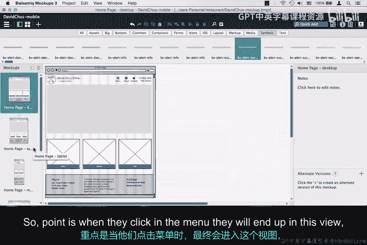
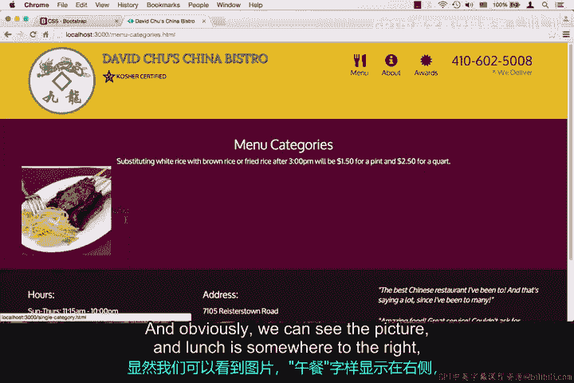
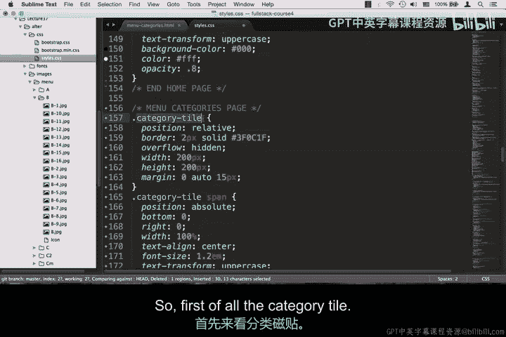

# 约翰霍普金斯大学《Web开发者的HTML, CSS, and Javascript》中英字幕 - P59：16_第37讲 第1部分 菜单分类编码.zh_en - GPT中英字幕课程资源 - BV1WzY6z9EUd

Yeah。

Okay so now that we've coded up the front page， the very main page。

 I think it's a good time for us to review what the navigation structure is going to be like。

 Well navigation structure is actually gonna to be pretty simple when the user first comes to the front page they'll have an option to click on this menu button or they could click on this menu tile and they will end up at exactly the same place and where they will up is the menu categories page So this is the menu categories page and all this page will do is list categories for us that are part of this menu with a picture associated with it and the name of the category Now one of the categories is called specials that should remind you of something on the very front page we have a tile called specials well all that is is just a direct link to a particular menu category called specials So point is when they click in the menu they will end up in this view which is going to list all the menu categories with their pictures。

And the names of the category the same thing will happen if they click on the menu button right here。

 they will also end up with this menu categories page Okay so let's go back to the code editor and we'll start coding up the page so here I am in sublime text in examples folder lecture 37 in the after folder And even though the structure of the page or the pages in the end product is going to be a little bit different once we introduce some jascript and start writing dynamic HTML at this point it's much easier since it's a design stage it's much easier for us to simply copy index at HTML and call it something like menu categories that HTML so we'll go ahead and do that we'll just call duplicate and the reason we're calling duplicates because a lot of the things that are inside index that HTML are going to be exactly the same So the header and the footer and the menu items they're all going be exactly the same it's the main content that's going to change So we'll call this menu categories that HTML。

Okay so there's a menu category to HTML。 We could close index that HTML we don't need it for now。

 So now what we need to do is we need to wipe out out of the menu categories that HTML。

 Anything that has nothing to do with that page。 all the menus。

 the collapsible things they all have to do with it and the only thing that doesn't have to do with it anything that's inside this main content container So we'll go ahead and select this and we'll go all the way down and we'll say here this is where it says end of main content very convenient。

 So we'll press shift and we'll select all of that content and we'll go ahead and wipe that。

 so now we're ready to start writing our menu categories that HTML and if we look at this page in the browser this one is index that HTML but now if we click on the menu tile we'll actually end up at menu categories that HTML as you could see we only have the header。

 the footer there is no content in the page So let's go ahead and start。😊，Fillling it out。

So the first thing we need to do is we need to kind of let the users know what page this is right so we're going to go ahead and paste this H2 it's not going to be H1 since H1 is David Cho China Bistro but H2 the secondary header heading is going to be menu categories that's the name of this page that we're at and we're going to give it an ID menu categories title that's going to be its ID and the class is going to be text center which is a bootstrap class just to center the text in the middle so if we save that and go to the browser we should see a nice menu categories title here appearing in the middle。

And the next thing really comes directly from the original menu and that's just a reminder to the customers about substituting white rice with brown rights and etc etc ce here。

 this is just just real business stuff that has to do with this particular restaurant and again we're just going put it in a div with a class text center just to center this in the page now we're probably going to style this a little bit let's take a look at what it looks like in the page actually doesn't really look that bad we might want to make it a little smaller we'll see okay so that's basically it for the heading of the page and now we need to start coding our tiles and of course our tiles or the menu categories themselves are going to have to be in a grid so let's go ahead and try to do it so let's go ahead and put the entire thing in a section so we're already inside a container right here so it's a container class that means we don't need to have another container but we do want to grid so we're going to go ahead and create a section with a class row so。

We're going to put everything in one row and if you take a look as to how we want to position this。

 we want six tiles across when it's a full browser and obviously as we squeeze it。

 we want to fit as many as possible that will still look good。

 but at the same time obviously some of them will need to be stacked。😊，Okay。

 so I know each grid in the cell is going to be a div。

 we're going to surround that in a div and I have some code prepared for inside of each grid cell and I'll go ahead and copy and paste that right here。

 let's remove that space。Right here so let's go over it real quick。

 so we haven't really assigned any columns yet to this grid。

 but this is going to be the contents of pretty much every single grid。

 So number one is we're going to have ahf to single category that HTML so single category that HTML is really just going be a generic page we haven't written yet but is's going to point to that particular category that's going to be identified by this div and by this picture So each category is going to have an anchor tag pointing to single category that HTML which in this case is just a placeholder page and in the future will'll be actually a designated either a page or we'll see how that works with ja will be basically a designated place that will show you this particular category and inside of it we're gonna have a div and a div is going to have this class called category tile obviously a custom class that we created and inside of we're gonna have an image of 200 by 200 and this is something that we've sized before and the image source is going to be in images。

😊，That's probably the wrong path。 So let's take a look at images。

 there' is gonna be menu and at this point let's just pick something like Bjpeg so it is images then menu then slash B slash B JPg and let's save that for now and we'll call this particular category lunch even though I don't think that's what it is but at this point it doesn't really make any difference we're just styling each of these categories that they should fit in a page and then we'll fill in the actual data later okay so so far so good let's go ahead and preview it in the browser and obviously we could see the picture and you know lunch is somewhere to the right and things are obviously not style 100% okay let's go ahead and copy this whole di which is going be a gridit cell and let's paste it a few times let's paste it3456789 let's say that's good enough。

Okay， so now we actually have a grid and they're all going to be really the same。

 The only thing that's going be different about them is where they're going to be pointing in terms of the URL in the in the hf tag and where the image source is going to be pointed but out that are' going be all the same So let's go ahead and start styling grid So what wanted to do is we wanted to have six of these things basically in one row and then whatever it doesn't fit should go ahead and spill over to the next row not technically a next bootstrap row。

 but just the next row visually Okay so how do we accomplish a six cell layout Well that means that each cell is gonna have to cover two columns so let's go ahead and do that and we probably want the six category layout even at the medium size screen so we'll do column M and two So if that's going to be the case that means this is going take two let's go ahead and copy that。

😊，And we'll just insert it into every div。Okay， so let's go ahead and save that let's take a look in the browsers to what we have so we see right away here that this is really going to work because you could see that the pictures are kind of stepping one upon the other and this is at the full size this is even at the large size so definitely as we squeeze this this is not going to work very well they're kind of stepping up on each other。

😊，So what that means is that the six picture layout is really not going to work。

 so we have to kind of rethink that， so if the sixth picture is not going to work。

 how about we try four pictures across？😊，We could try that very easily by just selecting this too。

 let's go ahead and select it every single place。All across our。Classes。Selecting this too。

And changing it to three。Okay so that's that。 So go ahead and press three。

 So every single place it changed to three。 So now we're gonna have is four pictures across the screen。

 so let's go ahead and go back to the browser， well even though it looks all messed up at the moment it does look actually kind of okay in terms of the pictures fitting in the screen So things are kind of messed up here but we'll take care of that in a minute Okay so that sounds about right and let's go ahead and start styling some of the things inside the actual cell using our styles that CSS let's go ahead and style CSS and let's scroll down to somewhere maybe under the homeage here's the footer。

😊，Here's the homep page and we'll scroll down right around here so let's remove that space over here and let me cut and paste some of the code that I made before the lecture and we'll go over it right now。

 Okay so first of all the category tile let's go ahead and take a look at our HTML here the category tile is that inner tile inside the a tag so the category tile is all that and we're gonna have the very same type of structure we had in the menu tile and the special style is that we have some text so in this case it's actually just an image and we have a span and we're going target that span and position it absolutely within the div element itself so the div will be like a relative anchor for the span that's inside of it and we're gonna to put it on the bottom so it's gonna look take a look how we're doing it So first of all the tile itself is going be relative like I told you is going to be the anchor and the border we're gonna have a nice border around it the overflow will be hidden so if anything is sticking out。

😊。

termsm of the picture or whatnot it should not be actually sticking out and protruding it should just be clipped and since we know that the picture or the image is going to be 200 by 200 we're going go ahead and style the width and the height to be 200 and 200 pixels and we're also going to have some margins the top will be zero the right will be auto the bottom will be 15 pixels and the auto is going to actually carry over to the left as well so this is that same trick we spoke about before as to how to center something as long as you give it a width and you give it auto on both sides margin right and margin left it will automatically center itself so that's the actual container div that's going to have that picture now what about the span that's kind of the title of the actual category Well the span is going to be positioned absolutely and it's going to begin bottom0 right zero the width is going to be 100% so we'll。

The entire width of that picture will center it will give it a 1。

 m size text and we'll transform it again to uppercase。

 the background color will get to be black and the forground color will be white and again will tune down its opacity just to taD here so it will be just a little bit transparent to give us that nice see through effect。

Okay， the next thing we'll do is the hovering part， we're going to give some back shadow。

 the same type of back shadow that we had on the front page when you rolled over this particular category。

 and remember each one of these category items， these pictures are going to be clickable items。

 so that's why we need some sort of a visual indication that a person can or the user can click on that。

😊，And last thing we're going to do here is target the ID menu categories title plus div。

 which means the next siblinging to this element。 So let's go take a look what is menu categories title is well it's all the way at the top here and we have menu categories title that's the one that says menu categories and it's next sibling meaning the next element of the same parent so this H2 has a parent of this div and the next siblinging of this H2 is this div right here so we're saying I want to target the element with this ID and I want to target its next siblinging right after it which is happens to be right here。

 the substituting white rice stuff right so that one we want to give it a margin of 50 pixels and the reason we're doing this is because we want to give a nice separation between the title of the page and kind of its subtitle no to the customers and actual menu categories that are going to be underneath so we're gonna go ahead and save this and we'll go back to the browser we could see that at least。

First row seems to be looking pretty well and the second row is something's wrong with it well let's go back to our code and let's take a look as to what we've done here so they should all be at this point column M3。

Let's see if we maybe be mess up somewhere。Column M3 and sure enough we messed up。

 We got to do column M3 here and I think that's about it right I think they're all column M3 from there on Okay。

 so let's go back to the browser Now that we say that and now they're nicely nicely aligned so and if we squeeze them here squeeze the browser they'll get a little closer and at some point they'll jump since we haven't really specified anything below MD medium screen size they'll go ahead and start stacking but obviously we don't want them to stack just yet around MD we want to specify something for the small and they extra small and that is what we're going to deal with in part two of this lecture。

