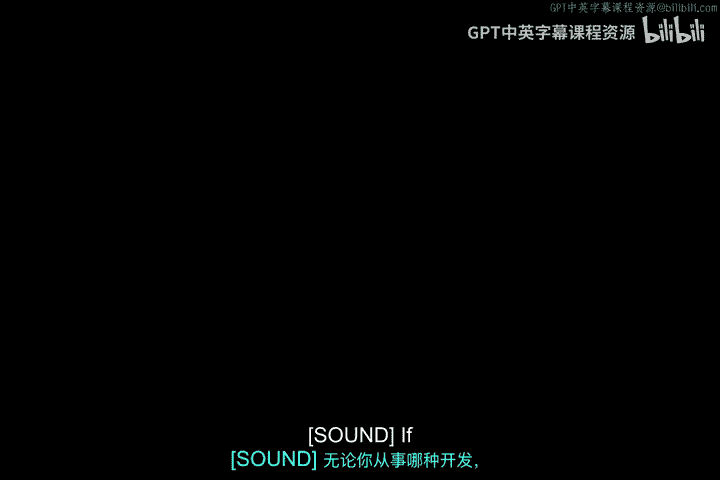
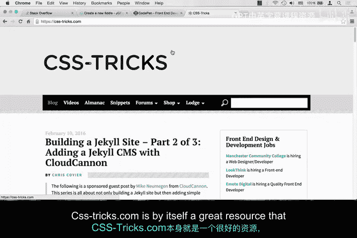
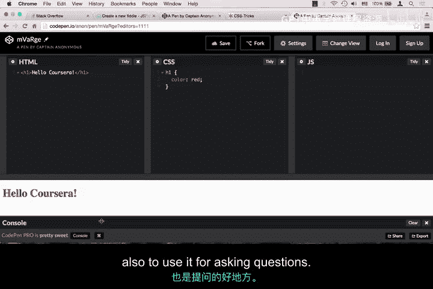
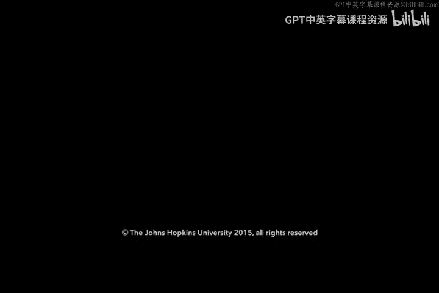

# 约翰霍普金斯大学《Web开发者的HTML, CSS, and Javascript》中英字幕 - P5：4_问题咨询资源.zh_en - GPT中英字幕课程资源 - BV1WzY6z9EUd

Yeah。

If you do any kind of development at all especially web development there will definitely come a point where you're going to have to ask some help from somebody and what I'd like to do in this lecture is give you a couple of resources where you can ask for help as well as give you some tips and tools that you can use in order to make your questions better and easier to communicate now obviously if you have any questions regarding the course or even the coding questions inside the course you're more than welcome to ask these questions at Cosera。

org however there are other resources that you could use to get help and get answers to your questions and one of the premier resources on the web is stackoverflow。

com I cannot tell you how many times this site saved me and my development because I didn know something or something was difficult to figure out and the community developer community out there is huge and it's ready to help you and as you can certainly go and turn around and contribute to the developer community back through the site as well so stackoverflow。

Definitely remember this website Now when you ask coding questions。

 it's obviously very helpful to the people who you're asking the question from if they can look at your code and you can't really shift the entire code to them。

 So one way of doing it is just to cut and paste your code straight into the question itself and you could probably get away with that a lot of the times but it's usually much more helpful for you to provide some actual working code that the people looking at it can look at it and diagnose and help you with it you'll certainly get you chances of answering a question and answering a question quickly much higher if you provide something that they can work with there's a couple of websites I'd like to show you that can help you with that especially when we're talking about web development one of them is called jsfiddlenet and what the site does is it lets you write hlcss ja code and then share that code via link so I'll give you a very quick example I'll just write H1 and say hello coursesera。

😊，And if I click run。You'll see that in the result pane I have Ho Cora well I could go to my CSS pane and change that real quick and I know we haven't learned about CSS yet but just bear with me here and I could change it and say that the color which should be red so if I run it again now the color of Coursera Hello Cosera becomes red Now if I click the save button right here I'll get a unique URL that I could then copy and paste。

😊，And get to exactly the same page with all the code ready to go and with the result of it right there。

 so that's really helpful because if you just provide this link to people。

 they'll be able to take a look at your code， they can also forkit themselves and forking in meaning you could create a new fiddle based on this one they can correct your code or provide some additional code and then you can look at yours versus theirs and actually examine the solution so JSfiddle。

net is a great resource。😊，There's another website that I absolutely love and that website is called Codepen。

io and this website is actually foundunded and maybe co-founded I'm not sure by Chris Coer when it comes to HTMLl css and javascript in the web developerer community Chris Coer is certainly a huge name he actually started a website called cstriggs co and if you'd like what could actually go there real quick triggs co it's csstriggs co which is like the onestop shop on a lot of different tutorials answers and it's all about css and htm cstris co is by itself a great resource that actually I've used quite a bit as well but back to codepen。

io Codepen。o allows you to do something very similar to jsfiddlenet except there's lots more here there's really a whole community that surrounds this website because you can actually look at featured pens meaning featured sets of solutions that will probably amaze you and you can actually。

😊。

Look at the code as to how they achieve those solutions so using the CSS HTML and JavaScript let's go ahead and give a quick try let's create a new pen and you don't have to sign up for it if you don't want to you could just remain anonymous but certainly if you sign up it's much better because you'll be able to then go back and look at all of your work it' will be saved in one place so we'll do the same type of thing we'll say H1。

LetThe hello， Coursera。And right there， it shows up automatically。

 don't have to really refresh anything。 And let's do the same thing。 Let's do H1 and give it a。😊。

Color red。And there you go changes throughout automatically and what's really cool and this is actually one of the newest features they have is you can actually have a console just like you have a console in a browser。

 if you pull it up， I could say something like var X equals hello Coursera。😊。

And I could say X or console。That log X and it spits out hello Cosera back So you basically have like a browser that you could work in and develop in remotely anywhere you are And again。

 if you actually click saveve and save this you could take that URL right there copy it and then provide it to somebody else to help you with your solution and there's the entire solution that we just had is right there in front of you so I highly encourage you to check out these websites and to keep them in your arsenal as resources not only for looking things up but also to use it for asking questions it will help you quite a bit in the long run。

😊。

