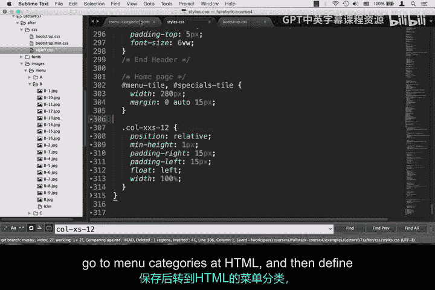

# 约翰霍普金斯大学《Web开发者的HTML, CSS, and Javascript》中英字幕 - P60：17_第37讲 第2部分 菜单分类编码.zh_en - GPT中英字幕课程资源 - BV1WzY6z9EUd

Yeah。

In part one of this lecture we laid out the menu categories page for the medium and large and larger screen sizes in part two we're going to start looking at smaller screen sizes below medium so small and X small so let's take a look as to what we need to do next Well if at MD there's four of them meaning it is column M3 so that means that maybe at small we want column M4 so let's go ahead and select。

Each one of these。Regents courtesy of sublime text editor that lets us edit multiple regions all at once。

 let's go ahead and do that。Okay so let's say space column dash small and in this case we'll do four and we'll save that and let's go to our browser and let's squeeze it now and see if it's going to now get into three three So right now it's  one。

2，3，4 and when it gets to small screen size should be three of them across the page let's get there there we go so now it's three and whatever doesn't fit just start spilling over to the next line。

 So what happens when we go even less than that。And they should stack and again。

 theres enough room for at least two of them， so we're not ready to stack just yet。

 So let's go back to our editor and what we'll do is we'll do extra small to be six and that way there'll be two of them again。

 let's multiple select every region real quick。😊，Make sure I don't miss any this time。Okay。

 that seems to be just about right， and we'll do column。Dash extra。Extra small6。 Okay。

 that sounds about right。 We'll save that and we'll go back to the browser。 and now if we squeeze it。

 it will become from four to three and from three。twoSo what happens if we squeeze it any more than that？

seems like there's a problem here right It seems like the pictures are just not quite fitting in into this particular screen size breakpoint。

 It seems like we need just yet another breakpoint just to tell them at this point go ahead and break it up So there is no smaller breakpoint that then extra small in bootstrap So we basically going have to create our own that is going to say that when we get to a certain point right around here we'll want the columns to start stacking instead of continuously staying at six columns and six columns So let's go ahead and try to do that。

 let's go back to our code editor。 let's go to styles that CSss and we'll scroll all the way down here and in this case seems like we already have that from before so we already have a smaller media query from before so all we really need to do is define one more column class that will actually work for our case so let's go ahead and do that and let's call it column dash X XS so。

😊，Extra extratra small12。 so at this point is going to be that the element that has this class assigned is actually going to take the entire grid of 12 columns Okay so how do we do this。

 How do we define this column X X12 one good trick here is to look in on bootstrap and to see how it defines column X S12 because really it's exactly the same thing as our except we are sitting in a different media query than the X S12 So it's really exactly the same thing but now sitting under a different media query which we already here So let's go ahead and go to let's copy this and we'll modify this in a minute let's open up bootstrap and let's search for column X S 12 and there it is we found this let's see what the styles are that and here are the styles and I'm not sure that I understand all of them I must tell you because I'm not sure why it needs to be relative and certainly doesn't understand why it needs to be minimum height of one。

So but it really doesn't matter for me because I just really want to mimic the same bootstrap behavior that already exists so let's go ahead and see if there's anything else that we're missing what else is there oops I didn't want to erase that go and find another one there's another playss here and float left okay so they're all floating left even though again in our case I'm not sure that we really need that but just to be consistent with bootstrap I'll go ahead and keep that as one of my styles columnax and with 100% that's a really important on right because without with being 100% we're not really going to be able to stretch the entire width of the screen and at this small super small extra small screen size we want whatever element gets this class to stretch across and stretch across the entire screen let's see if we have anything else that we need to look at and I believe that's just jumped right back the way we wore so that's pretty much it。

So now that we defined our column Xx 12， we could save that and go to menu categories that HTML and then define。

😊。

On every single one of those elements， column dash X X12， XsS dash 12， and save that。

 and when we go back to our browser。Let's see if that's working， so now we're at four。

 it goes to three。Goes to two and right around the smaller part here。

 the super small it should jump to one and so it does。 It actually is working。

 Okay so I think we are basically done with this and we could go back to our menu categories that HTML and really now it's a question of how many categories we have in just basically copy and pasting every single one of them if we wanted those categories to be manually entered in this page that happens to be as we're going to go into ja we're going to dynamically output all these things so it really doesn't matter that they're sitting here this way we're going to take care of that later but at this point it's laying out just fine and the entire layout of the page of menu categories is working so we're done with this page and we can now move on。

