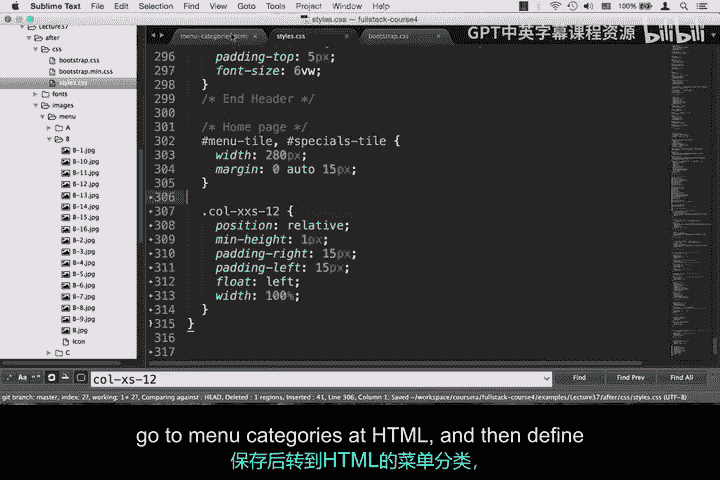

# Web开发者的HTML, CSS, and Javascript：P60：17_第37讲 第2部分 菜单分类编码


## 概述
在本节课中，我们将继续完成菜单分类页面的响应式布局。上一部分我们处理了中等及更大屏幕尺寸的布局，本节我们将专注于为小屏幕和超小屏幕尺寸调整布局，并学习如何创建自定义的Bootstrap断点来解决特定问题。

---

## 调整小屏幕布局

上一节我们介绍了中等屏幕的布局，本节中我们来看看如何为小屏幕尺寸调整列数。

在中等屏幕尺寸下，我们使用了`col-md-3`类，这意味着每行显示4个分类项。对于小屏幕尺寸，我们希望调整为每行显示3个项，因此需要将列类改为`col-sm-4`。

以下是操作步骤：
1.  使用文本编辑器的多区域编辑功能，选中所有分类项的列类部分。
2.  将`col-md-3`修改为`col-sm-4`。
3.  保存更改并在浏览器中测试。当屏幕尺寸缩小到小屏幕范围时，布局应变为每行3个分类项，多余的项会自动换行到下一行。

## 处理超小屏幕布局

现在，我们来看看当屏幕尺寸进一步缩小到超小屏幕时会发生什么。

在超小屏幕尺寸下，我们希望每行显示2个分类项。为了实现这一点，我们需要为这些元素添加`col-xs-6`类。

以下是操作步骤：
1.  再次使用多区域编辑功能，选中所有分类项。
2.  为它们添加`col-xs-6`类。
3.  保存并测试。此时，布局应能在小屏幕下显示3列，在超小屏幕下显示2列。

## 创建自定义断点

当我们把屏幕尺寸缩放到比超小屏幕更小时，会出现一个问题：图片无法很好地适应布局。Bootstrap没有提供比`xs`更小的内置断点，因此我们需要创建一个自定义断点来解决这个问题。

我们需要创建一个新的CSS类，当屏幕尺寸极其小时，强制让每个分类项占据整行宽度。我们将这个类命名为`col-xxs-12`。

以下是定义这个自定义类的步骤：
1.  打开项目的CSS文件（例如`styles.css`）。
2.  在文件底部，找到或创建一个针对极小屏幕的媒体查询。
3.  在该媒体查询内，定义`col-xxs-12`类。为了与Bootstrap的行为保持一致，我们可以参考Bootstrap中`col-xs-12`类的定义。
4.  关键样式属性包括将元素设置为相对定位、向左浮动，并且宽度设置为100%。

**代码示例：**
```css
@media (max-width: 480px) { /* 自定义的极小屏幕断点 */
  .col-xxs-12 {
    position: relative;
    min-height: 1px;
    float: left;
    width: 100%;
  }
}
```

## 应用自定义类



定义好自定义类之后，我们需要将其应用到HTML元素上。

以下是应用步骤：
1.  回到`menu-categories.html`文件。
2.  为每一个菜单分类项的元素添加`col-xxs-12`类。
3.  保存文件并在浏览器中进行测试。现在，当屏幕尺寸缩小到我们定义的极小断点时，分类项应该会堆叠成单列显示。

## 总结


本节课中我们一起学习了如何完善响应式布局。我们首先调整了小屏幕和超小屏幕的列布局，然后通过创建一个自定义的Bootstrap断点类`col-xxs-12`，解决了在极小屏幕下布局错乱的问题。现在，菜单分类页面已经能够在所有屏幕尺寸下正确显示，从大屏幕的四列到极小屏幕的单列，实现了流畅的响应式效果。后续我们将通过JavaScript动态生成这些内容，但目前的静态布局已经为开发打下了良好的基础。