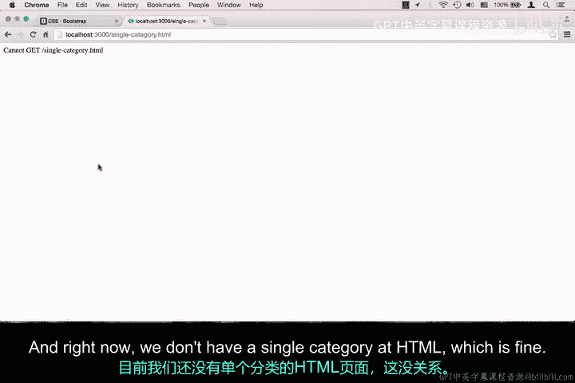
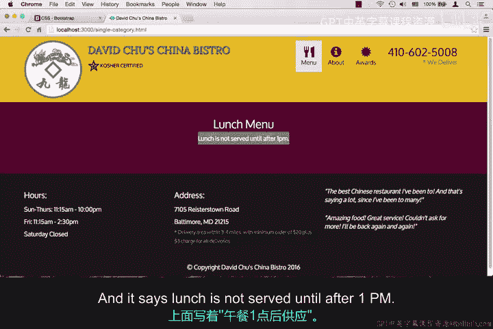

# 约翰霍普金斯大学《Web开发者的HTML, CSS, and Javascript》中英字幕 - P61：18_第38讲 第1部分 单个菜单分类页面编码.zh_en - GPT中英字幕课程资源 - BV1WzY6z9EUd

Yeah。

Okay now that we've completed our menu categories page let's take a look at the mockup as to what would happen if the user clicked in one of these menu categories in the menu categories page well what would happen is that it would go to that single category page that would have all the menu items that this category contains so let's go to the single category page and take a look here so we have the name of the category up front maybe some information underneath and every single item here in that particular category notice that the layout here is one menu item followed by another menu item on the same line and then it keeps repeating over and over which means this is probably going to be a bootstrap grid and we're going to divide this six in six columns so itll divide the width of the browser nicely Now also notice that we have yet another grid within individual cells so here you could see that there's about half and half again but I would say that this is a little smaller so maybe。

5 and seven so basically this is going to be one cell of the grid and this is also going to be one cell of the grid this one is probably going to take about five columns and this one is probably going to take about seven columns so we have a grid within the bigger grid that contains six and six columns。

Okay so let's go back to a code editor。 Well， let's first actually take a look at our menu categories page and if we click on this。

 this will go as you could see to single category。 and right now we don't have a single category at HTML。

 which is fine。 there's actually something that I noticed right now。

 it would be nice to give some sort of indication to the user that we're sitting on the menu page already right now it just looks like we're again kind of in the nowhere land。

 So the way we could do that is by going to our menu categories page and I'm right now in menu categories that HTML。

 which is located in examples a lecture 38 after folder and I could find my menu item right here let's actually make it capital menu right here and this is that menu item that navigational menu item Well the way to make this stand out is to give it a class of active and that's a bootstrap class。

 and I believe we might have actually overwritten this class or at least over written some of the properties in this class to match kind of。

😊。

The hoverover effect so let's go back to our browser and is a nice indication that we're sitting on the menu page and it's the same type of background that we get on hoverover of other pages Okay。

 so that's good let's go back to our code editor and copy the menu categories page because all the pages are gonna be again the same except for the main content So if we scroll down let's close up this menu the images let's go to the menu categories page and what we'll do is we'll click duplicate。

And we'll change that too。Single category。 S category。Okay， so now it's a single category Okay。

 so now what we need to do is we need to clear out all the menu categories related content out of this。

 So we have a clean slate to start with so we'll probably need to get to main content right here so we'll go all the way here and find where the main content ends。

Right there。 That's easy to see。 And we'll erase all that。

 So here's our clean slate that we could start coding。

 Let's go back to the browser and take a look as to what happens now。

 if I click on one the menu categories。 It should go to single category that H And sure enough it does except of course。

 there is no content here in the middle。 So let's go back to the code editor and start coding up our content。

 So the first thing we need to do is give our page some sort of a heading。

 So the way we're gonna to do that is by having an H2 and we're going to give it an I So we can nicely target it later of menu categories。

😊，Categories， title。Okay， menu categories title and class。

 we're going to give a text center so we're going to center this thing。

And the title is going to be something like lunch menu and this is something that's probably going to change or definitely going to change from category to category。

 Now every single category is going to have some sort of a subsection where we're going to list some kind of message about the particular category So I don't know what that is is going to be for lunch menu but I do know that I want to textcent it So I don't know what's gonna to be here but I don't know maybe something like lunch is not served until after 1 pm okay so let's say that's all we're gonna to say let's go back to our browser So we have the title of the page and it's a secondary title H2 because the first title is obviously David Choose China Bistro and it says lunch is not served until after 1 pm that's good enough for me okay。

The next thing we need to do is start coding this layout here。

 which is you know about six here and six here and I would assume that this is the type of layout we want to have up through the medium type of size of the screen and the second gets too small we're probably going want to stack these one upon the other So the first thing is to have these things right here inside of a grid so the way we start a grid is we're going need a row what we're going to do here is we're going to code up a section so we're going to use a section tag。

😊，And within the section is going to be our grids， which means the section itself is going to need class equals row Okay now why didn't I put this in a container。

 Oh the reason I didn't put this in a container is because it's already sitting inside of a container which is our main content right there Okay。

 so let me cut and paste some code that I prepared from before this lecture to kind of flesh out the grid itself。

 this grid cell and it's a little bit involved so let me go over it in a bit more detail。😊。

So first of all， we know that the actual cell， we want the cell to be about half the screen or not about exactly half the screen。

 and that's why we say in column medium screen， medium screen6。

 which means that the second and gets to small screen these styles will' start stacking one upon the other。

 so that's really all we need for our outer kind of a cell。

 but there's inside kind of a little bit more complicated in than that。

 The inside we have another row and the reason we have another row is because we wanted to subdivide the picture let's go back take a look at this and let me zoom in a little bit。

 So wanted to subdivide this picture into one cell and take up about five columns and the other part where it is going to tell us the name of the division。

 maybe some description of it is going to be a little bit bigger so it's going take about seven columns so let's take a look here。

 So what we're doing is we're subdividing it。😊，The first thing is we're gonna to have a row。

 And inside of that， we're gonna to have a column span of5。

 And the reason we chose small here is because when the screen is medium or small or large。 So small。

 larger medium， we want these things to be horizontal to each other。

 So this cell should be horizontal to this cell。 And if it's smaller than that。

 meaning if it's extra small， I'm okay with that point to have this cell stack upon this cell。

 So they're basically going to be positioned one on top of the other one。 Okay。

 so let's take a look at the picture part of this grid。😊，Okay first of all。

 we're gonna have a div and we're going to give it a class menu item photo and this is something we're gonna go over in a minute in the CSS we just give it a class so we could kind of style every single one of them the same way。

 number two is and we'll actually get this D1 This is that number that we want to put onto the actual picture so let's take a look here This is the number and this number comes directly kind of a number code comes directly from the restaurant' menu so we want to make sure to keep that and kind of let it correspond to the menu itself。

😊，And the way we're going position this if you take a look to bottom right over here is very similar to the way we positioned the menu titles and the category titles is that we're going to make this item a relative position relative and then position this absolutely to the bottom right which should be fairly easy next thing is the image itself Well image and we're going to give it a class IMG responsive that's a bootstrap class that lets it stretch out and contract depending on the size of the screen and we're going to give it the width of 250 and height of 150 simply because I know that that's the image size that we have we'll give it an alt just an item for now and we'll dynamically fill that in later。

😊，Now notice that I'm not really using responsive images in the sense that I'm not really substituting this image depending on the screen size。

 so I could have just made this a background image and then substitute the image depending on the screen size for the larger screen size I would give a higher resolution lower little lower and so on and the reason I'm not doing this because it's already a pretty small resolution as it is and I don't think it's gonna be such a big deal to load even on a mobile device over a cellular connection so that's our div menu photod The next thing we need to do is we need to give it some pricing and this is something that's not shown here。

 but this is just simply because we didn't think of it at a time。

 but we want to give some pricing right underneath here somewhere for this particular item and that's why the pricing is still sitting inside this grid this five column grid。

Okay so the pricing is gonna be just a div we're gonna give it a class menu item price。

 give it some price。 willll isolate the unit for that particular price inside of a span so we could basically target this a little bit more specifically and make this smaller so the price will stand out but the unit for the portion is going to be smaller and the same thing second price and again unit for the portion we're going isolate into a span and that's going to be our picture or picture with some information The second part which is going to span seven columns and again it's going be small because we want it to stack if it's smaller than smaller which means extra small so we want these two grids to stack one upon the other and so we're doing is we using an H3 because's yet another subheading even lower down the line we're giving it a class menu item title and this is something we obviously we're going to have to define ourselves and this is the name of that particular dish's totally。

made up， I don't even if it exists on the menu， but for now that's really all we need we have some Lom Iipum in a paragraph right below again with the menu item details class that we're going to code up and that's pretty much how we're going to finish this div right here。

 the div that spans the seven columns and then we're finishing the div that spans the entire thing。

 the entire row。Then we're going to close the div that is the row for those two items within that cell and then right before we close the div for the entire cell。

 we're going to put an HR that is only going to be visible using this bootstrap responsive class visible dash XS extra small and the reason we want that here is again kind of similar to our footer we did the same type of trick there is that we put an HR just as a visual separator between the menu items but we only want them when the menu items are going to stack on upon the other and that's only going to happen at the XS which is the extra small screen size so now that they basic HTML is written。

 we are ready to move on to styling list with CSS and that's exactly what we're going to do in part two of this lecture。

