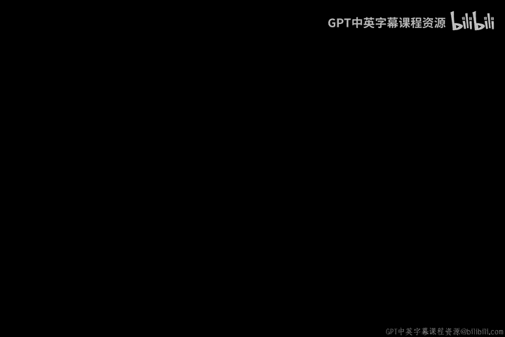
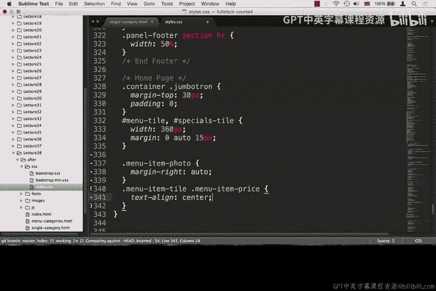
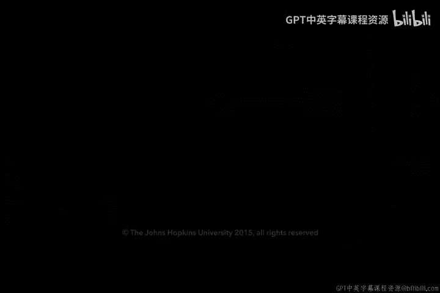

# 约翰霍普金斯大学《Web开发者的HTML, CSS, and Javascript》中英字幕 - P62：19_第38讲 第2部分 单个菜单分类页面编码.zh_en - GPT中英字幕课程资源 - BV1WzY6z9EUd

Yeah。

In part one of this lecture we wrote the HTML for the first Selenag grid in this lecture we're going to start styling that cell。

😊，Okay， so for now we have only one cell。 So let's go ahead and grab this and copy it。

 So we at least have two cells to take a look at in the browser。 Let's save that。

 and let's go to the browser。And here we are。 So we see that we have our picture here picture with what looks like an egg roll with to the right of it。

 We have our title of the menu and some lowerson text that's going to be a description of it it's not really styled yet this D1 is sitting all the way here instead of instead of down here and this is that style 100% yet either。

 So let's go back to the code editor and give it some styles。 First of all。

 let's give the second cell instead of D1。 let's give it a D2 so we can understand the difference between the two。

 Let's go open our styles that CSS。😊，And I already have some premade styles that I prepared before the lecture。

 so let's go ahead and copy and paste them right under our menu categories styles。

 let's go find them real quick they should be under home menu categories page and here it is let's go ahead and paste it right here。

And what we're going to do is we're going to comment them out。

 so we'll go one by one and explain them a little bit better that way。

 let's comment them out right here。And the first thing we want to do is the menu item tile。😊。

So the menu item tile is this one right here。 It's that single cell grid。 In other words。

 that's this whole thing that is the single cell grid right here。

 So what we're doing here is we're saying I want the margin bottom to be 25 pixels。

 So basically what we're doing is we're saying I want to separate this a little bit from the next row even though it's not a technically a bootstrap grid row it's going to be a next row just because some of the items or a lot of these items are going to start spilling over to the next line and there's going to be two of them per line this HR here。

 the item tile HR should only show up when we're squeezing the browser past。

 I believe the small when it gets to be extra small。

 So let's save it and take a look at our browser and let's see what's going on here let's squeeze the browser a little bit and see if that HR shows up and when we get to super small。

😊，The HR repair shows up to visually separate the first item from the second item and so on。

 so let's go ahead and stretch it back out and go back to our code editor。

And let's style the pricing here， let's remove this down the line right here。In fact。

 let's actually those are two pricing type of styles， so let's style them together。

Okay so the first thing we're doing is the menu item tile that is followed by menu item price。

 so the menu item price that is sitting inside of an element with a class name menu item tile let's go take a look at the HTML of that so the menu item tile is right here and the menu item price is right there so basically we're targeting this thing right here。

 this div where the prices are so let's go back to styles cs and what we're doing is we're increasing its font a little bit aligning it to the right because we wanted to align to the right over here to the right of this picture So we're aligning it to the right and we're giving it a margin top negative 15 and a margin right of negative 15 so that is probably something that you probably see that we need to adjust in fact let's go ahead and let's go ahead and comment that out just to see what would happen if if we didn't have that let's go ahead and comment that out and let's go back to the code。

Well actually before we do that remember that span that we had the kind of the unit portion。

 either pint a quard Well we're just making that smaller。

 that's how we're targeting it we're saying that inside the menu item price as a span and that span should have a font size that's smaller so let's save that and go back to our browser and it looks pretty good we see that we have the pint in the quar smaller these things are a little bit bigger the picture is done pretty well so far so I don't remember why I coded up these margins when I prepared the code for this lecture so I'm going just leave them off so now let's go ahead and keep going and styling some more things so let's go ahead and move this over here。

😊，And actually these two things probably go together very well。 So let's leave those alone together。

 And so we're styling here is the picture。 So let's move that up。 Okay。

 so what we're styling is the picture。 first of all。

 remember that picture is going to have a little sign at the bottom right of the item number that corresponds to to the restaurant's existing menu。

 So for that we need to make the container element。

 which is this item photo menu item photo position relative。 So we're making that position relative。

 giving it a nice kind of maroon border to pixel border。 again， if anything overflows。

 we're gonna go ahead and clip that， make padding0， move the margin 15 pixels to the left。

 meaning margin right will be moved to the left a little bit and the margin left will leave is auto。

 So this is something that's going to basically separate nicely between the left side between the left side of our cell and the right side of our cell where the description is。

 we'll give it a nice margin bottom of 20 pixels。And the maximum width of 250 pixels。

 let's go ahead and take a look at the HTML of the menu item photo right here。

 menu id photo and you see that we made the image responsive Well the image is 250 pixels wide we don't want the image to be any bigger than that otherwise is going to become pixelated and the layout is probably going to get messed up as well so that is why we're saying that the maximum width can ever go is 250 pixels don't stretch this element anymore okay then there is the menu item photo followed by a div let's take a look as to what we're targeting so the menu item photo is right here and the div is that kind of corresponding ID of the menu that's corresponding to the restaurant menu so let's go ahead and position that and obviously we' to position absolute bottom zero right zero so it' be in the bottom right corner and we're going give it width of 80 pixels the background is going to be。

There's greenish color and we're going to center it within Naiv。

 the text is going to be centered within Naiv， so if we save that and go back to our browser。

 we see that it's now nicely sitting right inside of that picture and kind of identifies for us what the menu item is。

😊，Now I actually can see be that because of positioning of this element and all the margins and all the different paddings that we're having over here。

 this whole pricing moved down quite a bit。 So now if we go back to the code editor and now I understand why I originally put the margin here So let's go ahead and remove the comments here because we actually do need these margins to move up the pricing and make it a little bit nicer looking So when we do that look at that it's aligned down nicely together with a picture this still is kind of misaligned a little bit。

 but we didn't work on that yet So right now the left side of our cell grid both of them because they're all classb So they apply to both sides or to both grid cells they're looking pretty good let's go back to the code editor and continue our styling here。

 So the description， so let's move that down here and we'll go ahead and actually remove it all and here's our description So padding right is 30 pixels and the reason we' doing this is if we want the content of the item description to be。

😊，A little bit away from the right either element， which is going to be a second cell in our grid or if it's the second one that we want to move it away from the edge of the browser the H3 menu item title and we're giving it some margin so let's take a look as to what we're talking about here So here's the H3 and the H3 do menu item title basically says this is the title of our menu item and what we're doing here is we're giving it some margins so we're giving it top0 right010 on the bottom and again the0 transfers to the fourth location so to the left of zero so basically we're just giving it a margin bottom really a fancy way of giving it a margin bottom of0 and possibly also zeroing out some margins that this item inherited from its parent。

Last but not least the actual menu item details class。

 we're going to decrease its font slightly to 0。9 ms and we're also going to give it a font style of italic so look a little bit nicer that way Okay so now we'll save this go back to our browser and now it's nicely aligned and everything looks pretty good。

😊，So the only thing that's left is to check out whether or not the responsive part is working pretty well。

 let's go ahead and squeeze the browser and see， well in this case this looks all right and let's squeeze it a little bit more。

😊，And this looks not so bad。Oh， and in this case， this doesn't look so good at all。

 So this is probably around small right So this is the small screen size。

 What we really want is we want this whole item photo。

 We want it to go all the way to the center and we want this to be centered as well。

 we don't want this kind of this going to the right and is going to the left that looks kind of weird And let's check out first as to what's this screen size that this is happening at。

 It looks to me like that that's the extra small。 but that's just double check here。

 let's see this is around what area this is 7670 something pixels。

 So that definitely sounds like extra small because extra small starts around 767 pixels。

 So let's go back to our code editor and let's scroll down to the extra small device media query right here。

 the extra small and let's put some styles that will fix this the whole issue here。

 But first let's go back to the browser and investigate why this thing is going to the right。

 Well let's go ahead and。😊，Spect the element right here and we'll see the menu item right here and let's see what we're applying here。

As you can see when it's stacking our margins really aren't really working out。

 we have a margin left of auto， we do have a maximum width。

 which is good because that makes us kind of anchored as to what our width is。

 but the margin right is negative 15 pixels when in fact it really should be probably auto as well if it's going to be out of on the right and out on the left this element will naturally position itself in the middle Okay so that's as far as this is concerned What about the description of the menu item let's go ahead and inspect that let's pull this down so we could see。

😊，What we're inspecting here， that's the menu item description right here。So why is that on the left？

There really doesn't appear to be any other reason other than the fact that it's just simply not aligned to the center。

 Okay， so we could do that。 Let's go back to the code editor。And inside of our small。

 extra small screen size inside of that media query， will go ahead and。

Write some styles So first of all the menu menu item photo。

 that's the first one that's the actual picture but what we're missing there but we're missing margin right being autoto instead of negative 15 pixels so if we just do that and go back to our browser oh very good so we could see that this is now aligned properly。

This is still sitting to the right， but that's probably because we just need to center it on the screen。

 Let's go back to the code editor and we'll go ahead and find the pricing。That's going on。

 So the pricing is menu item price， and it's sitting inside menu item tile。

 So if we actually go to our styles that CSS， we could say menu item tile。

Followed by a menu item price。 and that's the thing that well need to make text align。To the center。

So if we do that， go back to our browser。And there we go So this align now very nicely together with this picture。

 so the only thing that's left is to align the description of the menu item。

 so let's go back to the code editor and let's go ahead and do that and let's look in our HTML that what is that description a description is the menu item description that's the class so let's go ahead and copy that and we'll say menu item description and we'll do again text align。

Being center okay， so let's save that let's go back to our browser and now we have both things nicely aligned in the center for both items so you know at this point we seem like we're good here。

Okay， so we're going to stop here for part two this lecture， and then part three this lecture。

 we're going to take a look at an issue that often creeps up。

 especially with the data that you don't control， like for example。

 the description of items that may come from the server later and maybe be shorter or longer depending on how the owner of the site decided to describe each of the menu items。

😊。

