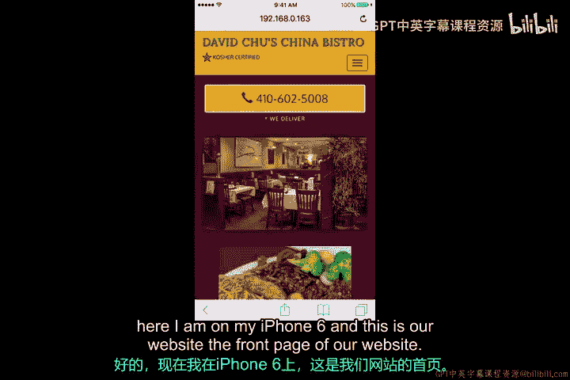
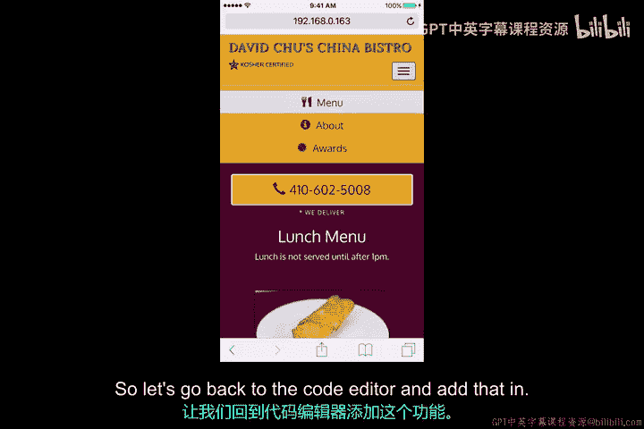

# 约翰霍普金斯大学《Web开发者的HTML, CSS, and Javascript》中英字幕 - P64：21_第39讲 在真机上测试移动端版本.zh_en - GPT中英字幕课程资源 - BV1WzY6z9EUd

Yeah。

Okay， so before we proclaim a complete victory over our layout。

 let's go ahead and test this website on a real phone。

 so I have here in iPhone 6 and I'm going to load up the site on iPhone 6 and let's go ahead and click around and see if there is anything that we notice that we might need to fix。

Okay so here I am on my iPhone 6 and this is our website， the front page of our website。

 let's go ahead and scroll around a little bit to see what it looks like and it seems to look just fine to me let's go and click on the menu tile and it should take us to the menu categories page and it does that seems to work pretty nicely also let's click on one of the menu categories and then we'll take us to the single category page which shows us menu items one by one and that seems to work pretty well as well let's now go ahead and tap the phone number button and see if it's going to try to make a phone call and sort does it it is trying to make a phone call let's cancel that and let's go take a look at the menu here on the top right if I click here and then the menu shows up so if I click on the menu it will go to the menu categories page。

So let's go back to the single category page and there it is and let's go ahead and open up that menu one thing that bothers me about it is that there is no home navigational menu that I could click it's only menu about an awards and even though in the desktop version we probably get away without it and we don't want to crowd the desktop version but for this we would like to really have other options other than just tapping on the David Choose China Bistro the actual restaurant name in order to get back to the homeage so I would really like to have the homep page selected right here。

There's another thing that's a little bit weird。 If I， for example。

 tap on lunch menu and try to select a lunch menu。 it really would be natural for me to assume that my menu。

 my dropdown menu really should automatically just go ahead and go away。

 but it doesn't it only does that if I actually tap on the menu button。

 Well that is something we're not really going be able to address right now。

 because that's something that cannot be addressed with HTML and CSS alone。

 it needs to be addressed with jascript and we're gonna to learn ja next So until then we're going to leave that alone but putting the home button in our dropdown menu that's something that we could do right now。

 So let's go back to the code editor and add that in。

Okay so here I'm back in sublime text and I'm located in examples lecture 39 after folder and I'm looking at index HTML and really all we need to do is add another menu item and that's actually fairly easy we just have to find our list of menus and there it is our list of menus Each menu is an li and so we just need to make some space in the front here and let me cut and paste some code that I already wrote so we want this menu item to only be visible when the screen size is extra small and in this case we want it to be active since we're sitting on the index that HTML page so that's the homep page so we want to market as being active so in the mobile view it'll actually put a line through it like a gray background through it and all it is is just a link to index that HTML and we're also using the Gly Gly icon home basically it's gonna to have a little like house little button looking thing and space home just to give it some text so let's go ahead and save that and let's go back to our brow。

And click on that and there it is Now we have home here if we go to menu and then we click again and now it's menu。

 so we didn't really put that on the on the menu page menu categories page。

 so let's go ahead and fix that。 let's copy that right here。

Let's open up our menu categories page and again， scroll down to。

The lis right here and we'll cut and paste right here except this time we want to remove the active out of here because it's not active on the menu categories page and in a single category page。

 the same thing was scroll down and find our LI list which is right about here。

It's a little jumpy okay here we go and we're going cut and paste and again we're going to remove the active here because on this page it is not active Okay let's go back to our browser and let's click this button and here we go so now we're in menu if we click home we get to be on home and home will be selected if we go to menu go to the single category page and select that we're still on menu that's good click to home and then we get back to the home screen。

😊，Okay， so it seems like we've fixed our minor issue。

 except for some things that we're going to need JavaScript for and we're ready to move on。

