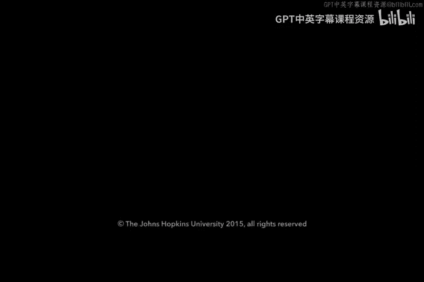

# 约翰霍普金斯大学《Web开发者的HTML, CSS, and Javascript》中英字幕 - P65：22_模块3总结.zh_en - GPT中英字幕课程资源 - BV1WzY6z9EUd

Well that's the end of module 3 wasn't that fun if you're enjoying the course so far we would really appreciate it if you took a couple of minutes and gave this course a five star rating it would mean a lot to us Moule4 is next See you in the next module。

