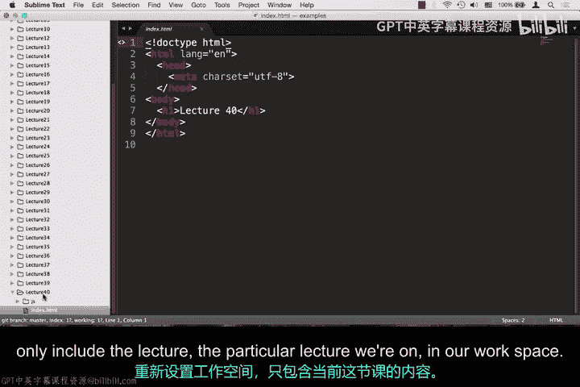
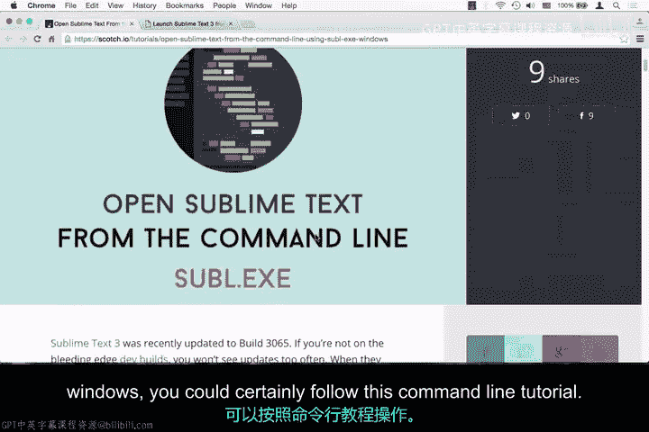
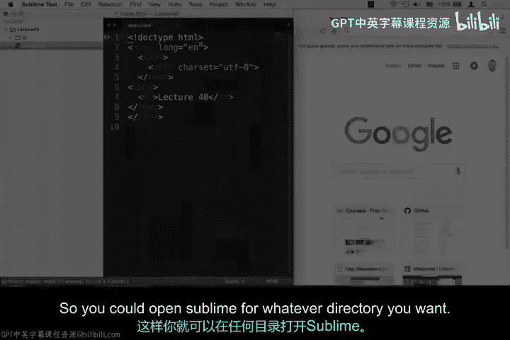
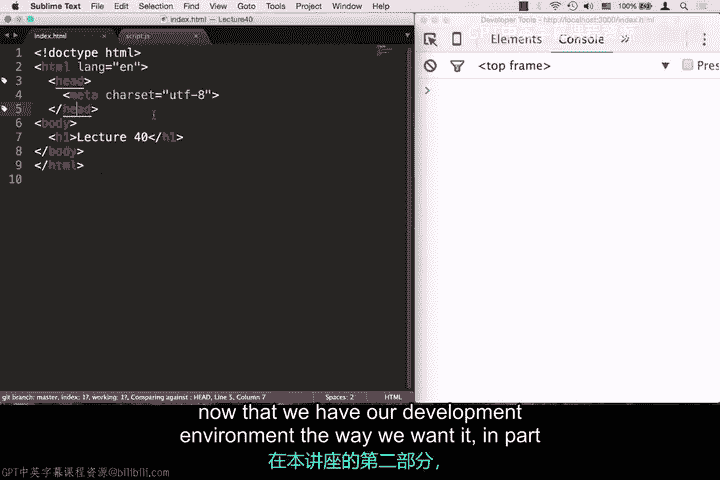
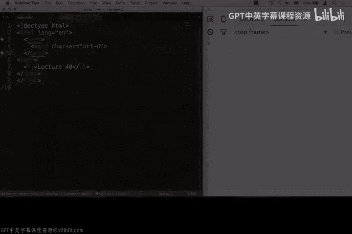

# 约翰霍普金斯大学《Web开发者的HTML, CSS, and Javascript》中英字幕 - P66：0_第40讲 第1部分 配置JavaScript开发环境.zh_en - GPT中英字幕课程资源 - BV1WzY6z9EUd

Yeah。

Okay so before we launch into jascript and the beginnings of ja I'd like to rearrange my workspace a little bit to make it a little bit easier on sublime Now why am I doing that Well the reason I'm doing this is because when I am going to be editing jascript inside some ja file or for CSS for that matter at this point sublime is going to try to help me out of complete as I type the problem is that sublime at this point things that all 40 lectures from beginning to end are part of our project and every single one of them as you could see has some CSS in it some of them when we get to bootstrap already have some ja in it as well so all that is going to be tried to be put into the context and put into memory of sublime to try to help us out so let's going to create some slowness So let's go ahead and redo our workspace and only include the lecture the particular lecture we're on in our workspace Okay so how do we do that Well if we go to the command line and。

Let's go ahead and Cd into my lecture 40 There is a command that sublime comes with and it works on Windows Linux or Mac and this command allows you to start sublime in a particular directory so in this case I mapped it to the keyword sublime and if I say that which at this point is the current directory and open it up sublime will open the sublime editor and it will only have that particular folder as it's kind of a workspace so nothing else will be included so let's go ahead and do that and I'll rearrange my Windows so we could see a little bit better now how first of all did I get to the sublime or subbble as it's called actually this command well if we go to the browser I opened up a couple of links for you which I'll include it right after this lecture that will allow you to go step by step and it will explain to you how to set this up so you can actually do this yourself again it works on Mac which is very similar to Linux so you can pretty much follow the same directions。

Except maybe for the folder structure and on Windows the same way， this is another link for Windows。

 you could certainly follow this command line tutorial so you can open sublime for whatever directory you want okay so here I am I rearranged my windows a little bit。

 So now I am sitting in lecture 40 index that HTMLm and here's our index at HTML So we just like before can start browser sync and have the code that we write sync together with the browser So we won't have to refresh this anymore So let's go back to our command line and we are in lecture 40 right here and as I you see it's an examples lecture 40 and let's go ahead and start the browser sync we'll say browser sync it's the same command as we did before start server directory and so on and we do need star star star because if we actually go back you'll see that we have a Js directory and if we do an a lesson Js director you'll see theres a script that Js in there So if we change something in that。

s we want that to be reflected in a browser as well so let's go ahead and start our browser sync together with our star star star so it will go ahead and go down directors as well we'll start it up and we'll go to our browser and you could see here it loaded up the page but didn't execute the index that ital yet so let's go ahead and click on that and here's our lecture 40 heading one。

Okay so what we're actually interested in is not so much the page anymore is we're interested in the ja that is going to run and Chrome developer tools which is part of Chrome browser is a great tool to have and to actually use so we're going to do is we're going to do command old I and on Windows I believe it will be control alt I so we'll go ahead and open Chrome developer tools and this is basically where we've been kind of living for the last so many lectures we've been living in the elements tab what we're going to be living from now on at least for a little while is in the console tab so when we click the console tab。

 this is where the jascript and the ja messages are going to show up now we don't really need to see this lecture 40 thing all the time and I do when this window to have a little bit more space so the way we could do that is by going this dot dot dot and actually unduck this whole panel so we'll do that right now and that just throughout this panel all the way here。

We we're going to do is we're going to make it a little bit smaller and we'll align it just like so。

And now we can have our full blown ja console right in front of us as we write our code So in this here in the sublime text we could try to make this a little bit more minimize but what we actually should do is just to close it all together because we know where we are so at this point we'll go ahead and open up our script。

 javaju javascriptjs and our index。ht and we'll do command KB or control KB on Windows and we'll just close the file Exper Okay so now that we have our development environment the way we want it in part2 this lecture we're going to speak about where to place javascript code。

