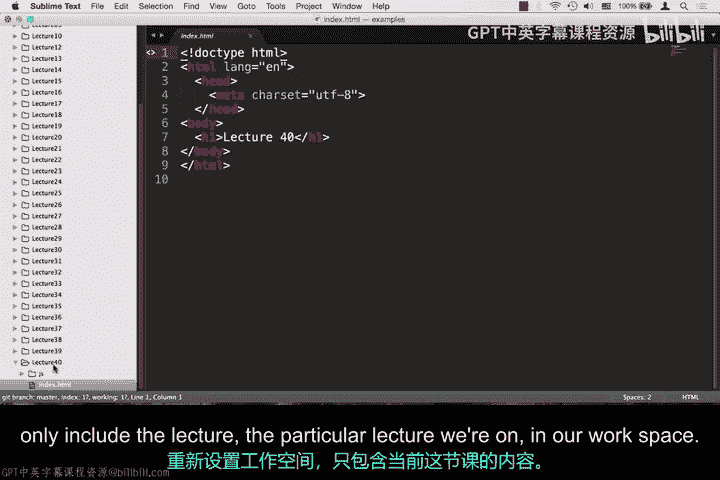
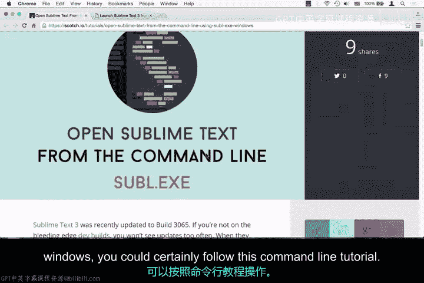
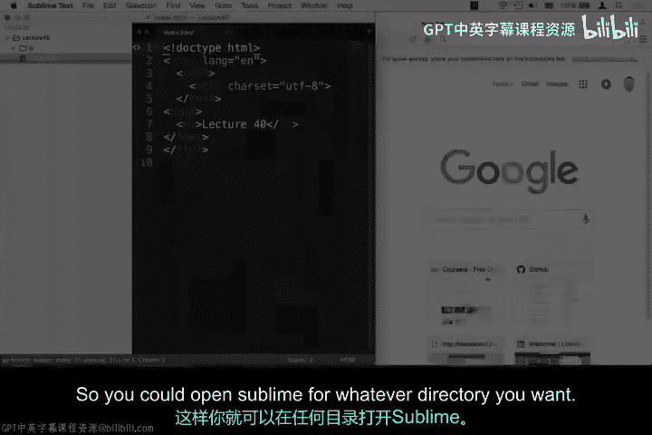
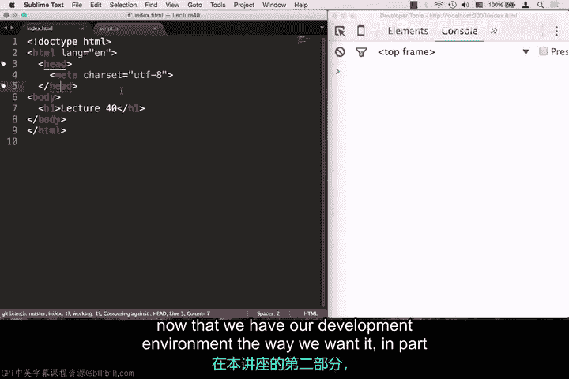
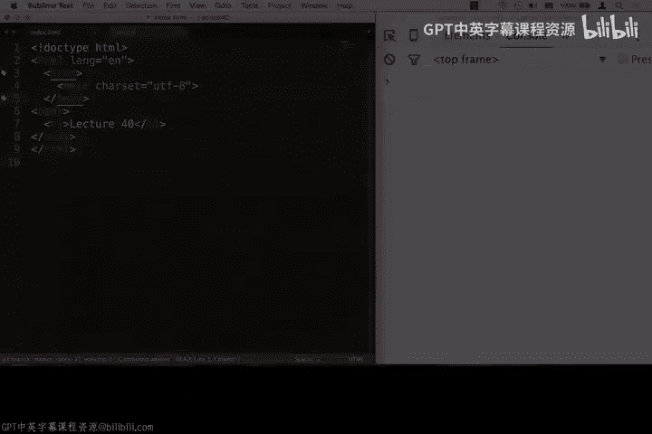

# Web开发者的HTML, CSS, and Javascript：第40讲：配置JavaScript开发环境 🛠️


在本节课中，我们将学习如何为JavaScript开发配置一个高效的工作环境。我们将重点介绍如何优化代码编辑器，以及如何设置浏览器工具来辅助我们的开发工作。

## 优化Sublime Text工作区



在深入学习JavaScript之前，我们先调整一下工作区，以便在Sublime Text中获得更好的体验。这样做是因为，当我们开始编辑JavaScript或CSS文件时，Sublime Text会尝试通过代码补全来帮助我们。然而，如果它认为我们整个课程的所有40个讲座文件都属于当前项目，它就会将所有文件（包括内含的CSS和JavaScript代码）加载到内存中，这可能导致编辑器运行缓慢。

因此，我们需要重新配置工作区，只包含我们当前正在学习的特定讲座内容。

以下是具体步骤：

1.  首先，打开命令行工具。
2.  使用 `cd` 命令导航到第40讲的目录。
    ```bash
    cd lecture40
    ```
3.  Sublime Text提供了一个跨平台（Windows、Linux、Mac）的命令，可以在特定目录中启动编辑器。我将这个命令映射为关键字 `sublime`。
4.  在当前目录下执行 `sublime .` 命令。这个点号代表当前目录。
    ```bash
    sublime .
    ```
5.  执行后，Sublime Text会启动，并且只将当前文件夹作为工作区打开，不会包含其他无关文件。

关于如何在你的操作系统上设置 `sublime` 命令，课程提供了详细的教程链接。对于Mac和Linux用户，设置方法非常相似；Windows用户也有对应的指导教程。你可以按照这些步骤进行配置，以便在任何目录下都能方便地使用Sublime Text。

## 启动实时预览

现在，我们已经打开了只包含第40讲文件的工作区。接下来，我们需要启动浏览器同步工具，这样我们编写的代码就能实时在浏览器中更新，无需手动刷新。

1.  确保命令行当前位于 `lecture40` 目录中。
2.  输入以下命令启动Browser Sync服务器：
    ```bash
    browser-sync start --server --directory --files "**/*"
    ```
3.  命令中的 `**/*` 表示监视当前目录及其所有子目录中的文件变化。这是因为我们的项目结构里包含一个 `js` 目录，里面存放着JavaScript脚本文件（例如 `script.js`）。我们需要确保对这个目录下文件的修改也能被同步到浏览器。
4.  启动成功后，在浏览器中打开提供的本地地址。虽然页面可能不会自动加载 `index.html`，但我们可以手动点击它。
5.  现在，我们看到了第40讲的页面，标题为“Lecture 40”。





## 使用Chrome开发者工具

从现在开始，我们关注的重点将不仅仅是页面本身，更重要的是运行在页面上的JavaScript代码。Chrome开发者工具是Chrome浏览器内置的强大调试工具，我们将频繁使用它。

1.  在打开的页面中，按下 `Cmd + Option + I`（Mac）或 `Ctrl + Shift + I`（Windows/Linux）打开开发者工具。
2.  在前面的课程中，我们主要使用 **Elements（元素）** 标签页。而从现在起，我们将主要在 **Console（控制台）** 标签页中工作。
3.  点击 **Console** 标签页。这里将显示JavaScript代码的输出、日志信息和错误消息。
4.  为了获得更大的代码编写和查看空间，我们可以将开发者工具面板从浏览器底部分离出来。点击面板右上角的三个点菜单，选择“Undock into separate window”（分离到独立窗口）。
5.  现在，我们可以调整这个独立窗口的大小和位置，让它与代码编辑器并排显示，从而获得一个完整的JavaScript控制台视图，方便我们边写代码边调试。

## 整理编辑器布局

为了进一步优化开发环境，我们可以整理一下Sublime Text的布局。

1.  在Sublime Text中，我们同时打开了 `index.html` 和 `js/script.js` 文件。
2.  我们可以使用 `Cmd + K, B`（Mac）或 `Ctrl + K, B`（Windows/Linux）来切换侧边栏的显示，或者直接关闭不需要的文件标签页，让界面更简洁。
3.  由于我们知道当前的工作目录，可以暂时关闭文件浏览器侧边栏，为代码编辑区留出更多空间。

## 总结





本节课中，我们一起学习了如何配置一个高效的JavaScript开发环境。我们通过优化Sublime Text工作区来提升编辑器性能，使用Browser Sync实现了代码的实时浏览器预览，并设置了Chrome开发者工具的控制台作为我们调试JavaScript的主要阵地。现在，我们的开发环境已经准备就绪。在下一部分，我们将探讨JavaScript代码应该放置在HTML文档中的什么位置。