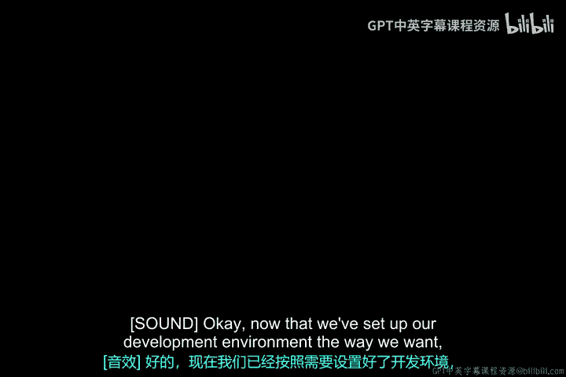
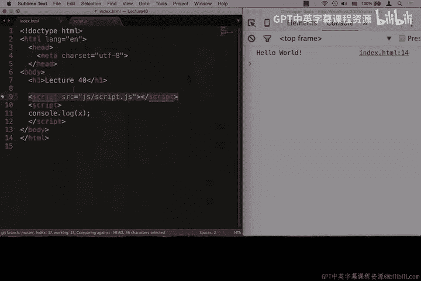

# 约翰霍普金斯大学《Web开发者的HTML, CSS, and Javascript》中英字幕 - P67：1_第40讲 第2部分 JavaScript代码放置位置.zh_en - GPT中英字幕课程资源 - BV1WzY6z9EUd

Yeah。

Okay， now that we've set up our development environment， the way we want。

 the first thing we should talk about is where do you include your ja code。

 where do you write it Well， there's essentially a couple of places where you could do that。

 The first one is you could have a script tag inside the head section so we could write script if I could type right now script and we could say type。

Equals。Text jascript Now the type is technically not required。 so if you wanted to。

 you could basically just avoid it altogether and just have script and here's our script right here。

 So this between the opening script and the closing script tags。

 you can now write your ja another place where you could do that is an external file。

 so an external file also starts with a script except it has a source。

Attribute where you could specify an external file and in this case it will be script。

js because our script is sitting inside js script。js。

 Now notice that whenever you include an external javascript file you still have to provide the closing script tag a script tag is one of those tags that always requires a closing script tag。

 whether or not there is actually body within the script tag or not Now just like CSs and Hm。

 java code is executed sequentially So it means whatever is inside of this script。

js file is going to get executed first and whatever is inside this script tag is going to execute get executed second So let's go ahead and try that out let's put jascript or script。

 Js Let's declare a variable we'll talk about declaration variables in a minute but for now let's just declare a simple variable it's going to be a string and it's going to say hello world So we'll save that We'll go to our HTML。

And inside the script， we'll go ahead and say console。

That log and console thatlog is something they're going to be using a lot and basically that is a function that's available on every single browser except some really old internet Explorer browsers where it will log whatever it is you write in between these parentheses it will log that to our console right here so let's go ahead and log our X since we declared X and now that I saved the file our browser sync when I ahead and synced the code with the browser and it immediately said hello world Well where did this X come from while the X came from script Since inside script already defined this X I am certainly very much welcome to use it outside of it obviously after it has been defined and the value hello world is obviously coming into this X because it has been defined already inside the script Js it's also important to remember that the jascript engine inside the browser is a single threaded engine。

😊，Which means that as the code in your ja executes。

 it will execute completely without being interrupted by any other ja code from somewhere outside。

 so it is not a multi threadreaded environment it's a single threaded environment and also as you could see already it's a sequential execution which means JavaScript would execute line by line without jumping and inserting other lines of code from other places。

 Now the head section is not the only section where I could define JavaScript I could define ja in a very similar manner that I define it in the head。

 I could define that ja in the body as well so for example， right before body ends。

 I could say script and。😊，Close the script tag and I can have some code right here。 So in this case。

 we'll say console that log and we'll say right before body。Closing tag。Given an exclamation point。

 if I save it now， you'll see that Hello world gets executed first since this is what gets triggered first in the sequential execution of the code。

 and then you see right before body closing tag message and that gets executed over here at the end since it's coming after the other JavaScript code Likewise I could really take this entire contract go ahead and cut it。

And paste it right here right at the end and it will still have exactly the same effect as before。

 at least in this case， and if I save it， you'll see that I say hello world because I can include a JavaScript file right in the middle of the body of the HTML page as well so to summarize there's a few places where you could actually write your ja code。

 you could write it inside the headtag inside the script tag。

 you could write it outside of the headtag inside the script tag or again inside or outside of the headtag。

 you could include a JavaScript file， the effect of which will be as if you're cutting and pasting the contents of that file right into the place where you declare it inside the HTML page。

