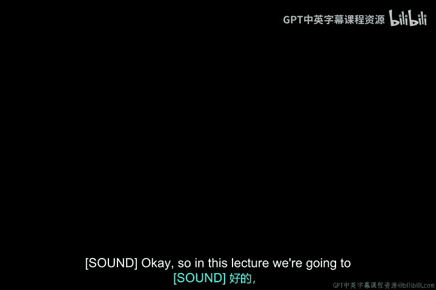
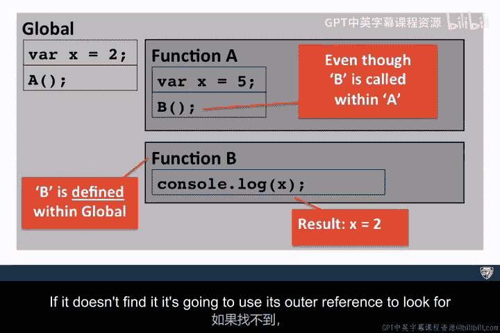
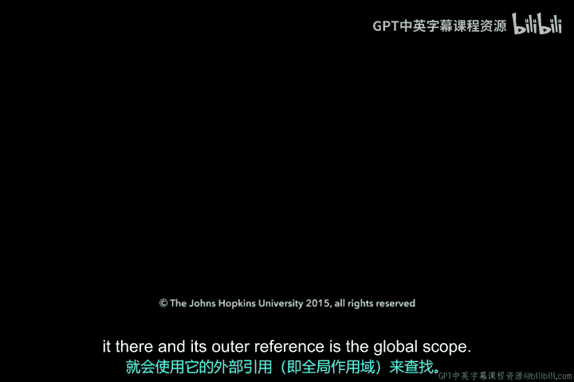

# 约翰霍普金斯大学《Web开发者的HTML, CSS, and Javascript》中英字幕 - P68：2_第41讲 第1部分 变量定义、函数与作用域.zh_en - GPT中英字幕课程资源 - BV1WzY6z9EUd

Yeah。

Okay， so in this lecture we're going to talk about defining variables。

 functions and where these artifacts live， otherwise known as scope。😊。

Now it's fairly straightforward how you define a variable variableable definitions should always start with the keyword var Now notice that no types are declared in JavaScript and the reason that is is because JavaScript is called a dynamically type language now what that means is that the JavaScript engine figures out the type of a particular variable at runtime and it also means that the same variable can hold different types during the life of the execution of the program so variable can start out to be a string then change to a number then change to an object and so on and all of that is perfectly legal so that's as far as variable definitions。

Now the way define a function is by using the keyword function followed by function name and followed by parentheses than curly braces Now in JavaScript。

 when you define a function name， it's very， very similar to defining a variable whose value is a function so for example。

 you could define a function in JavaScript by either using the keyword function followed by the function name or either create a variable and set it equal to a function。

 Now when you do it the second way， no name is defined after the function keyword， however。

 either syntax lets you refer to this function as a Now notice that the value of the function is assigned to a not the returned result of the execution of that function。

 so after either of these definitions you could now invoke otherwise known as execute function by referring to it by its name A。

😊，Now once you define the function， either you define the function。

 the first way that we talked about or the second way where you store the function inside of a variable。

 the way you invoke a function is by taking the name or the reference to that function and putting the parentheses afterwards。

 so that is called function execution or function in vocation。

 the word execute and invoke are synonyms so you can really use either one。

 but in programming literature it's very often that the execution of a function is referred to as in vocation of that function。

Now you can also define arguments to be passed to the JavaScript function Now the defined arguments are defined without the keyboard var。

 in fact， if you place the keyword var in the function argument definition。

 that will be a syntax error。If you want your function to return some value。

 you use the return key followed by whatever value it is that you want to return if the return key is not followed by a value which you're signaling to the ja engine is that it should terminate the function and exit out of it without returning anything Now the way you pass the arguments to the JavaScript function is also kind of unique so in the first line of this example here we have the function Comp we saw in the previous slide and it's defined here with arguments X and y in the second line we're executing or invoking function compare and passing to it two arguments 4 and5 Now the result of the execution of that function is then stored in the variable a on the third line you notice that we're still executing the compare function but we're not storing the result anywhere that is perfectly legal and it's also legal since JavaScript is a dynamically type language to pass a as a second argument as a string as opposed to a number。

That may not make sense as far as the logic of function is concerned。

 but it's certainly perfectly legal syntax Now the last line demonstrates yet another rule about ja functions All arguments defined in a ja function are optional you can call that same compare function without any arguments at all and it all be perfectly legal again。

 it may not make sense as far as the business logic of the execution of the compare function。

 but the syntax and thevocation of this function is perfectly legal Now each function or variable lives within a particular scope in ja is really two scopes global scope and function or otherwise known as lexical scope Now lexical here means that it depends on where something is physically defined like for example。

 a variable that is defined within a function is physically defined within that function there's no block scope in ja in other languages curly braces themselves signify a new scope in JavaScript function signify a new scope。

That's all you really need to know about functions for now and we're going to talk about functions in much more detail in a later lecture Now variables and functions defined in a global scope are available everywhere。

 meaning any other functions that are defined in a global scope and so on can get access to these globally defined functions and variables as far as function and lexical scope variables and functions defined here are available only within this function and you heard it right。

 you could define functions within other functions and those newly defined functions have a way to get edits out of function variables and functions which leads us to the next topic the scope chain Now in order to understand how scope chain works in ja you have to understand how ja engine executes things everything in JavaScript is executed and an execution context Now a function andvocation creates a new execution context within which that function。

😊，Is executed。Now each execution context has the following number one。

 it has its own variable environment， this is where it stores its newly defined functions and variables it also gets the special this object which we're going talk about in a later lecture and what's most important for our discussion right now。

 it gets a reference to its outer environment meaning the execution environment within which this particular function is defined。

😊，Now global scopepe does not have an outer environment simply because it's the most outer there is。

 so here's how scope chain works。Reference notice reference not defined variable will be searched for in its current scope first。

 If not found， the outer reference will be searched if not found there。

 the outer references outer reference will be searched and etc and so on。

 Now this will keep going until the global scope。 If not found in global scope。

 the variable is going to be undefined that will discuss the special value undefined when we speak about ja built in types。

 but for now just know that the variable undefined means it's just not found。

 Now in order to understand this scope chain a little bit better。

 let's take a look at the following visualization。😊。

Suppose you executed a couple of lines of code inside the global scope。

 the first line defines variable x and assigns a value of 2 to the variable x。

 and the second line executes function A。Now function A itself is defined in global scope。

 and it has its own variable x that is set to5。Now then within function A you call function B function B is also defined in a global scope and all it does is just print out to the console the value of x now what will be printed out to the console will be x equals5 because B is invoked inside function A or will B x equals 2 from the global scope and the answer is that the result that will be printed will be x equals 2 from the global scope now why is that well if you remember where we just said the reason pretty simple even though b is called within a and a has its own X what actually matters as far as resolving where x is coming from is its outer reference and B is defined within the global scope therefore the outer reference of function B is the global scope not function A what this means is that it does not matter where a particular function is executed what matters as far as。

😊，A resolving scope of a variable is concerned is where that function is physically defined function B is physically defined inside the global scope。

 therefore a reference of x inside function B is going to look inside function B first if it doesn't find it it's going to use its autoer reference to look for it there and its autoer reference is the global scope let's jump to the code order and see an example of this。

