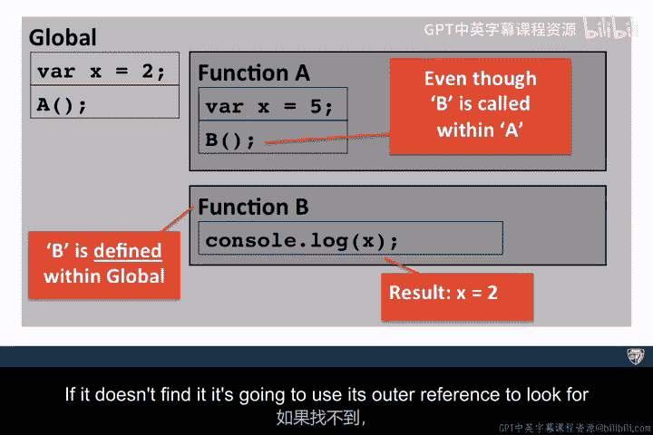

# JavaScript基础：2.41.1：变量定义、函数与作用域


在本节课中，我们将要学习JavaScript中的三个核心概念：如何定义变量、如何定义函数，以及这些元素在何处“存活”，也就是作用域的概念。

## 变量定义

上一节我们介绍了课程概述，本节中我们来看看如何定义变量。

在JavaScript中定义变量非常直接，应始终以关键字 `var` 开始。JavaScript被称为动态类型语言，这意味着JavaScript引擎在运行时确定变量的类型，并且同一个变量在程序执行期间可以持有不同类型的值。例如，一个变量可以初始化为字符串，然后更改为数字，再更改为对象，这些都是完全合法的。

以下是变量定义的示例：
```javascript
var myVariable;
```

## 函数定义

了解了变量定义后，接下来我们看看如何定义函数。

在JavaScript中，定义函数有两种主要方式。第一种是使用 `function` 关键字，后跟函数名和括号，然后是花括号。第二种方式是创建一个变量，并将其值设为一个函数。

以下是两种定义方式的示例：
```javascript
// 方式一：函数声明
function functionName() {
    // 函数体
}

// 方式二：函数表达式
var functionName = function() {
    // 函数体
};
```

请注意，当使用第二种方式时，`function` 关键字后没有函数名。但无论哪种语法，你都可以通过名称 `functionName` 来引用这个函数。这里，函数本身被赋值给了变量，而不是函数执行后的返回结果。

定义函数后，你可以通过在其名称后加括号来调用（或执行）它：
```javascript
functionName();
```

## 函数参数与返回值

现在我们已经知道如何定义和调用函数，本节中我们来了解如何向函数传递参数以及如何返回值。

函数参数在定义时直接写在括号内，**无需**使用 `var` 关键字。如果使用 `var`，会导致语法错误。若希望函数返回一个值，需使用 `return` 关键字，后跟要返回的值。如果 `return` 后没有值，则向引擎发出信号，表示应终止函数执行且不返回任何内容。

以下是函数参数与返回值的示例：
```javascript
function compare(x, y) {
    return x > y;
}
var result = compare(4, 5); // 调用函数并存储结果
compare(4, 5); // 合法调用，但不存储结果
compare(4, “5”); // 语法合法（动态类型）
compare(); // 语法合法，所有参数都是可选的
```

JavaScript函数的参数都是可选的，你可以调用函数时不传递任何参数，这在语法上是合法的。

## 作用域

理解了函数的基本结构后，我们需要知道变量和函数在何处有效，这就是作用域。

在JavaScript中，主要有两种作用域：全局作用域和函数作用域（也称为词法作用域）。词法作用域意味着作用域取决于代码在物理上的定义位置。例如，在函数内部定义的变量，其作用域就在该函数内部。JavaScript中没有块级作用域（由花括号 `{}` 创建的新作用域），只有函数会创建新的作用域。

以下是关于作用域的要点：
*   全局作用域中定义的变量和函数在任何地方都可用。
*   函数作用域中定义的变量和函数仅在该函数内部可用。
*   你可以在一个函数内部定义另一个函数。

## 作用域链

为了理解变量如何被查找，我们必须引入作用域链的概念。

JavaScript引擎在执行代码时，会为每一段代码创建一个“执行上下文”。函数调用会创建一个新的执行上下文。每个执行上下文都有自己的变量环境（用于存储新定义的变量和函数），一个特殊的 `this` 对象，以及**对其外部环境的引用**（即定义该函数的那个环境）。全局作用域没有外部环境，因为它是最外层的。

作用域链的工作原理如下：
1.  当引用一个变量时，引擎首先在当前作用域（变量环境）中查找。
2.  如果未找到，则通过外部环境引用去其外部作用域中查找。
3.  此过程会沿着作用域链一直向上，直到全局作用域。
4.  如果在全局作用域中也未找到，则该变量为 `undefined`。

让我们通过一个可视化例子来理解。假设在全局作用域中执行以下代码：
```javascript
var x = 2; // 全局变量 x
function A() {
    var x = 5; // 函数A内的变量 x
    B(); // 在函数A内部调用函数B
}
function B() {
    console.log(x); // 函数B尝试打印变量 x
}
A(); // 执行函数A
```
当 `B()` 执行并尝试打印 `x` 时，它会：
1.  首先在自身作用域（函数B）内查找 `x`，未找到。
2.  然后通过其外部环境引用（即定义它的环境，这里是全局作用域）查找 `x`。
3.  在全局作用域中找到 `x`，其值为 `2`。

因此，控制台将输出 `2`。**决定变量查找位置的关键，不是函数在哪里被调用，而是函数在物理上被定义在哪里**。函数B定义在全局作用域，所以它的外部环境引用指向全局作用域。

---




本节课中我们一起学习了JavaScript的基础构建块：使用 `var` 定义变量、使用两种语法定义函数、如何传递参数与返回值，以及最重要的作用域和作用域链概念。理解变量和函数在何处定义及如何被查找，是掌握JavaScript编程的关键一步。