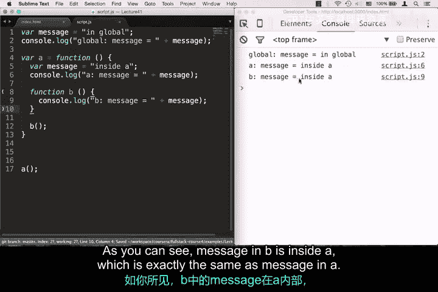
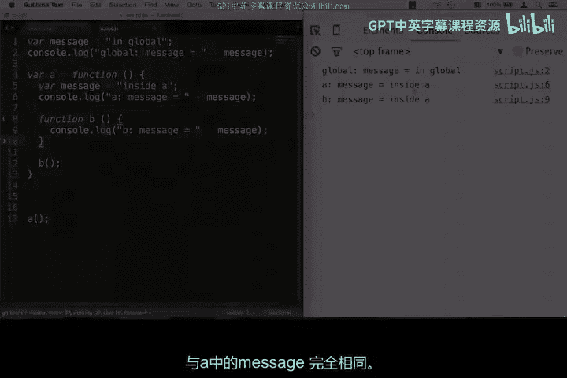
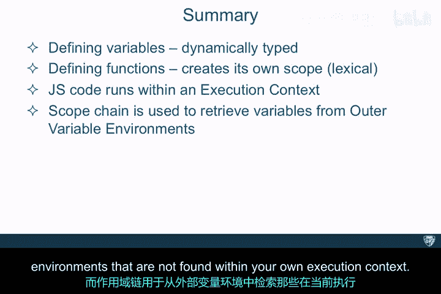

# 约翰霍普金斯大学《Web开发者的HTML, CSS, and Javascript》中英字幕 - P69：3_第41讲 第2部分 变量定义、函数与作用域.zh_en - GPT中英字幕课程资源 - BV1WzY6z9EUd

Yeah。

Okay， so here I am in sublime text and I'm looking at scriptptDgS。

 which is located in lecture 41 in the examples folder。😊，Now again。

 we opened up this workspace exactly the same way we opened it up in lecture 40。

 So if you don't remember how to do this， please refer to that lecture。

 We also have our browser sync turned on and I have my developer tools open that is connected to index at HTML which includes script dojs let's go ahead and close the file Explorer so we could see it a little bit better So the first thing we're doing here is we're defining this variable message in the global scope and we're just giving it a screen called in global and then what we're gonna to do is going to just console it out so let's go ahead and save it and see that message pop out So as expected we're seeing message equals in global just like we defined it right here Now where is this message variable stored as I told you before each execution gets its own execution context so it is inside the global execution context which also has a special object referred to as this so let's go ahead and type this and take a look This actually is referring to window if you type。

😊，Window here it's the same object as you can see this window object has lots of different name value pairs and one of them is message in global so the message variable is actually attached to this variable which is our global execution context let's go ahead and comment some more of the code that we wrote here and we'll comment the very last line of this function so we won't execute B so now we define a function and stored the function in the variable a and this function defines its own message variable that the value of which is inside a and all it really does is just output the message value to the console Now we obviously need to also execute this function so we'll go ahead and un this line So when we save this the browsering should refresh our console and we should see first global message equals in global since this is something that is sitting in the global scope and then when we execute function A we'll see a。

😊，ss equals inside a since this message variable is sitting inside of the function scope of the function A。

 So let's go ahead and save that。 let's get refreshed。

 and just like we thought we see the global in global and a is inside a Now what happens now if we call B from inside a and B is also going to be defined in the global scope So here we're not defining our own message we're just using whatever message comes to us from our outer scope Well the outer scope of function B is the global scope。

 So what we should see is first the message that it's in global then we'll see a because a is being invoked right here and the message defined inside a will be output to the console and finally when we invoke B we'll see this message referring to the global one since its outer reference is global let's go ahead and save that and as we predicted message equals from the B function is equal。

😊，GlobalNow let's see what happens if I take this function and I cut it out of here and I actually define this function inside function A。

 so let's go ahead and anddent this a little bit， so now B is defined inside function A。

 which means B's outer reference is function A variable scope。😊。

So let's go ahead and save that and now this message B will be the same as message in A。

 let's go ahead and save that as you can see， message in B is inside A。

 which is exactly the same as message in A。

So in summary we spoke about defining variables， we spoke about the fact that all variables in JavaScript are dynamically typed。

 which means its type is determined at runtime Now we also spoke about defining functions and the fact that when you execute a function it creates its own scope。

 lexical scope or functional scope now it's important to remember that all JavaScript code runs within some execution context and each execution context has a number of things that are available to it。

One of those things is the outer variable environment。

And scope chain is used to retrieve variables from outer variable environments that are not found within your own execution context。

