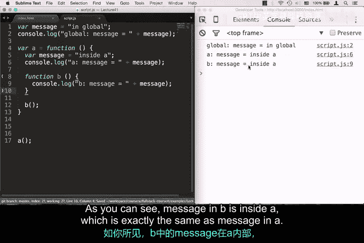
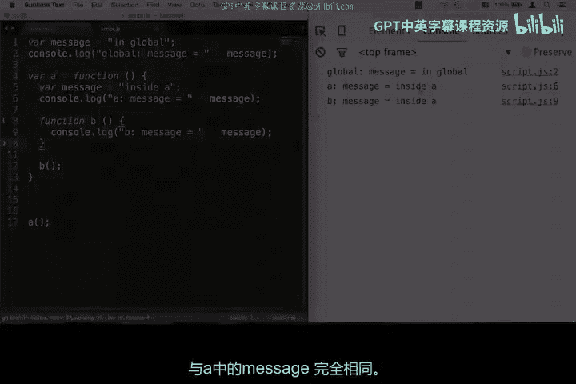
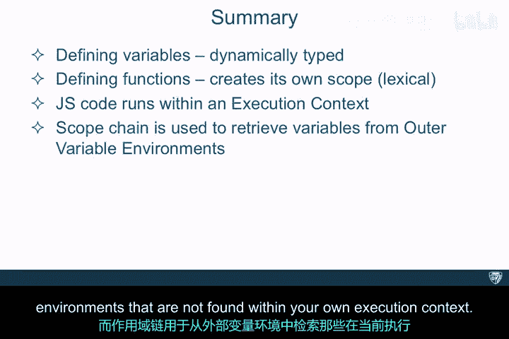

# JavaScript基础：第41讲：变量定义、函数与作用域 🔍


在本节课中，我们将学习JavaScript中变量定义、函数以及作用域的核心概念。我们将通过具体的代码示例，理解变量如何存储、函数如何创建自己的作用域，以及JavaScript引擎如何通过作用域链查找变量。

---

## 概述

我们将从在全局作用域中定义一个变量开始，然后探讨在函数内部定义变量会发生什么。接着，我们会观察函数如何创建自己的执行上下文，以及变量如何通过作用域链从外部环境被访问。

---

## 全局作用域中的变量定义

首先，我们在全局作用域中定义一个变量 `message`，并将其值设置为字符串 `"in global"`。然后，我们使用 `console.log` 将其输出到控制台。

```javascript
var message = "in global";
console.log("message = " + message);
```

保存代码后，浏览器控制台会显示 `message = in global`，这与我们的定义一致。

这个 `message` 变量存储在全局执行上下文中。在浏览器环境中，全局执行上下文与 `window` 对象相关联。因此，`message` 变量实际上是附加在 `window` 对象上的一个属性。

```javascript
console.log(this); // 指向 window 对象
console.log(window.message); // 同样可以访问到 "in global"
```

---

## 函数作用域与变量

上一节我们介绍了全局变量，本节中我们来看看在函数内部定义变量会发生什么。

我们定义一个函数 `a`，并在其内部声明一个同名的 `message` 变量。

```javascript
function a() {
    var message = "inside a";
    console.log("a: message = " + message);
}
a(); // 调用函数 a
```

当我们执行函数 `a` 时，它会创建自己的执行上下文和作用域。函数内部的 `message` 变量独立于全局的 `message` 变量。因此，控制台会先输出全局的 `in global`，然后输出函数 `a` 内部的 `inside a`。

---

## 嵌套函数与作用域链

现在，我们引入另一个函数 `b`，并观察其变量查找行为。

最初，我们将函数 `b` 定义在全局作用域中。它内部没有定义自己的 `message` 变量，因此会通过作用域链向外查找。

```javascript
function b() {
    console.log("b: message = " + message); // 引用外部的 message
}
a(); // 先调用 a
b(); // 再调用 b
```

由于 `b` 的外层引用是全局作用域，所以它找到的 `message` 值是 `"in global"`。

接下来，我们将函数 `b` 的定义移到函数 `a` 的内部。

```javascript
function a() {
    var message = "inside a";
    console.log("a: message = " + message);

    function b() {
        console.log("b: message = " + message); // 现在引用 a 作用域中的 message
    }
    b(); // 在 a 内部调用 b
}
a();
```

此时，函数 `b` 的外层引用变成了函数 `a` 的作用域。因此，当 `b` 尝试访问 `message` 变量时，它找到的是 `a` 作用域中的 `"inside a"`，而不是全局的 `"in global"`。这演示了**词法作用域**（或函数作用域）的工作方式：函数在定义时（而非调用时）就确定了其可访问的外部变量环境。

---

## 核心概念总结



本节课中我们一起学习了以下核心概念：



1.  **变量定义**：使用 `var` 关键字定义变量。JavaScript 是动态类型语言，变量类型在运行时确定。
    *   `var x = 10; // 数字`
    *   `var name = "Alice"; // 字符串`

2.  **执行上下文**：所有JavaScript代码都在某个执行上下文中运行。每个执行上下文都有自己的变量环境。

3.  **函数与作用域**：当函数执行时，它会创建自己的执行上下文和作用域。在函数内部定义的变量，其作用域仅限于该函数（函数作用域）。

4.  **作用域链**：当在当前执行上下文中找不到某个变量时，JavaScript引擎会沿着作用域链向外层查找，直到全局作用域。这个链由函数**定义时**的位置决定。

    ```
    // 作用域链示例：b -> a -> global
    var globalVar = "I'm global";
    function a() {
        var outerVar = "I'm in a";
        function b() {
            console.log(outerVar); // 在 a 的作用域中找到
            console.log(globalVar); // 在全局作用域中找到
        }
        b();
    }
    a();
    ```

---

## 总结




在本节课中，我们通过实践探索了JavaScript的变量定义、函数以及作用域机制。我们了解到，函数会创建独立的作用域，变量访问遵循词法作用域规则，并通过作用域链进行解析。理解这些概念是掌握JavaScript编程的基础。