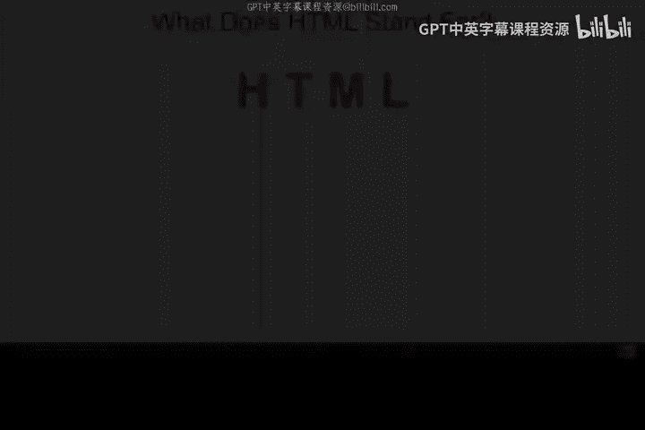
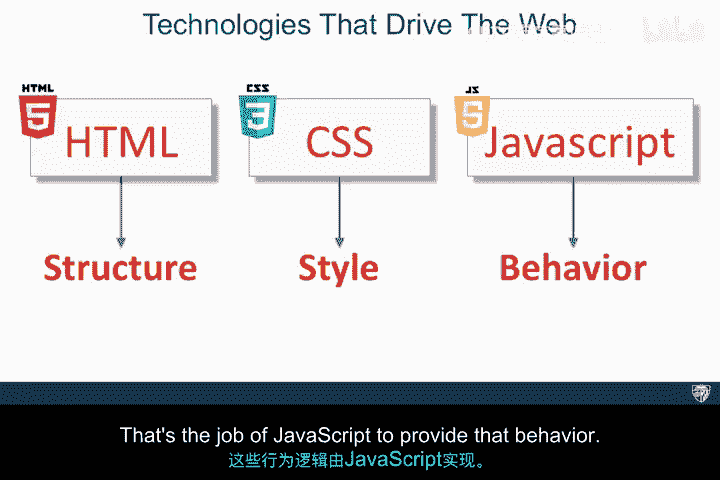
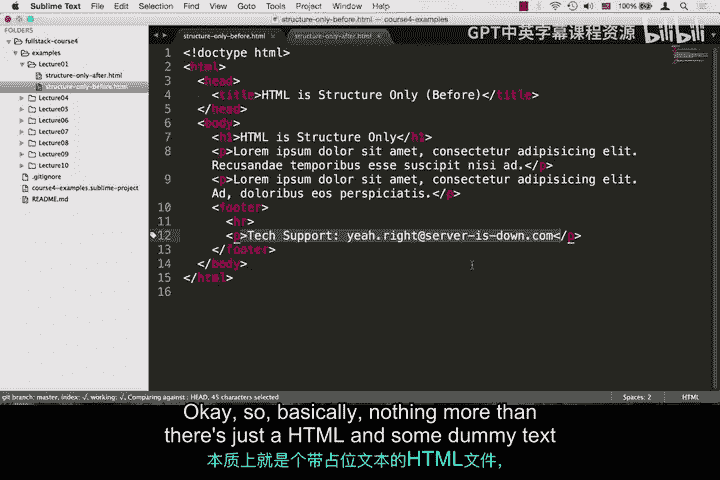
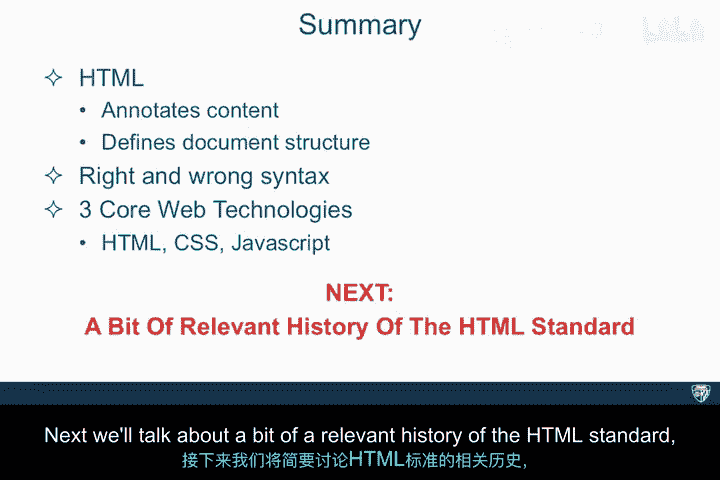

# 约翰霍普金斯大学《Web开发者的HTML, CSS, and Javascript》中英字幕 - P6：5_第1讲 HTML简介.zh_en - GPT中英字幕课程资源 - BV1WzY6z9EUd

。

So what is HTML， what does the term HTML even mean and how does it relate to the web In a minute we'll talk about the big picture of three technologies that drive the web。

 HTML， CSS and JavaScript。But where does HTML fit， in other words。

 precisely what role does HTML play in web development as we go along。

 you will see that understanding the answers to these pretty simple questions will actually help you make correct coding decisions down the line。

Well first of all so what does HTML stand for well it stands for hypertext markup language so let's go over each one of these words and find out what exactly they mean so first of all hypertext well hypertext is text which contains links to other texts and that's basically the entire web right one document points to another document or points to a bunch of other document and it grows on and and on sometimes they link back to the original document and it becomes one gigantic web。

And obviously it's not just about text nowadays， hypermedia plays a huge role in the web today。

 you can watch videos， listen to music， and really hypermedia is just an extension of hypertext。

The next term is markup so markup means to mark something up to annotate so for example。

 it's really all about content on the web it's all about content。 So if you have some content。

 for example， if you have a document you're writing called why I love this course which is I'm sure going to be the title of your next blog post that's the content and you want to annotate the content to tell the browser to tell some other machine out there。

 some other program out there what this content is and that's what HTML does So HTML goes and surrounds that surrounds and wraps that content in some markup in some markup language like tags so you could see here why I love this course is wrapped around with a title tag which kind of tells us and some other software out there that this is the title of this document which brings me to the first big point HTML is human readable So these tags look like instructions for。

Docu structure structure， you don't need to run it through some interpreter in order to understand the output structure of the document。

 it's very clear what it is。The last word in hypertext markup language is language and language basically implies that it has its own syntax。

 meaning there's a right and a wrong way to code it so for instance in the example on the left closing div tag appears after the closing H1 tag so itss closing order is switched which causes parsing and potentially rendering errors。

 so HTML is language you could actually code it up in a way such that it's wrong and something will break HTML also has its own semantics which means tag names can mean something either two machines or to humans。

😊，Okay so let's talk about the three technologies that drive the web each one has its own distinctive purpose and all three of them fit very nicely together let's start with HTML HTML provides the structure which means what components that does the HTML document have。

 for example can have one heading， two paragraphs and a footer。😊。

Note that that does not tell you anything about how these components are visually laid out。

 what they look like， what color they are， what font size they are。

 it only tells you what are the components like in a house， if you have three rooms in the kitchen。

 you don't really know what color the kitchen is， what color of the walls of the kitchen are and the only thing you know is what components make up the house。

The color and style is the role of CSS， so colors， layouts， font sizes， in other words。

 any stylistic types of things。So for example， if we have a heading in our HTML document。

It will tell us what color what font size it is， so that's the job of CSS and the third JavaScript its job is to provide behavior。

 provide functionality， it adds functionality to the page so for example。

 what happens when HTML document finishes loading into the browser or what happens if I click on one of the headings that's the job of JavaScript to provide that behavior let's take a look at a quick example of these concepts in action。

Okay， so the example we're going to take a look at is located in the examples lecture 01 folder and the file we're going to look at is called structure dash only dash before the HTML and it's a simple HTML file there's nothing but some HTML and the dummi text data here。

 dummi text and it's got a title， it's got the heading here。

 a couple of paragraphs and it has a footer where in the footer we have the text support email address for the poor So who' is going to try to contact the technical support。

Joking obviously okay so basically nothing more than this just HTML and some dummy text and we're also going to take a look at structure only dash after that HTML where it's the exact same HTML document but we inserted some styles into it and some behavior as well so we made the for example the heading we made it green and we center aligned it。

😊。

The second paragraph have some margin applied to it。

 the footer here has a paragraph with our tech support email and if we click and the tech support email is going to pop up and alert for us。

Okay， so let's take a look at both of these documents in the browser。Okay。

 so here's the first document， there's nothing special about it it's got that title that we talked about。

 a couple of paragraphs and the tech support email at the bottom in the footer and if I click on it nothing actually happens but if we look at document number two we see that HTML is structure only heading is now green and it's much bigger title and we see that the position of it it moved to the center and we also see that the second paragraph is in the center and it's much bigger font compared to before and if we click on the email address that we talked about we see an alert gets popped up with the message emailing us is useless which sounds just about right for most people's experiences with tech support。

😊，So the thing to notice here is that the difference between the two HTML documents are the upts and the behavior we applied。

 but the structure of both HTML documents is exactly the same。So in summary。

 we spoke about HTML in the fact that its job is to annotate content and define document structure。

And obviously， as any language， it has a right and wrong syntax。

 which you'll have to learn in order to code it。And the three core rep technologies， HTML。

 CSS and JavaScript， work very well together because each one of them has its own distinct and precise role。

 and they kind of don't really step on each other， they work very nicely together。Next。

 we'll talk about a bit of a relevant history of the HTML standard， and I do mean relevant。

