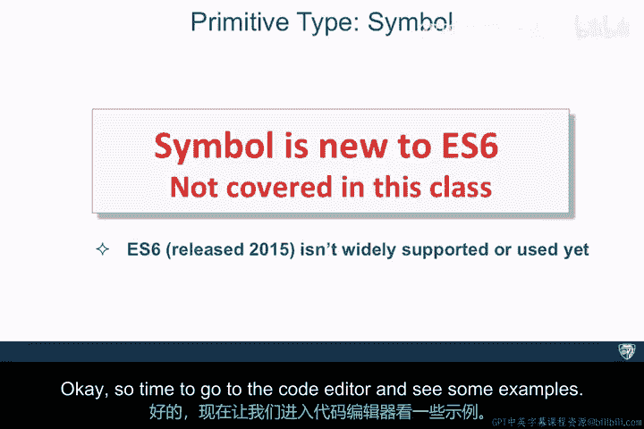

# 约翰霍普金斯大学《Web开发者的HTML, CSS, and Javascript》中英字幕 - P70：4_第42讲 第1部分 JavaScript类型系统.zh_en - GPT中英字幕课程资源 - BV1WzY6z9EUd

Yeah。

In this lecture， we're going to talk about JavaScript built in types。Now first of all。

 what is a type， a type is a particular data structure now each language defines some builtin types and JavaScript is no different。

 built in types can be used to build other data structures that you can then use for your particular business logic。

😊，Now JavaScript has seven built in types，6 primitive and one object type so what is an object in JavaScript well in JavaScript an object is nothing more than a collection of name value pairs it can have one name value pair really can have zero name value pairs but is a collection of name value pairs let's take a look at a quick example of what that might look like visually。

So here I have a person object it has a bunch of different name value pairs。

 first name Yaov the last name hikeken social and so on so first name would be the name and yaca would be the value and so too a value doesn't necessarily have to be a single value it could be a nested object so a name here for example is social the name of the property of the object and the value of that property is an entire other object that has again name value pairs So that's object type What about primitives Well primitive type is a type that represents a single immutable value So what does the mean a single value means it's not an object remember that object is a collection of name value pairs even simplest object there is there is a name and value pair well the very simplest one has zero name value pairs but the very simplest one that has some data in it is a name value pair it's not a single value Now what is a mutable mean。

😊，Well immutable means once it's set， once that value is set， it cannot be changed。

 it means that once you set it， the value of that variable becomes read only you could certainly create another value based on the existing value。

 but the memory space that was allocated for the first value is not changed instead you create a new memory space for the new value。

 so let me run down one by one of all the primitive types that JavaScript defines。First of all。

 bullolean well Boolean can only have two values， either true or false and true and false are reserved keywords in JavaScript language now if you ever ever done any programming at all and this course assumes that you have。

 you should be very familiar with this type an offset really。

Another type is called undefined the undefined data type signifies that no value has ever been set on this particular variable of this type。

 this is the value that every variable gets when the JavaScript engine sets up the variable in memory when it's defined but has never been assigned any value yet。

And it can only have one value and it's a reserved keyword undefined now you can set a variable to the keyword undefined yourself manually。

 but you should never ever do that and the reason is is because its meaning is that it's never been defined so defining it and then setting it to undefined is really counter to its core meaning if you ignore this advice and explicitly in your code。

 set a variable to the value of undefined that will create tremendous confusion in your code and confusion and code is never a good thing。

😊，Another value that the JavaScript language defines is nu， no signifies the lack of value。

Now the lack of value as opposed to undefined， which signifies the lack of definition。

 there's only one value that could ever set for that type and that value is the reserved keyword null。

 and it's also perfectly normal and perfectly okay to explicitly in your code set a variable to the null value。

Another type is number well number is actually the only numeric type in JavaScript and it's always represented under the hood as a double precision 64 bit floating point In other words。

 JavaScript does not have integer type integers in JavaScript at a subset of doubles instead of a separate data type。

Another data type is string。And string in JavaScript is very similar to the string type in other languages in that it is a sequence of characters used to represent text。

 and you could define strings either using single or double quotes， either one is 100% legal。

The last prim type that I'll mention is symbol now we're not really going to cover this data type in this class and the reason is that it's new to the ES6 otherwise known as ECma scriptri 6 now Ema scriptri 6 was released in 2015 around mid 2015 and it just isn't widely supported or really used yet it will probably become quite popular in the next number of years but it's not there yet so we're going to skip it for this course okay so time to go to the code editor and see some examples。

😊。

