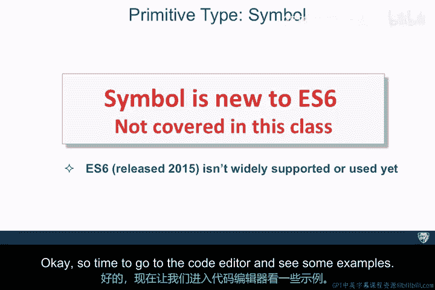

# JavaScript 类型系统：4.42.1：JavaScript 内置类型


在本节课中，我们将要学习 JavaScript 的内置类型系统。理解类型是理解任何编程语言的基础，JavaScript 也不例外。我们将探讨什么是类型，JavaScript 提供了哪些内置类型，以及它们各自的特点。

## 什么是类型？

类型是一种特定的数据结构。每种编程语言都定义了一些内置类型，JavaScript 也是如此。这些内置类型可以用来构建更复杂的数据结构，以满足特定的业务逻辑需求。

## JavaScript 的内置类型

JavaScript 有七种内置类型：六种原始类型和一种对象类型。

### 对象类型

在 JavaScript 中，对象本质上是一个**名值对**的集合。它可以包含零个或多个名值对。让我们通过一个简单的例子来理解。

```javascript
let person = {
    firstName: "Yaov",
    lastName: "hikeken",
    social: {
        twitter: "@yaov",
        facebook: "yaov.hikeken"
    }
};
```

在上面的例子中，`person` 是一个对象。`firstName` 是属性名，`"Yaov"` 是其对应的值。值也可以是另一个对象，例如 `social` 属性的值就是一个嵌套的对象。

### 原始类型

原始类型代表一个**单一的、不可变**的值。这意味着它不是一个对象（对象是名值对的集合），并且一旦其值被设定，就无法被改变。如果你基于一个原始值创建了新值，JavaScript 引擎会分配新的内存空间，而不是修改原有的值。

以下是 JavaScript 定义的六种原始类型：

#### 1. 布尔值
布尔类型只有两个可能的值：`true` 或 `false`。这两个都是 JavaScript 的保留关键字。

#### 2. 未定义
`undefined` 类型表示一个变量已被声明但从未被赋值。这是 JavaScript 引擎为变量分配内存空间后的默认值。虽然你可以手动将一个变量设置为 `undefined`，但强烈不建议这样做，因为这与其“未定义”的核心含义相悖，会造成代码逻辑混乱。

#### 3. 空值
`null` 类型表示“没有值”。它与 `undefined` 不同，`undefined` 表示“未定义”。`null` 也是一个保留关键字，在代码中显式地将变量设置为 `null` 是完全正常且合理的。

#### 4. 数字
`number` 是 JavaScript 中唯一的数值类型。它在底层始终以**双精度 64 位浮点数**的形式表示。这意味着 JavaScript 没有独立的整数类型，整数只是浮点数的一个子集。

#### 5. 字符串
`string` 类型用于表示文本，它是一个字符序列。在 JavaScript 中，你可以使用单引号或双引号来定义字符串，两者都是合法的。

```javascript
let greeting1 = "Hello";
let greeting2 = 'World';
```

#### 6. 符号
`symbol` 是 ES6（ECMAScript 2015）中引入的新原始类型。由于它相对较新，尚未被广泛支持和使用，因此在本课程中我们将不深入讨论它。

## 总结




本节课我们一起学习了 JavaScript 的内置类型系统。我们了解了类型是数据结构的基础，并详细探讨了 JavaScript 的七种内置类型：六种原始类型（布尔值、未定义、空值、数字、字符串、符号）和一种对象类型。理解这些类型的特性和区别，对于编写正确、高效的 JavaScript 代码至关重要。在接下来的课程中，我们将看到这些类型在实际代码中的应用。