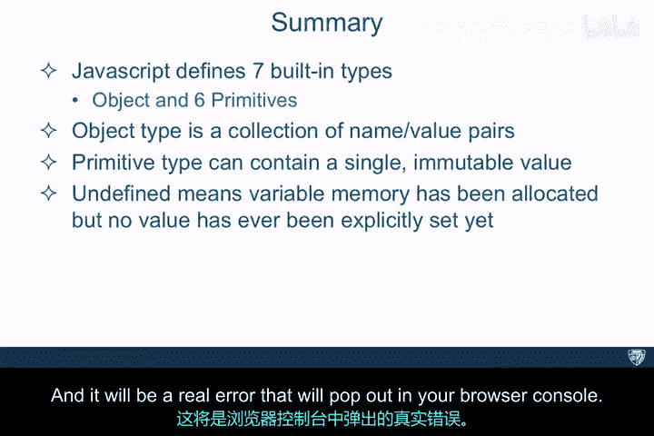

# 约翰霍普金斯大学《Web开发者的HTML, CSS, and Javascript》中英字幕 - P71：5_第42讲 第2部分 JavaScript类型系统.zh_en - GPT中英字幕课程资源 - BV1WzY6z9EUd

Yeah。Okay so here I am in sublime code editor and I'm located in the script Js。

 which is located in the Js folder of the lecture 42 folder and again I opened up sublime the same way I've been opening it up for the last couple of lectures let's go ahead and close the file browser and let's take a look as to what we have over here so here we define a variable X and then we print it out straight to the console let's go ahead and do that by saving the file and as we can see the value of the variable x is undefined well the reason it's undefined is because it's never been set to anything So if the next line I say x equals5 and save it again the value it will be5 Okay so let's go ahead and erase that for a second and let's un this line of code right here So this line of code directly tests whether or not x is actually equals to undefined and if it is it will go ahead and print out to the console X is undefined So let's save this and see what our console says。

😊。

And sure enough， x is undefined。 This kind of demonstrates to you that this is a reserved keyword that you can actually test against to see if it's undefined or not。

 you have to be a little bit careful because jascript has this concept of type coercion which we haven't covered yet but in general。

 this is something you could definitely test Now let's see what happens if we uncommon this and what this does is actually sets the value to5 so now x is explicitly defined and if we test it against the undefined keyword it should jump out of the if statement and we haven't covered if statements。

 but if statements are pretty generic across many languages so I'm sure you understand this code here So if x is equal to undefined。

 then we'll say x is undefined otherwise else well just say x has been defined So what is it going do it first should tell us x is undefined and then it should jump and tell us x has been defined Let's go ahead and save that。

😊，So we get our undefined x is now undefined and x has been defined。

 Okay so all this is well and good。 let's go ahead and comment this out for a minute and let's do this。

 let's comment and out the actual definition of x。 if we comment and out the actual definition of x and let's try to print out x and if we go ahead and save that we're going to get an error and the error message is a little bit confusing It says uncutaught reference error X is not defined。

 Well what is this a joke we just said that x is undefined so is undefined not the same as not defineded and that is correct undefined in jascript has a specific meaning and the meaning of it is is that it has been declared or defined so to speak but it has not been set to any value So in this case the variable has been declared and a memory space has been allocated for it but no value has been placed in that memory space that's the state that assigns this。

😊，VableTo be a type of undefined。 So now if I save that。

 now it will tell me that the variable is actually undefined。So to summarize。

 JavaScript defines seven built in types， one object and six primitives。

Now objectject type is a collection of name value pairs。 It is nothing more than that in ja。

 a primitive type can only contain a single immutable value and remember that immutable means that once you set it it cannot be changed。

 it could create new values based on this value but you cannot change the original value anymore Now there' is a particular interesting type called undefined among the primitives an undefined means variable memory has been allocated but no value has ever been explicitly set yet and it's important to distinguish between that and variable is never been defined in which case if you try to use it。

 you're gonna to get a reference error and it will be a real error that will pop out in your browser console。

😊。

