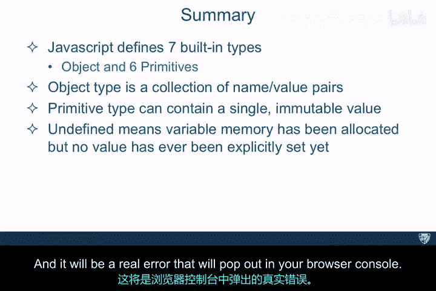

# JavaScript 类型系统：第5章第42讲：理解 Undefined 与变量声明

在本节课中，我们将学习 JavaScript 类型系统中的一个核心概念：`undefined`。我们将通过代码示例，理解变量声明、内存分配以及 `undefined` 与“未定义”错误的区别。

---

## 概述

JavaScript 定义了七种内置类型：一种对象类型和六种原始类型。对象类型是名值对的集合。原始类型则只能包含单一的、不可变的值。`undefined` 是原始类型中的一种特殊状态，表示变量已被声明但尚未被赋值。理解这一点对于避免常见的引用错误至关重要。

---

## 变量声明与 Undefined

上一节我们概述了 JavaScript 的类型。本节中，我们来看看 `undefined` 的具体表现。

首先，我们在代码编辑器中打开 `script.js` 文件。我们定义一个变量 `x` 但不为其赋值，然后将其打印到控制台。


```javascript
var x;
console.log(x);
```

保存文件后，控制台输出的 `x` 的值是 `undefined`。这是因为变量 `x` 已经被声明（内存空间已分配），但从未被设置为任何值。

---

## 测试 Undefined 状态

我们可以直接使用 `undefined` 这个保留关键字来测试变量是否处于未赋值状态。

以下是测试 `undefined` 的代码示例：

```javascript
var x;
if (x === undefined) {
    console.log('x is undefined');
} else {
    console.log('x has been defined');
}
```

保存并运行代码，控制台会输出 “x is undefined”。这说明 `x` 确实处于 `undefined` 状态。

---

## 赋值后的变化

现在，我们为变量 `x` 赋值，然后再次进行测试。

```javascript
var x = 5;
if (x === undefined) {
    console.log('x is undefined');
} else {
    console.log('x has been defined');
}
```

保存后，控制台会输出 “x has been defined”。因为 `x` 已经被显式地赋值为 `5`，不再等于 `undefined`。

---

## Undefined 与 “未定义” 错误的区别

这是一个关键概念。`undefined` 和 “变量未定义” 是两回事。

如果我们注释掉变量的声明语句，然后尝试打印它：

```javascript
// var x;
console.log(x);
```

保存后，浏览器控制台会抛出一个错误：`Uncaught ReferenceError: x is not defined`。

这个错误信息容易让人困惑。它不是说 `x` 是 `undefined`，而是说 `x` 根本没有被声明。在 JavaScript 中：
*   **`undefined`**：变量已被声明，内存已分配，但未赋值。
*   **`not defined`** (引用错误)：变量从未被声明，尝试使用一个不存在的标识符。

---

## 核心概念总结

为了清晰理解，以下是本节课的核心要点：

*   **原始类型的不可变性**：原始类型的值一旦创建就不可改变。你可以基于它创建新值，但不能改变原始值本身。
*   **`undefined` 的含义**：它是一个原始类型值，特指“变量已声明但未赋值”的状态。可以用 `===` 进行测试。
*   **引用错误**：当尝试使用一个从未声明过的变量时，JavaScript 引擎会抛出 `ReferenceError`，阻止代码继续执行。

---

## 总结




本节课中我们一起学习了 JavaScript 类型系统中的 `undefined`。我们明确了变量声明与赋值的区别，理解了 `undefined` 是一种特殊的、已声明但未赋值的状态，并且将其与导致程序错误的“变量未定义”情况区分开来。掌握这些概念是编写健壮 JavaScript 代码的基础。