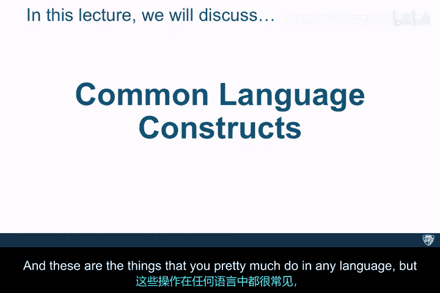
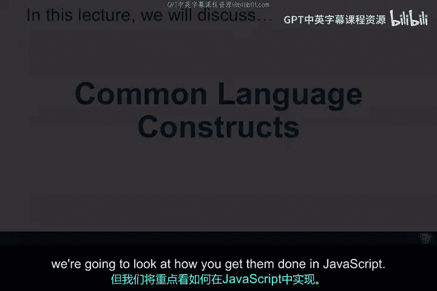
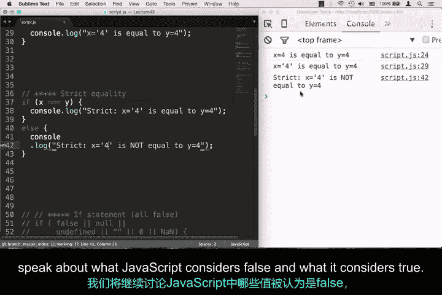

# 约翰霍普金斯大学《Web开发者的HTML, CSS, and Javascript》中英字幕 - P72：6_第43讲 第1部分 常见语言结构.zh_en - GPT中英字幕课程资源 - BV1WzY6z9EUd

Yeah。

So in this lecture we're going to speak about comma language contracts and these are the things that you pretty much do in any language。

 but we're gonna look at how you get them done in ja so here I am in sublime editor and I'm looking at scriptjs which is located in the lecture 43 folder and again the setup is very similar I have the Chrome developer tools opened here in the console tab and therefore whenever we save this scriptjs the browing tool that is running in the background will sense that we've updated this file and we'll go ahead and refresh the browser executing our ja code So I have a bunch of topics I'd like to go through and basically the code for those topics is sitting right in the same file but at this point commented them out so we could go one by one The first thing I want to take a look at is string concatenation Well just like a lot of other languages。

 jascript allows you to concatenate strings on the fly is if there are numbers as if there are arithmetic numbers so for example。

You have declared a string with the value hello and in very next line we're concatenating the string with another string with a space and the word world so now this operator right here plus equals is really equivalent to the operator let me comment that string out let me comment that line out and if I said this string string plus world this would be an identical line to this one so let's go ahead and keep both those lines for now and we'll comment out the second line and the way I comment out the thing without actually having to type it is is to press control slash on windows and command slash on a Mac and basically what I'm doing is concatenating the string with the word world then I'm going to output it to the console using string plus and an exclamation point in another string so the only difference between these two statements to this one and this one is that this one is actually going to store a new string。

😊，In the string variable， as opposed to this one is just going to concatennate it and throw it right into the log function。

 so let's go ahead and save this。😊，As you can see it refresh and it said ho world exclamation point So let me test this out as I said before。

 if I comment this line out and un this one， these lines are exactly equivalent this is just a shortcut to say the exact same thing as we're saying right here so let's say that and again it's going to refresh and saying exactly the same thing so let's go ahead and comment this whole thing out。

😊，So we could go to the next example that I want to talk about So actually let me close the file browser in the side so we could see it a little bit better so the next one we're going to talk about is math operators in the math operator are straightforward and if you've done any kind of a math operation in other languages there's really no difference here pretty much actually let me comment out the second line for now So the first thing is there's a plus operator the minus the multily operator and divide operator in the same type of rules that apply in other languages and really in math in general apply here as well so for example the precedence of parentheses also applies here so as you can see here I'm doing5 plus4 and that will get executed before the division by3 so5 plus4 that's nine divided by3 that's three so if I say that I should see that it' going to output console that log output3 let me comment the second line here and what we're doing here is kind of strange。

😊，Unfined divided by5 now when we execute that let's go ahead and save that we're going to get an NAN Now what is NAN NAN is a special symbol that indicates not a number and the biggest reason I'm showing to is because it's very common to define a function let's say when you find a function test1 that takes an a argument and in the function we do console that log。

😊，And Cons Lol will say a divided by5。 So now if we call this test one function。

We never really passing the a in here So what's gonna to happen Go ahead and let's go ahead and save that and you'll see we're can get an NAN again not a number So when you debug your code and you call a function and somewhere inside the function something starts throwing not a number chances are that theres something that was supposed to be passed in into that function and either got neglected to be passed in or something happened to along the way right before we're supposed to be passed in and then you have an undefined variable inside your function okay so let's go ahead and comment this out and we'll say that again so we'll clear the screen for us and let's go to this topic called equality let's un this so here what we have is we're declaring a variable defining variable X equal to4 and defining a variable y equal to4 as well now notice by the way that we're defining them with only one keyword var this is a shortcut JavaScript that if you wanted to you could just put a comma in between variable definition。

😊，And that is perfectly legal syntax and in fact， this is very common in other languages as well in the next line we have an if statement and the if statement in ja is nothing special compared to any other language is's pretty straightforward and what we're doing here is we're comparing x and y and we're comparing it with a double equals operator Now one of the most common mistakes is instead of double equals is to say x equals to y well x equals to y we'll take the value of y place it in x and use the result of that as the value to evaluate whether or not it's true or not so we don't want that we actually want to compare x and y and therefore it's a double equals so we're doing here saying if x is equal to y then we're going to execute the next line which is this console x is equal to y so let's go ahead and the second part out here and save that and you could see it says x is equal to y because x is4 and y is4 as well Now let's make this a little bit more interesting let's un this line and see what we're doing here。

😊，Here， first of all， we're changing the type of x。

 the x now is no longer four as a number x is4 as a string。

 So what happens if we actually compare them now well， let's go ahead and try that。

 let's save that and you could see it says x equals to44 as a string is equal to y equals to4 Now what is going on here。

 obviously the string can't possibly be equal to a number well what's going on here is called type coercion and type coercion just means that the language converts something for you from one type to another type automatically on the fly。

 So when the jascript tries to evaluate this equality it converts one of the types to be the same type as the other variable and only then compares the values Now what if you didn't want that。

 What if you didn't want jascript to automatically convert things for you when trying to evaluate it as equality Well that's where strict equality comes in。

 Let's go ahead and comment that out and go to the strict equality。

HereAnd will uncommon that so strict equality is signified by using triple equals So now if I'm comparing x triple equals to y it will first see whether or not these things are the X and y are the same type and if they're not it's not going to try to compare them anymore at that point and in fact。

 I just realize I commented out x and y that I'm defining here。

 so let's go ahead and actually uncommon this whole thing that way we'll have the variables available。

😊，So now if we execute this X at this point is a string for and y is a number4 so this will never actually execute right here what we'll execute however is the else part and here you get the chance to see what else is looks like in JavaScript and it's really again nothing special other languages have basically the same construct and in the else clause we are having console that log that says the strict x as a string4 is not equal to y equals 4 and that is what we actually should see in the second printout so let's go ahead and save that and see what it says says strict x is not equal to y equals 4 because one is a string and1 is a number。

😊，In part two of this lecture， we're going to pick up where we left off and speak about what JavaScript considers false and what it considers true。

😊。

