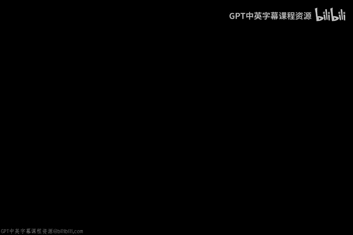
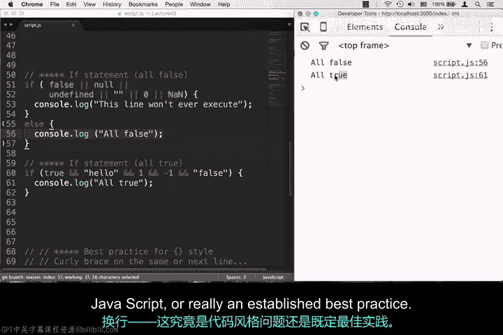
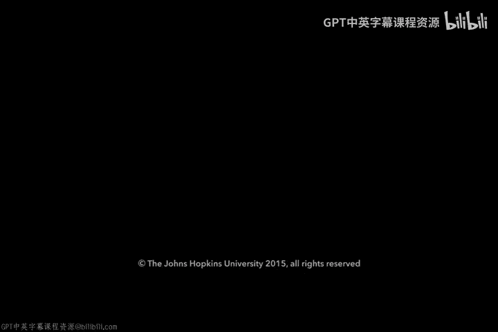

# 约翰霍普金斯大学《Web开发者的HTML, CSS, and Javascript》中英字幕 - P73：7_第43讲 第2部分 常见语言结构.zh_en - GPT中英字幕课程资源 - BV1WzY6z9EUd

Yeah。

In part one of this lecture， we'll left off speaking about strict equality versus regular equality in this lecture。

 we're going to go ahead and pick up speaking about what JavaScript considers Boolean true and what JavaScript considers Boolean false。

So like all languages， ja has a specific set of things that it considers to be false or true when you evaluate bulling expressions so let me go ahead and comment out this whole section and let's go to the next section where it's talking about the if statement but we're actually going to list everything that the if statement would consider true and everything that the if statement will consider false or actually the other way around false first so in the if statement I listed every single thing that the if statement will consider false The first of all is it's going to consider the keyword false as false Now then you see something that is an or operator Now the way the or operator works is that if something evaluates to true on its left side it does not check anymore what is going to be to its right side and since I know that to its left side at the moment is going to be false I can be sure that is going to evaluate this and if this is false which it is is going to try to evaluate this for truth。

😊，And if this is true， it will stop and will not evaluate anymore。 However。

 null also gets coerced to being false in ja。 So therefore we keep continuing， say null。

 which is again false or undefined undefined is a keyword that also gets coerced to false in ja Next it's an empty string So it's basically double quotes with nothing in the middle that also gets coerced to being false0 gets coerced to being false and NAN。

 not a number gets coerced to being false。 So point is that every one of those things is false。

 that means this line will actually never execute。 and in fact。

 it's going to go to the else clause and execute all is false Let's go ahead and say that and you could see it says all false Now let me show you a very quick trick that if you ever forget if you have something and you're not sure is it supposed to evaluate to false or true Well ja provides these rapper objects around the primitives。

 So even though bullying is a primitive type theres a wrappper object called。

In with the capital B that you can actually pass things to to see what it would coerce to So for example。

 if I pass it a null， that will coerce the false and there you go it tells you false if I pass it something like an empty string。

It will coerce it to false， but if I pass it anything else that is not in the list of false things that we listed right here in that if statement。

 so if I pass it something likeHello world。That will evaluate to true。

 which brings us to the next thing of what is true in ja Let's go to un this if statement and here what is true in ja Well first of all。

 the true keyword is evaluate it as true in ja after the keyword true you see2 m percent and two m percent signify the logical and operator and the way the logical and operator works it will only return true if both things on the left and on its right are true so if both of these things are true this will be true and again so since we have a non-empty string here。

 this will evaluate to true then we ending it ending it again with a number one which is a number not a0。

 anything not a0 also evaluate to true and just in case you think a negative one would evaluate it to false it does not it actually also evaluate to true any number that is nonzero will evaluate to true and if we end it with the string。

False even though the string itself has the value false， but since it's a nonempty string。

 that will evaluate to true so if we save this， we'll see the statement all true go ahead and say that the first one is all false from this clause and the second one says all true。

Okay， so we're going to stop here for part two of this lecture， and in part three of the lecture。

 we're going to pick up speaking about whether or not putting curly braces in the same line or next line is a matter of style of JavaScript or really an established best practice。

😊。

