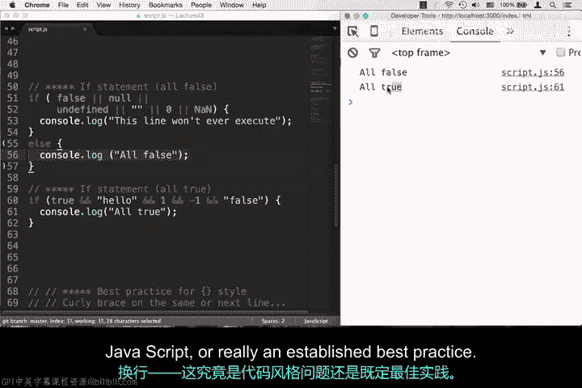

# JavaScript 核心概念：7.2：布尔值与真值/假值


在本节课中，我们将学习 JavaScript 中布尔运算的核心概念，特别是哪些值会被强制转换为 `true`（真值），哪些会被强制转换为 `false`（假值）。理解这一点对于编写条件判断和控制程序流程至关重要。

在上一节中，我们讨论了严格相等与普通相等的区别。本节中，我们来看看 JavaScript 如何评估布尔表达式中的真与假。

与所有编程语言一样，JavaScript 在评估布尔表达式时，有一组特定的值会被视为 `false`，其余则被视为 `true`。让我们先注释掉之前的代码，进入讨论 `if` 语句的部分。实际上，我们将列出所有会被 `if` 语句视为 `false` 的值，然后再列出被视为 `true` 的值。

以下是所有会被 `if` 语句视为 `false` 的值：

*   **`false`**：布尔值 `false` 关键字本身。
*   **`null`**：`null` 值在 JavaScript 中会被强制转换为 `false`。
*   **`undefined`**：`undefined` 关键字同样会被强制转换为 `false`。
*   **空字符串**：即中间没有任何内容的双引号 `""`。
*   **数字 `0`**：数字零会被强制转换为 `false`。
*   **`NaN`**：表示“非数字”的值。

以上所有值都被视为 `false`。这意味着，在一个条件判断中，如果遇到这些值，条件将不会通过。

现在，让我们看一个实用技巧。如果你不确定某个值会被强制转换为什么，JavaScript 为原始类型提供了包装对象。对于布尔类型，有一个包装对象叫 `Boolean`（首字母大写）。你可以将任何值传入 `Boolean()` 来查看其强制转换结果。

例如：
```javascript
console.log(Boolean(null)); // 输出：false
console.log(Boolean("")); // 输出：false
console.log(Boolean("Hello world")); // 输出：true
```

正如最后一行所示，任何不在上述假值列表中的值，通常都会被评估为 `true`。这自然引出了下一个话题：哪些值在 JavaScript 中被视为 `true`。

以下是会被视为 `true` 的值：

*   **`true`**：布尔值 `true` 关键字本身。
*   **非空字符串**：例如 `"Hello"`。
*   **任何非零数字**：包括正数、负数，例如 `1`、`-1`、`3.14` 等。
*   **注意**：即使字符串的内容是 `"false"`，因为它是一个**非空字符串**，所以它仍然会被评估为 `true`。

理解真值与假值列表，是掌握 JavaScript 条件逻辑的基础。

本节课中，我们一起学习了 JavaScript 中的真值与假值。我们明确了会被强制转换为 `false` 的六种情况，并了解到其他大多数值（包括非空字符串、非零数字等）都会被评估为 `true`。掌握这些概念，能帮助你更准确地编写条件判断语句。




在下一部分课程中，我们将探讨在 JavaScript 中，大括号 `{}` 是放在同一行还是下一行，这仅仅是一个代码风格问题，还是一个公认的最佳实践。