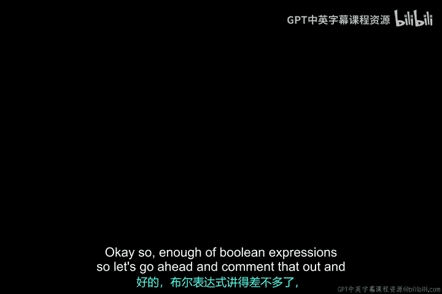
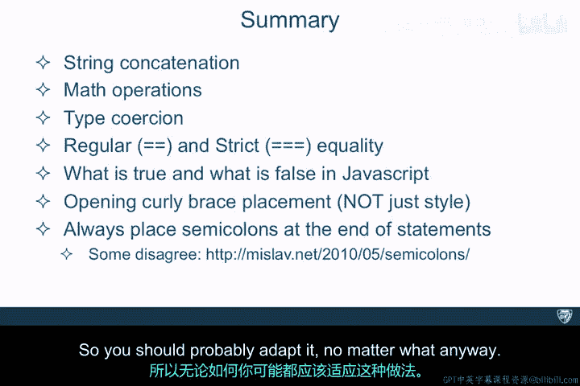

# 约翰霍普金斯大学《Web开发者的HTML, CSS, and Javascript》中英字幕 - P74：8_第43讲 第3部分 常见语言结构.zh_en - GPT中英字幕课程资源 - BV1WzY6z9EUd

Yeah。Okay so enough of bulling expressions， let's go ahead and comment that out and let's go to the next topic。

 which is best practice for the curly braces Curly braces on the same line or on the next whenever you speak to people about their preference whether or not the curly braces either for function of some other contract should be on the same line as some wording of keywording or should it be on the next line。

 sometimes you get into a pretty big religious war。

 whether or not you should have it one way or the other Well that religious war doesn't have to be in jascript because in ja there's actually an established best practice and that best practice is not just a matter of style。

 it's a matter of syntax and how ja engine works So let me demonstrate that for you real quick let me unment this and what we have here is we have two functions one is function A another one function B and we're going to execute function A and then execute function B logging the output of each function So function A follows the style is where it's always putting the curly brace。

😊。

s on a new line so function A starts and the curly brace is a new line and it returns an object actually this is an object literal and don't worry about that we're going to talk about objects a little bit later but the point is this is something that needs to be here which is a curly brace So it's returning the object literal and it's also putting the curly brace on a new line function B does exactly the same thing except it follows the style that puts the opening curly brace on the same line as the function declaration and on the same line as the return statement Now let's go ahead and execute function A and then execute function B and see what it gives us let's go ahead and save that。

😊，Did you expect that to happen？ The first value from function A is undefined Now why is that undefined Well。

 this actually brings up another interesting issue that is going on in ja the reason it's undefined is because what the ja engine does behind the scenes when you execute this code is it looks at the return statement it doesn't see anything after it and places for you a semicolon right after it So basically what this function a is doing is starting to execute and immediately returning and it's returning nothing and since it's returning nothing when we try to output nothing it gives us undefined as a sign point。

 even though semicollonons at the end of statements are optional in ja it is pretty much an accepted best practice to always put them there Now there are some minor I would say very minor controversy about that and there are people out there that insist that they want to have it without the semicollonons at the end。

 however by and large people。😊，semicolons are very strict about it。

 so you should probably follow the best practice of the majority。

 So now you understand why in this case it returned undefined and in this case it's actually returning the object with name value pair name being the name property and value being yaov so let's go ahead and comment this out and go to our last topic for this lecture which is the for loop。

 What language can there be without a for loop let's go ahead and comment that out and here's a for loop this for loop is doing something very simple it's defining a sum variable to be0 to begin with and then it's looploing from 0 to9 and summing up everything in between and then it's outputting what the sum from0 to9 is So let's go over this four loop real quick So just like many languages the for loop has three parts to it first is the initialization part of initialization of the counter variable or other conditions The second one is the condition that the engine will check to see whether or not the loop should be on again。

And the third one， some sort of either increment or decrementer or something like that。

 So the first thing is we're declaring a variable I equal to 0 that is going to be a starting point By the way。

 if this variable I has been declared in this scope already once declaring it again with a var would be a syntax error So if I have a four loop a little bit above it that also has var I equals0 This four loop would just start with i equals0 I don't have a four loop above so I will go ahead and declare the variable I equals0 jump into the last part we see I plus plus well this is not one of those shorthand notations for I equals to I plus1 it's the increment operator。

😊，In to make this a little bit shorter to type I plus plus we' do there's a very similar operator。

 by the way， that is I minus minus that subtracts one from whatever variable it's applied to in this case。

 we wna incremented by one So it's i plus plus so we're starting with zero in the very first time I is being compared to 10 and 0 is less than 10 and I is being incremented by one then the body of the loop executes and after that when we hit the curly brace it comes right back increments I by one and then checks it again is I in this case one less than 10 will go again and again again until I reaches9 in which case it will go ahead and execute the loop one more time increment I to become 10 and 10 is not less than 10 and it will go ahead and exit the loop and output this line for us。

 So let's say go ahead and put a console that logan here and will output I as the loop keeps going。😊。

And save that and take a look at the result so as you can see it's going all the way from0 to9 and sum and the sum of0 through9 is 45。

😊，So we went over quite a bit of this lecture， so let's quickly summarize we went over the string concatenation。

😊，And we went over math operations and how the typical precedent rules applies there just like it would apply and pretty much all the other languages and if you want to know more about it。

 there's certainly much more to learn about it you could go to the Mozilla developer network and delve deeper into that documentation we spoke about type coercion that is dynamically converting a type to a different type for either addition or comparison or a different type of other operations that you would need both sides of the upper end to have the same type for We also spoke about the regular and strict equality。

 the regular equality being with double equals and the strict equality being with triple equals and the big difference between them is that the strict equality will first compare to see whether or not both sides are the same type and if they're not it will not consider them equal it will not check anything more so type coercion will happen with double equals the regular equality but strict equality prevents type coercion。

😊，We also spoke about what is true and what is false in JavaScript， what is considered true。

 and what is considered false in JavaScript。We also talked about opening curly brace placement It's not just the style in JavaScript in JavaScript。

 it's very important that you adapt the style of putting the opening curly brace on the same line as the function definition or a object definition and so on now as a general good practice always place semicolonons at the end of every statement Now there are some that disagree and I provide a link here for you here to an article that makes a really good case as to why you might not want to do that or at least might not have to do it absolutely have to do it kind of makes fun of the people who insist on it but the bottom line is most people do do that and place the semi columnlon at the end of pretty much every statement so you should probably adapt it no matter what anyway。

😊。

And last but not least， we spoke about the basic for loop syntax。

 and I showed you some simple code to sum up numbers between zero and nine。😊。

