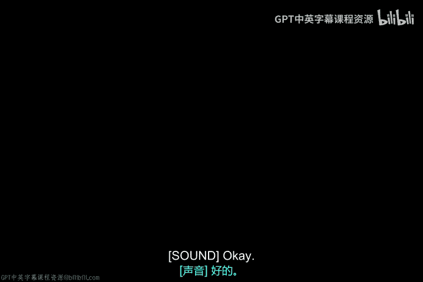
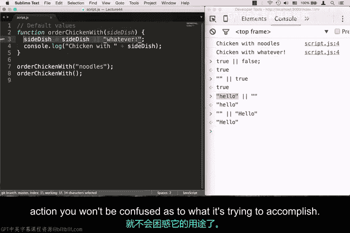

# 约翰霍普金斯大学《Web开发者的HTML, CSS, and Javascript》中英字幕 - P75：9_第44讲 默认值处理.zh_en - GPT中英字幕课程资源 - BV1WzY6z9EUd

Yeah。

Okay so let's talk about a very common scenario that happens a lot when you're coding and before we begin I am located now in lecture 44 in the scriptjs so I have a function here and the function is order chicken with and it lets you pass a side dish and really it's very simple just prints back out to the console the order chicken with and whatever the side dish is so in this case we're calling it order chicken with and we're passing the string noodles what it should print out is chicken with noodles to the console so if we save this。

😊，And indeed， chicken when noodles gets printed out。

Now what happens if I call the same function but I pass nothing to it well side dish will become undefined in this function。

 so when side dish is undefined it should print chicken with and it will coer this side dish variable into string undefined so if I save that。

I'll get chicken with noodles。 That's the first call。 And the second one， chicken with undefined。

 Well obviously this is not something we want to the user to see or really is not very helpful。

 So what can we do to avoid that。 Well， we could create a default value that if the value for side dish is not provided。

 we could substitute it with value。 So let's go ahead and do that the simplest way of doing that is just to create an if statement。

 So we'll say if side dish is equal and we could able do triple equal to undefined。😊。

And we'll go ahead and say that our side dish is equals to the string noodles， here we go。

 it's already sitting there okay， so now when I save this， the second time it calls。

 it will say noodles， in fact actually let's change that to let's say side dish with whatever。Okay。

 so now when I call it without any arguments， it will see that the side dish is undefined and it will print out chicken with whatever。

 let's go ahead and save that。😊，And there he goes， that's chicken with whatever。

Now this is all nice and well， but the thing is this is a little bit too verbose and JavaScript has a shortcut way of doing the same thing。

 And let me go ahead and code that for you now。 So what you could do instead is you could say side dish is equal to side dish or。

😊，Whatever。The string whatever。 Now so how is that working especiallyly let's see if it's working right So let's save that And it still says chicken with whatever。

 So how is this working。 Well the reason this is working is because each of one of these values is getting coerced into a boolean value and we spoke about coercion before。

 So when we make the second call without any arguments。 the side dish here。

 this variable is undefined。 So undefined right here gets coerced into a bullolean and becomes false So if it's false or the second statement will get evaluated and the second statement sense it is a non-empty string gets evaluated to true And what the or statement does in this circumstance is actually returns the value before it was coerced。

 So what it actually returns to side dish here is the string whatever exclamation point。

 let's go check that out in the console。 So we have this wrapper class called bullolean and we could say okay what happens if you do true In fact。

 forget that we'll just do true or false。😊，If we do true or false， it will say true。

 what happens if we do empty string or true？You will say true。 But what happens if we say hello。

Or empty string。It will say hello， so it will return whatever coerces to true first。

 so here we never even got to evaluate the empty string， so if we reverse that we'll still get hello。

😊，We'll still get hello this hello and the reason this never got evaluated is since this evaluated itself to true。

 the or statement no longer has to evaluate anything else because the or statement by its definition says if the first thing it see is true it is no reason to evaluate anything else because it's an or right it's either this is true or this is true well once you know this one is true then it no longer matters what anything else is coming behind it So this is one way to set up a very quick default value type of scenario and if you open up professional code of JQury library or any professional libraries out there or really any professional ja code you will see this construct quite a bit so I wanted to make sure to cover it here so if you ever see this code kind of in action you won't be confused as to what is trying to accomplish。

