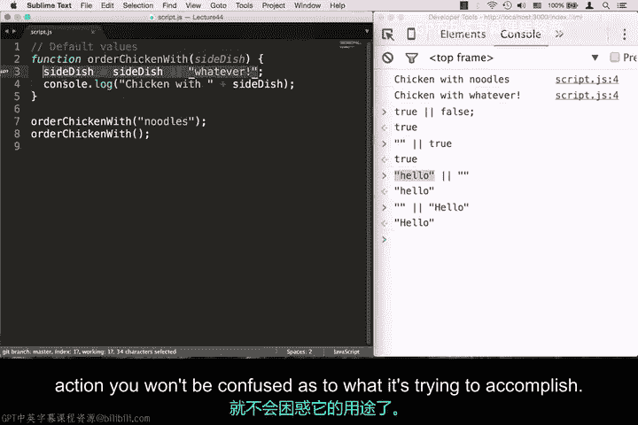

# JavaScript 入门：第44讲：默认值处理 🍗


在本节课中，我们将学习一个在编码时非常常见的场景：如何处理函数参数的默认值。当调用函数时未提供某个参数，该参数的值会变成 `undefined`，这可能导致不理想的输出。我们将探讨如何为参数设置默认值，以避免这种情况。

---

## 问题引入

假设我们有一个函数 `orderChickenWith`，它接收一个参数 `sideDish`（配菜），并在控制台打印出“Chicken with [配菜]”。

```javascript
function orderChickenWith(sideDish) {
    console.log("Chicken with " + sideDish);
}
```

当我们调用 `orderChickenWith("noodles")` 时，控制台会正确输出“Chicken with noodles”。

然而，如果我们调用函数时不传递任何参数，例如 `orderChickenWith()`，那么 `sideDish` 的值将是 `undefined`。JavaScript 会将 `undefined` 强制转换为字符串，导致输出“Chicken with undefined”。这显然不是我们想要展示给用户的结果。

## 解决方案一：使用 `if` 语句

为了解决这个问题，我们可以使用 `if` 语句来检查参数是否为 `undefined`，如果是，则为其赋予一个默认值。

以下是具体步骤：
1.  在函数内部，检查 `sideDish` 是否严格等于 `undefined`。
2.  如果条件为真，则将 `sideDish` 的值设置为一个默认字符串（例如“whatever”）。

```javascript
function orderChickenWith(sideDish) {
    if (sideDish === undefined) {
        sideDish = "whatever";
    }
    console.log("Chicken with " + sideDish);
}
```

现在，再次调用 `orderChickenWith()`，输出将变为“Chicken with whatever”。这种方法虽然有效，但代码显得有些冗长。

## 解决方案二：使用逻辑或 (`||`) 运算符

JavaScript 提供了一种更简洁的方式来设置默认值，即使用逻辑或 (`||`) 运算符。

其工作原理如下：
1.  逻辑或运算符会从左到右依次评估其两边的操作数。
2.  它会返回**第一个**能被强制转换为 `true`（真值）的操作数的**原始值**。
3.  如果所有操作数都被评估为 `false`（假值），则返回最后一个操作数的值。

在 JavaScript 中，`undefined` 是一个假值。因此，当 `sideDish` 为 `undefined` 时，表达式 `sideDish || “whatever”` 会跳过 `sideDish`（因为它是假值），并返回字符串 `“whatever”`。

我们可以这样重写函数：

```javascript
function orderChickenWith(sideDish) {
    sideDish = sideDish || "whatever";
    console.log("Chicken with " + sideDish);
}
```

这段代码与之前的 `if` 语句功能完全相同，但更加简洁。这是 JavaScript 中一种非常常见且高效的模式，你会在许多专业的代码库（如 jQuery）中看到它。

## 逻辑或运算符的评估机制

为了更好地理解 `||` 运算符，让我们看几个简单的例子：

*   `true || false` 返回 `true`。
*   `“hello” || “”` 返回 `“hello”`，因为非空字符串 `“hello”` 是真值。
*   `“” || “world”` 返回 `“world”`，因为空字符串 `“”` 是假值，所以运算符继续评估并返回下一个真值 `“world”`。

关键在于，`||` 运算符一旦找到第一个真值，就会立即返回该值，并停止评估后续的操作数。这种“短路求值”特性使其非常适合用于设置默认值。

---

## 总结




本节课中，我们一起学习了如何为函数参数设置默认值。我们首先遇到了当参数为 `undefined` 时可能产生的问题，然后通过 `if` 语句解决了它。接着，我们介绍了一种更简洁、更专业的模式——使用逻辑或 (`||`) 运算符。这种模式利用了 JavaScript 的类型强制转换和短路求值特性，是代码中处理默认值的常用技巧。理解这个模式将帮助你更流畅地阅读和编写 JavaScript 代码。