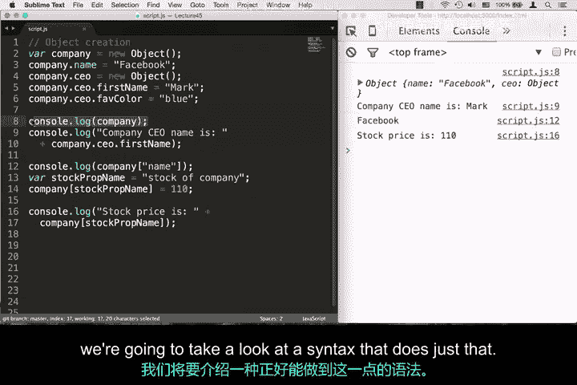

# 约翰霍普金斯大学《Web开发者的HTML, CSS, and Javascript》中英字幕 - P76：10_第45讲 第1部分 使用new语法创建对象.zh_en - GPT中英字幕课程资源 - BV1WzY6z9EUd

Yeah。

In the lecture on jascript types， we mentioned one very special type that is object type an object is again a collection of name value pairs in this lecture we're gonna go over how to create objects in different ways and how to assign properties in other words how to create those name value pairs so currently I am in the sublime text and I'm looking at script js and I'm located in the lecture 45 folder let me go ahead and close the file Expr and what you see in front of you is a very simple object creation so we're creating a company variable and we're setting it to new object once we're created a reference to an object we're ready to create properties of that object Now in ja when a property doesn't exist and you simply mention that property in an object jascript engine creates that property for you So for example we' say company that name and that property name doesn't exist yet。

 but the second I set it to something or the second I mentioned it on the object it becomes。😊。

ReAnd now it does exist。 So now if I go ahead and do console that log。

And I output the company object， I'll see， let me save that and you'll see that now the company object has a name property and the name property value is Facebook。

 but let me erase that and I can keep going and say company that CEO and I want CEO to have several properties and I want CEO to be an object by itself so let me just go ahead and try this first name is equal to mark and let's go and save that and maybe you'll do console log and we'll output company again。

And let's see what happens and we save it。We're going to get an error。 What is the error。

 the error cannot set property first name of undefined。 Now， what is going on here。

 Why is this not working， The reason this is not working is because company that CEO is something that hasn't been defined yet。

 Remember just like if we I said var a and then try to do a do hello equals， I don't know， hello。

Let me comment this line out so if I save that it will give me hello of undefined cannot set property hello of undefined so it's the same type of issue so what do I have to do here let me un this line what I really have to do here is I could specify that first name but I first have to create the dot CEO property so let me go ahead and copy it here and say here new object。

😊，Once I set CEO to the new object， now I could set the property first name on it。

 let me go ahead and save that。😊，And now I can see that object has first name and has CEO。

 which is also an object， so if I open that up。😊，And as CC is an object and CEO has a first name Mark well let me set another property。

 let's give Mark his favorite color， the CEO Fve color。

I'll give it blue since Facebook is blue and we'll print it out again to the screen so now we have CEO fave color and first name and just like I set the properties with a dot notation I could certainly get at the property with a dot notation so for example。

 let me do another console that log and I could say that let's say company CEO name is and a space and I'll do string concatenation and I'll say company that CEO dot first name。

Okay， and we'll put a semi on the end。 and we're kind of going off the border here。

 So when we will just。Javascript is very liberal with spaces so we'll just do that and when we save it we could see it now it says company CO name is Mark so the JavaScript engine traversed the object company and went to the CO property which is also an object and then went and retrieve the first name property Now the do notation is not the only way for me to get at the properties I can also do the following I could say console is going into console that log。

😊，Conancesl that log and what we'll do this time is we're going to use the bracket notation。

 so we'll say company。And we'll say bracket。Name and name will be in quotation marks because now we're getting at the property name and the name is a string and go ahead and output that So you see now it's getting to be Facebook so I can get at the company name using the bracket notation not just the dot notation Now why there's their two notations here。

 why can't I just use the dot notation Well the reason I can't always use the dot notation is because the dot notation will only work with whatever is a valid javascript identifier or valid jascript either function name or valid javascript variable name So for example。

 if I wanted to say that company thatt dollar sign stock and remember dollar sign is something jascript variables identifiers and function names are allowed to start with and I'll say stock is equal to 110 let's say that's how much it is and I'll go ahead and do console log and console company and we'll output that you could see that the stock。

But he got set to 110， but what if I wanted to be kind of， you know， very dramatic。

 I don't want to just say stock， I want to say stock of company。And put spaces in here well。

 I can't really do that， and I can't really do that either。That wouldn't work either。 However。

 what would work is instead of the dot notation， I'll put it in the brackets notation。

 And when I do that and save it。😊，You'll see that our property is now named stock with the dollar sign of company。

 and it could probably remove the dollar sign now。 that was only for the effect of the variable name。

 So now if we look， we have stock of company and that is the name of our property。

 So I can now go and retrieve the stock price by saying， okay， stock。Price is。

And we'll concatenate the string and say company and since I can't really do a dot stock price because it's stock of company。

 what I could do is I could use the bracket notation the same way and say stock of company。

And if I save that， I'll say stock price is 110 and notice that it doesn't have to be a string literal here。

 I can actually set it to a variable。 So if I go ahead and cut that out of here and save our stock prop name。

And I will set it to stock of company， and I'll go ahead and use stock propp name right here。

And we'll do the same thing over here， let's do stock prop name。

And if I say that everything works exactly the same way so I'm able to actually calculate the name of the property in my code on the fly okay so let me fix this up so you could see it a little bit better so if I say it again everything works as expected now this is a way to create an object and it kind of looks kind of ver both if there's new objects everywhere I wish there would be kind of a shorter way to create the same thing that would be much more readable and in part two of this lecture we're going to take a look at a syntax that does just that。

😊。

