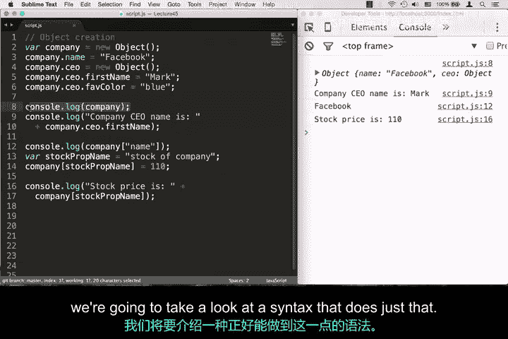

# Web开发者的HTML, CSS, and Javascript：P76：10_第45讲 第1部分 使用new语法创建对象 🏗️


## 概述
在本节课中，我们将要学习如何在JavaScript中创建对象。我们将重点介绍使用 `new Object()` 语法创建对象，并探讨如何为对象添加和访问属性。理解对象是掌握JavaScript的关键一步。

---

## 对象类型简介
在之前的课程中，我们提到JavaScript有一种非常特殊的类型，那就是对象类型。一个对象是**名值对**的集合。在本节中，我们将回顾以不同方式创建对象的方法，以及如何分配属性，也就是如何创建那些名值对。

## 使用 `new Object()` 创建对象
现在，我们来看一个非常简单的对象创建示例。我们创建一个名为 `company` 的变量，并将其设置为 `new Object()`。

```javascript
var company = new Object();
```

一旦我们创建了一个对象的引用，就可以开始为该对象创建属性了。

## 为对象添加属性
在JavaScript中，当一个属性尚不存在时，你只需在对象中提到该属性，JavaScript引擎就会为你创建它。

例如，我们写下 `company.name`。此时 `name` 这个属性还不存在。

```javascript
company.name;
```

但是，一旦我为其赋值或仅仅是在对象上提及它，它就被创建了。

```javascript
company.name = "Facebook";
```

现在它确实存在了。如果我执行 `console.log(company)`，就会看到 `company` 对象现在有了一个值为 `"Facebook"` 的 `name` 属性。

## 创建嵌套对象属性
我可以继续添加属性。例如，我想添加一个 `CEO` 属性，并且希望 `CEO` 本身也是一个包含多个属性的对象。

首先，我尝试这样做：

```javascript
company.CEO.firstName = "Mark";
```

然后执行 `console.log(company)` 来查看结果。我们会得到一个错误：`Cannot set property 'firstName' of undefined`。

为什么这行不通？原因是 `company.CEO` 这个属性还没有被定义。这就像我声明了 `var a`，然后尝试执行 `a.hello = "world"` 一样，`a` 是 `undefined`，无法设置其属性。

要解决这个问题，我必须先创建 `company.CEO` 属性本身。

```javascript
company.CEO = new Object();
company.CEO.firstName = "Mark";
```

现在，我可以成功设置 `firstName` 属性了。让我们再为CEO添加一个属性：

```javascript
company.CEO.favoriteColor = "blue";
```

现在，`CEO` 对象就拥有了 `firstName` 和 `favoriteColor` 两个属性。

## 访问对象属性：点表示法
就像我使用点表示法设置属性一样，我当然也可以用点表示法来获取属性。

例如：

```javascript
console.log("Company CEO name is " + company.CEO.firstName);
```

JavaScript引擎会遍历 `company` 对象，找到 `CEO` 属性（它本身也是一个对象），然后从中检索出 `firstName` 属性的值。

## 访问对象属性：括号表示法
点表示法并不是访问属性的唯一方式。我还可以使用括号表示法。

```javascript
console.log(company["name"]);
```

这里，属性名 `"name"` 需要放在引号中，因为它是一个字符串。这样也能成功输出 `"Facebook"`。

那么，为什么有两种表示法呢？我不能总是使用点表示法吗？原因是点表示法只适用于有效的JavaScript标识符（即有效的变量名或函数名）。

例如，我想添加一个属性叫 `"stock of company"`，中间包含空格。

```javascript
company["stock of company"] = 110;
```

我无法使用 `company.stock of company` 这样的点表示法，因为它包含空格，不是有效的标识符。但是，使用括号表示法就可以成功设置。

现在，我可以通过括号表示法来获取这个属性的值：

```javascript
console.log("Stock price is " + company["stock of company"]);
```

注意，括号内的内容不一定非得是字符串字面量，它也可以是一个变量。这让我可以在代码中动态计算属性名。

```javascript
var stockPropName = "stock of company";
console.log("Stock price is " + company[stockPropName]);
```




## 本节小结
本节课中，我们一起学习了使用 `new Object()` 语法创建JavaScript对象的基础知识。我们掌握了如何通过点表示法和括号表示法为对象添加及访问属性，并理解了括号表示法在处理动态或包含特殊字符的属性名时的必要性。这是一种创建对象的方式，但代码中遍布 `new Object()` 可能会显得冗长。在下一部分课程中，我们将探讨一种更简洁、更易读的语法来实现同样的功能。