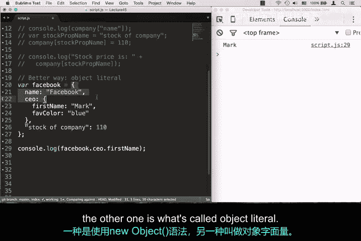

# 约翰霍普金斯大学《Web开发者的HTML, CSS, and Javascript》中英字幕 - P77：11_第45讲 第2部分 使用对象字面量语法创建对象.zh_en - GPT中英字幕课程资源 - BV1WzY6z9EUd

Yeah。

Okay， so I'm located still in script Gs， which is located in lecture 45 folder and in part one of this lecture。

 we spoke about how to create a simple object and how to set properties on it and we even talked about how to set an object within an object and so on Now in part two we'd like to take a look at a syntax that simplifies all this object creation What we'll do for now is we'll go ahead and comment all of this out and we'll create a new one and we'll create the object in a bit of a better way or at least simpler way so let's go ahead and make a comment here better way。

😊，Object， literal。And what we're going to do now is called object literal notation。

 let's go ahead and set our object to a little bit of a more interesting name。

 let's call it Facebook and we'll give it an object literal and object literal is just curly braces。

😊，And we could put a semilon at the end because it's the statement or actually it's an expression that's going to have its value sitting inside the Facebook variable and since JavaScript is very liberal and with spaces we can actually make it much more readable by putting space right here and starting to type properties just like this name Facebook name the company's Facebook and we're separating our name value pairs the name value pair itself is separated with a colon and the actual name value pair is separated with a comma so we put a comma in and we'll put CEO。

 that's what we wanted to have as a subobject within this object and since the sub objectject we again put curly braces and we open it up this way let's erase that extra line so first name was Mark。

And we put it， separate this with a comma， faitha color was blue。

Notice the last name value pair inside the object curly braces does not get a comma at the end。

 That's very important。 Now， this right here from this curly brace to this curly brace is an object little by itself and this CEO together with curly brace object is a name value pair。

 So since we want yet another name value pair to appear afterwards。

 we want to put a comma after here and then say something like stock and the stock is going be equal to 110。

 So if we save that this is going to get cleared and we're going to do console。

 let's actually make some room here the console do log。😊，And output'll Facebook。

So let's see what it comes out to be and it looks exactly like the object we created before。😊。

And we have the CEO subobject sitting here with a favorite color mark and don't worry about this proto property for now。

 but CEO is an object has a favorite color first name and we still have the name of the outer object be Facebook and the stock price 110。

 we can also repeat the same thing as we did before here where we wanted the stock name to be a little bit of more of an elaborate type of name so wanted to be stock of company right so let's go ahead and copy that name and we could do the same thing here by specifying the property name to be a string so we could just say quotes I' forget the colon and paste the name of the property right here So when we save。

😊，And it refreshes now we have the value or the name of the property be stock of company with the spaces。

 which is something you wouldn't be able to set using the dot notation。

 but you're able to set using the object literal notation and certainly are able to set using the bracket notation and we could access the properties of this subject exactly in the same way and we access it before so there is really no difference between the way to create the object this way and the way we created it with a new object so we could still say Facebook that CEO that name and when we say that we'll see that I messed up something here right because we had not dot name but that first name let's go ahead and do that and say that and you could see it still outputs mark So everything works and this is exactly again the same way to create the object and this is a much better way because it's much more readable and a much faster to type I'll add two more words about how to type up。

😊，Oject now a lot of people make a mistake is when they say var。

 let's say company and they say equal and they do this and they start expanding this thing before let's say CEO and again like this it's much easier to first put all the ending things on the line so for example。

 the way I type things is when I say a company and it's equals to curly braces and I know that it's going to be an object and I know that this is an expression and I want to put a semicolon at the end。

 I put a semicolon end right away。 So that way when I put my cursor in between the curly braces and just put a space now the syntax doesn't look as bad because it's not easier for you to type so when I say CEO again and I put two curly braces right here and I know there's going to be a second property after this I will put a comma right here and then say stock of company something like this and say 110 So that way when I get to here and I put a new line here。

 I'm not really。anymore to try to remember what is this curly brace closing do I need a comma here maybe there's another subobject in here so it's much easier to put all the ending characters to your programming line up front instead of wait till the end and try to match them up later so that's just a little quick tip for you to know going forward Okay so we have our two ways of create the object one way is using the object the new object syntax and the other one is what's called object literal。

