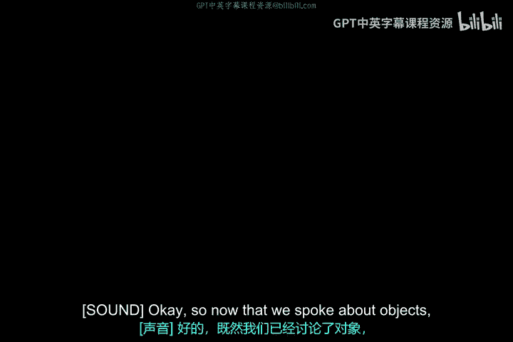
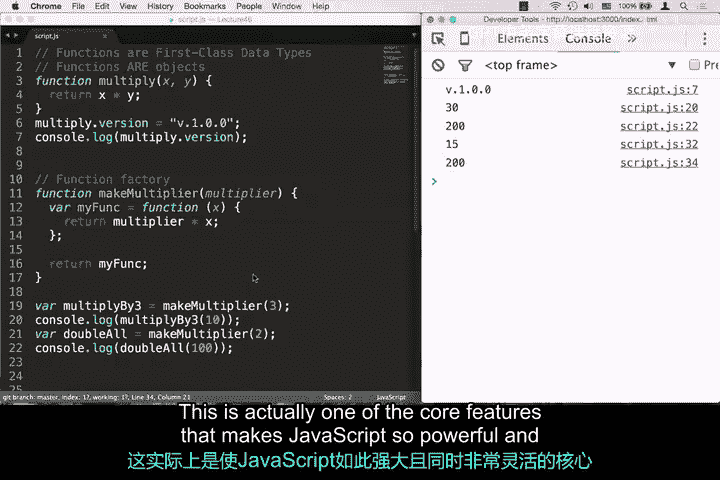

# 约翰霍普金斯大学《Web开发者的HTML, CSS, and Javascript》中英字幕 - P78：12_第46讲 函数详解.zh_en - GPT中英字幕课程资源 - BV1WzY6z9EUd

Yeah。

Okay， so now that we spoke about objects， it's time to speak about what functions really are underneath in ja I'm located in script。

 Gs and that is sitting inside the lecture 46 folder let me close the file browser here and let's take a look at a very simple function here function multiply and it takes two arguments X and Y and it returns just a multiplication of x and Y So the first thing I want you to know is that functions in ja are what's called firstclass data types What that means is is that whatever you could do with a variable。

 whatever you could do with an object you could also do with a function， you could pass it around。

 assign it to a variable which is you've seen before。

 you could pass it as an argument to another function。

 you could return it as a return result from a function functions in ja are objects they are regular objects that have some special properties to them So since they're regular objects I should be able to set properties on them just like I said properties。

On any other object so for example heres I have a function called multiply and let's test it that it works。

 let's do multiply let's say523 multiply5 by3 and if we save that we'll see that well if I to console it out。

 let's console that log。Multiply5 by three。And we should see 15 and we do Okay。

 so now what I could do is I could set a property on the multiply function just like I said on any other object。

 so let's go ahead and set a property called multiply dot let's say version and let's set it to version V1。

0。0。😊，Okay， and let's go ahead and cancel that log and let's cancel that log the actual function multiply。

So we're not actually calling the function if we call the function。

 we would have to put the parentheses after it， but we actually just want to output the value of the function。

 let's go ahead and output the value of the function。

 let's save that and we forgot to put console log， no problem will fix that and the value of function is the function code itself。

😊，So the reason that's happening is because every object has this inherent method or inherent function to it that's called two strings so if we do two string and call two string in it we're going to save that and get exactly the same thing so we want to do is actually get that property version so if we do multiply that version and now we save that you'll see that the version is been set on our function so our function is nothing more than an object Now the fact that it's an object allows us to do quite a number of interesting things that are so useful in every application let's go ahead and actually erase a couple of these code statement so we'll just have the multiply version and what we'll do is we'll start making function factories okay so let's call this function factory so what we're going to do is we're going to create a function and the function is going to be called make multiplier and we're going to provide a multiplier for it。

😊，So what we're going to do is we're going to return a multiplier function out of this function。

 so we're going to say var my funk。😊，Equals and we're going to make it equal to a function。

 so we'll do function。And the function is going to take an x as an argument and again， as I told you。

 I will put the semicone right here so I don't get confused later and what I want to return is multiplier。

😊，Where's my multiplier multiplier， I meant to say multiplier， so I'm going to return multiplier。

Times x， and that's why I'm going to return out of this function。

There you go Okay so now what I need to do is I need to now return this function as the return result of the function make multiplier so what I need to do is say return my funk and now the value of this function。

 the value of this function that is sitting right here is going to be returned as a return result and that allows me to do quite fun things here let's try to make a multiplier by3 so we'll say multiply by3 and we're going to create a function that does that for us。

 make multiplier and our multiplier is3。😊，So now what multiply by3 is is a reference to a function that we made inside this function。

 so in order to invoke it we'll do console that log so we could see it and we'll do multiply by3。😊。

And we'll put， let's say， 10。 So multiply by 3。So it's 10 times 3 so it should return 30 to us。

 Let's go ahead and save that and sure enough it returns 30 so we can make another one。

 let's say we'll make another one called double all。

 So everything is going to get double So we're going say make multiplier again and it's times2 so now console that log let's say multiply or double at all double all。

And we'll pass it， let's say， 100。So this should return 200 and we save it and sure enough it returns 200 so you see what we're doing here we're creating a function we created a function double all and the way we created it is by passing a multiplier into our make multiplier function our make multiplier function then creates a function for us inside of itself and then returns it as a value so since again functions are just objects we should be able to pass them around just like we pass around any other arguments to functions。

 so let's call this one passing functions as arguments so let's go ahead and create a function called do operation on and we'll give it an x that's the value we want the operation to be done on and the second parameter willll call operation。

😊，So in this case， let's go ahead and create the curly braces here。 in this case。

 what we want to do is we want to actually execute whatever function you pass to us on the value X。

 So what we need to do is return and its operation。😊。

And we need the parentheses in order to invoke the function， and it's invoked on x， Okay。

 so let's save that。😊，And now we could say result， R result， and we could do operation。

On and we could create a value or pick a value。 It's say 5。 And we'll say we want to multiply by3。

 Now， notice we're not passing multiply by three with parent。

 that would actually execute the function multiply by 3。

 We just want to pass a reference to that function。 Multiply by3。 So when we do that we get a result。

 And the result will be multiply by3 passed in with a5。 So it's five times 3。

 So let's go ahead and console it out。 We should get。😊，15。

 So our result is let's go ahead and save that and we do get 15。 and we can do the same thing again。

 result equals we don't need to declare it anymore because we're already set var so it's do operation on and let's say 100 and then we'll do double all so we multiplying now we're having a double all as a reference to our function double all that we created right here and we're passing it into our do operation on as a reference to that function and once we get as a reference we can go ahead and put parents around it and pass it to x that we're passing through the do operation on and that will' execute that function。

 return the result and store it inside the result variable so let's go ahead and console it out again so let's make some space here so you could see that log and we'll do result and then this time it should give us 200 and sure it does。

😊，Okay， so in this lecture you can clearly see that functions are first class data types。

 you could pass them around， they're nothing more than special type of objects。

 you could pass them around and treat them as objects pass them as arguments。

 return them as the result of a function execution and even set properties on them just like on regular objects This is actually one of the core features that makes JavaScript so powerful and so flexible at the very same time。

😊。

