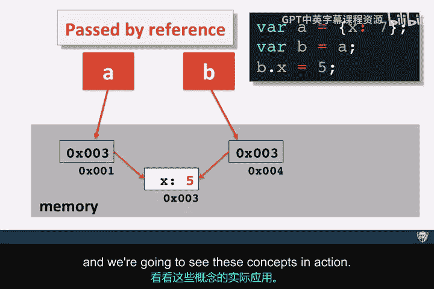

# 约翰霍普金斯大学《Web开发者的HTML, CSS, and Javascript》中英字幕 - P79：13_第47讲 第1部分 传值 vs 传址.zh_en - GPT中英字幕课程资源 - BV1WzY6z9EUd

Yeah。

There's a concept that's very important to understand for really old languages and certainly JavaScript is no different。

 and the concept is passing variables by value versus by reference。

 and this is what we're going to discuss right now。Now first of all。

 what does that mean to pass or copy things by value variables by value so the loose definition is that given b equals a so if you have an A and a B and you copying the contents of a into the variable B so passing when it's talking about functions or copying in case of just regular equality B equals a so copying or passing things by value means that changing the copied value in B does not affect the value stored in a and vice versa so if I change B after I've copied the value of a into B a stays the way it was before and B changes but does not affect a on the flip side passing or copying things by reference means that given B equals a again we're copying the contents of a into B passing and copying by reference would mean that changing copied value in B does indeed affect the value。

Stored in A and vice versa， so they're kind of pointing to the same location。Now in jascript。

 the way it works is that primitives are pass by value and objects are passed by reference or to say it another way。

 primitives are copied by value and objects are copied by reference Now the truth is that underneath the hood in the ja engine。

 everything is actually passed and copied by value and the difference is y1 is really called pass by reference and one pass by value really comes because of the way the objects and primitives are stored in memory So let's go ahead and take a look。

 So here on the left we have primitives a is equal 7 and then we're copying variable a or the contents of variable A into variable B。

 and on the right we have a variable a that is equal an object that has a property X to be equal 7 and then in the second line we're copying the contents of a into B。

 So B in the end of the day in both circumstances ends up with the same value as。😊，A。

 at least to this point。So the question is how does that work Let's take a look at some visualization to understand this So when comes to primitives。

 the first thing that happens is as we declare variable a and we equal it to 7 so what happens in memory is that a gets memory allocation location in this case the memory address is 001 and the value that's sitting in that memory is 7 Now when we declare variable B and then copy the contents of variable a into B what we're doing is we're allocating another memory location in this case 002 and we're copying the value 7 into that memory location so then when we overwrite the variable B with a value 5 what we're actually doing is we're placing a different value into the same memory location that B is pointing to in this case002 so in this scenario what you end up with is that a is still pointing to its original memory location001 which still has number 7 in it as the value in that memory location and B。

I now pointing to 002 with a different value so therefore A and B really have nothing to do with each other。

 they really just a copy originally were copied one into the other。

 but at this point they are not affecting one the other and this scenario is what is referred to as past by value or copied by value。

So let's take a look at the same scenario， but in case of objects。

The first thing that happens of course is again we declare an object in this case we declare an object literal with a property x7 so what's going on is is that a gets again allocated a memory location again in this case001 is the address and memory and what gets put into that memory location as the value is another memory address so inside the address 001 the value in that position and that position and memory is another memory position that is pointing to another part of memory and in the address 003 is where the value actually sits now the truth matter is I'm actually alwaysspling this what is actually sitting in a memory location 003 is a bunch of a list of other memory location where they have the same type of relationship where it's a primitive now and it's pointing to a particular memory location which at which memory location value 7 is stored but to make this a little bit simpler and not to confuse you further。

😊，Say that memory location 003 is where the actual value is contained or actual value is stored。

 So then when we declare variable B and we equate variable B to a。

 what's actually happening is that again the value of variable A where variable a is pointing to is copied into variable B Well the value is 003 it's a memory location and it's copied into B So B now even though it's sitting at a memory location 004 its value is another memory location with a value of 003 So what ends up happening is they both both pointing to a memory location 003 So finally when we update b x equals 5 where we're actually updating is the memory location where B is pointing to and that is the memory location 003 the value the direct value of B still stays the same it's the value that it's pointing to that is changing and since。

😊，A and B are pointing to the same value the end result is is that both are pointing to a changed value and this is what's called pass by reference so the bottom line is the difference between pass by value in pass by references is that in pass by value the values once it's changed do not affect the original value or the original variable as opposed opposed to pass by reference when you change the value and the object that's passed by reference the original object that's pointing to it is changed as well so that's the theory behind how pass by reference and pass by value works in part two of this lecture we're going to jump into the code editor and we're going to see these concepts in action。

😊。

