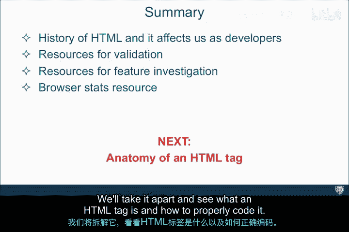

# 约翰霍普金斯大学《Web开发者的HTML, CSS, and Javascript》中英字幕 - P7：6_第2讲 HTML发展简史.zh_en - GPT中英字幕课程资源 - BV1WzY6z9EUd

。

Let's briefly talk about the history of HTML。It's usually the case that the history of any technology is not particularly interesting or exciting。

 and I can't claim that the history of HTML is that interesting either。

 but there are certain parts of this history that not only give you an understanding of how this technology was developed。

 but also gives you an appreciation of certain aspects of HTML that are still relevant and applicable today。

So before 1997 there were no community standards so browsers basically did whatever they wanted。

 they invented new tags， they implemented the same tags differently it was kind of the wild West of the web and you could go to a website and end up being told that your browser is not compatible with this website so you have to go get a different browser in order to even view the website to begin with now around 1997 the World web consortium the W3C came up with the first standard browsers actually started to pay somewhat attention to which is HTML4 and they very quickly updated it to HTML 4。

01 that standard was pretty loose and the browsers had still had way too much leeway inside that standard as to how they implemented it and how pages were were being rendered so around 2000 the W3C came up with another specific。

calllled XHtMl1。0 and that specification was based on Xml and XMl is a very rigid but very clear markup language and W3 wanted to kind of picked that up and keep going with it and produced XHt2。

0 The problem is that the browser vendors which at this point already had a history of not really listening 100% to any standard they decided that this whole W3C thing is moving way too slowly and on top of that they felt that the specifications are really moving in the wrong direction So the browsers bended together the browser vendors bended together and they created yet another group that produced specifications that was called whatwig and what wig that's yet another abbreviation because we don't have enough of them So that group is called whatwig and it stands for web hypertext application technology group So it's bunch of browser vendors that got together and this group is。

😊，Much less democratic that than the W3C in other words they have one central one editor that makes the final decision so all the browser vendor representatives can argue all they want but at the end they appointed one editor that kind of makes the final decisions and they're the ones that are driving the entire HTML5 what we have now they they're the drivers behind it so for a long time the two organizations didn't really C toi much at all and they didn't work together so they were really going to two different directions but I think W3C eventually realize that hey hey know that organization is actually being driven by the people by the companies that actually matter because they're the guys who are developing the browsers themselves so maybe it's a good idea to kind of make peace and try to see if we can work together somehow and this is what happened around 20072009 timeframe so what Wig and W3C started sort of kind of working together and what they produced in the end。

Is what we have now HTML5。So what does any of that matter to you Well what matters now is that there are two organizations out there one is W3C and the other one is WhatWig and they're both in charge of HTML somewhat。

 so it could be that you can get into a situation it's certainly possible that a browser potentially can be compliant with a specification which isn't yet even formalized by the official W3C so you know makes your headpin a little bit doesn't it。

So the way they divided it up is that W3C is going to be in charge of the standard since this is what their bread and butter is its standards and they're going to be in charge of the HTML5 standard and whatWig is not even going to give a version to their HTML standard they're just gonna say it it's HTML and it's constantly evolving there is no version we never stop we keep evolving it and whatWig since they're the ones that they're the ones that really implement the browsers so what W3C does is kind of cherry picks some of the more successful things that are actually kind of start to be implemented by the browsers and they slowly slowly bring it into the official standard So the point of this history quick history lesson is that this whole thing is a bit of a muddy waters and it's kind of hard to keep track of well what is the browser supposed to be compliant with。

But unfortunately it is our job as developers to keep track of these capabilities and it is particularly important nowadays because all the major modern browsers are all evergreen browsers and what that means is is that they silently update themselves on the user's computer so you no longer even need to have the user acknowledge the fact that they want to update that means that which is a good thing actually because now every browsers kind of patched as much as they can be patched for security reasons and also it kind of automatically without the user intervention gets the latest greatest features of HTML5 and all of the browser software itself but every major browser Chrome Firefox Safari inter and Explorer they all are evergreen browsers so they update themselves automatically so what I would like to do now is give you a few resources on the web that will make this job of keeping track of these changes a little bit easier the first resource that I really should share is the W3C。

Um， the W3C HTML5 standard， and this is a very academic type of reading。

 but you can still look stuff up in it that， you know there is somewhat useful and certainly if you want to kind of know what the actual standard is that everybody agree to。

 this is a great document to start with。😊，Another excellent site that you should definitely check out and kind of keep in new arsenal is can Iuse。

com and this is a site that basically itself keeps track of HTML 5 standard SDG standard。

 CSS standard， JavaScript APIs and on and on and on to in the web space to be able to tell you which browser supports what so for example。

 if I search for sourceet which is a pretty new attribute that is going to hopefully come soon to the image tags。

 which we'll talk about it later， but you could take a look。

 see if I want to type sourceet it'll tell you well this is an attribute and will also tell you which browsers at this point support it and which ones like Ie do not。

And you could yourself take a look at and see whether or not something that you a browser。

 let's say you're not really targeting， you're not really， don't care so much about。

 if it doesn't support it， doesn't support it fully。

 you could make the decision whether or not you want to use that particular feature。😊。

Another great resource to find out whether or not your HTML actually is going to work in browsers is to use a validator and there's a great validator provided by the w W3。

org website and you could basically cut and paste the URL of your website straight here or you could upload a particular HTML file or at this point you could even copy and paste your HTML straight in here and check whether or not it's valid and if it is valid chances are very high chances are that it will work very well in。

😊，In the browser， so let's take a look and see， let's test it out and see if we could validate the W3C's own page and if we click check and sure enough it tells us that it is valid or everything is green。

Now when you write web pages in the real world， you can't always say that I am just going to go ahead and try to support every browser that exists in the entire webphere and that's not going to work because they're just so many of them and some of them are so outdated so it's always good idea to check the browser statistics and to see certainly if you're in an organization that you know all the browsers that are in that organization that are being used all the browsers and browser versions that helps but if you're writing the writing an application for the entire web it's good to know well which browsers are actually popular and which basically falling off the edge and if you take a look here this is website w3chools。

com gives you the browser statistics and if you take a look here in September of 2015 Chrome is basically crushing its competition and you could see the next one is almost three times less market share than Chrome and you could tell that6566 almost。

Of users on the web are using Chrome so that seems like a pretty important browser to make sure that your webage works in and if you're all the way at 1。

4% of market share， if there's some feature that you're really really want to implement and all the other browsers implemented but one of them that has such a little such little market share doesn't implement well you might want to decide to go with it anyway this is something that you can make a decision about and last but not least is Google co or any other really search engine that you would like to use I don't think there's a data goes by that in web development that you don't have to look something up on the web and this is just part of the day-to-day business and if you're going to be in web development you kind of have to get used to the fact that you have to constantly look things up things are constantly changing and you obviously no human being can know at all by themselves So to summarize we went over somewhat relevant hopefully history of HTML and。

Kin of saw how it affects us as developers even today。

 so I gave you some resources for validation of HTML which kind of gives you a little bit more of a comfort factor that your HTML will work in browsers properly and I gave you some resources for feature investigation like the website of can I use。

com which lets you know whether or not a particular feature is implemented in a particular version of a browser and we also went over where you could look up browser statistics so you could make an informed decision of what browsers you should even target for your web application to begin with。

Next， we're going to talk about the anatomy of an HTML tag。

 we'll take it apart and see what an HTML tag is and how to properly code it。😊。

