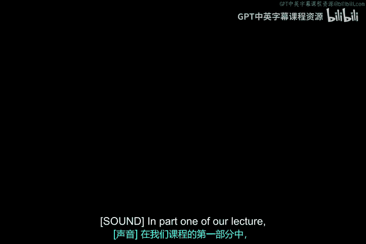
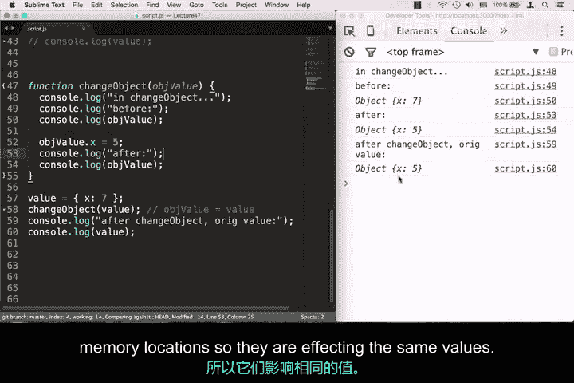
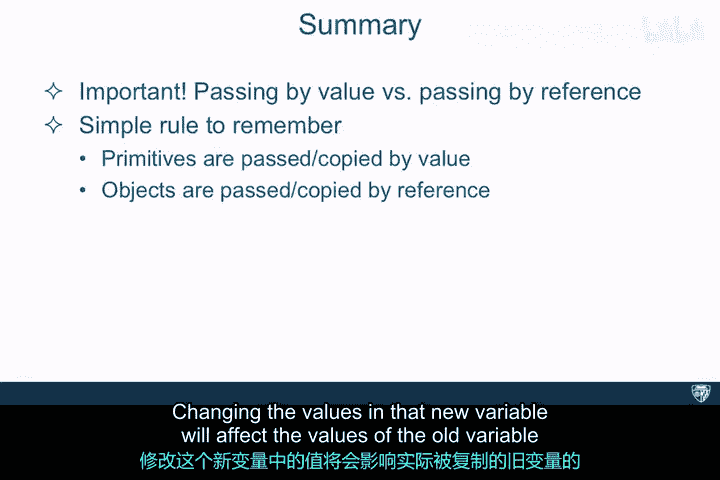
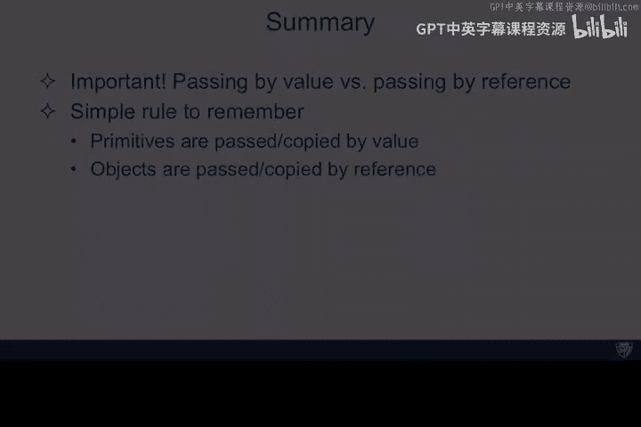

# 约翰霍普金斯大学《Web开发者的HTML, CSS, and Javascript》中英字幕 - P80：14_第47讲 第2部分 传值 vs 传址.zh_en - GPT中英字幕课程资源 - BV1WzY6z9EUd

Yeah。

In part one of our lecture we spoke about the theory and kind of try to understand what does it mean to pass something or copy something by reference versus by value in this lecture we're going to look at some examples so we can experience this concepts in code so I'm currently looking at lecture 47 at the script do Js file that is located in the lecture 47 folder I'm going to go ahead and close the file Expr here and sublime and let's take a look at our example code so here we have variable A equals 7 and then what we're doing is we're copying a into B and 7 obviously is a number so it's a primitive so it should copy into variable B by value which means B is no longer pointing anywhere to where a is pointing to so if we console them out Con log them out and let's go ahead and do that right now just comment this out for now you'll see that both are7 Now what happens when we change B equals5。

Well since B is pointing to its own memory location， B is not going to affect where a is pointing to。

 so they're both going to go in their merry way in other words after Bs update a is still going to remain to be7 and B now is going to be5's let's go ahead and save that and take a look so sure enough A is now7 and B is5 so that's pass by value let's go ahead and comment that out and let's take a look at a different example let's save that。

Take a look at a different example which is passed by reference and now we're speaking about objects let's un that So in the first line here。

 we're having a equal to an object literal that has a property 7 and then we're copying A into B so as you remember from the first part what we're actually doing is copying the memory location that it's pointing to this object literal into B not the actual values So if we now output A and B let's go ahead and do that you'll see that both object that have x property equal to7 So now if we go ahead and update B in other words B do x equals5 what we're actually updating is we're updating this object which both variables are pointing to so after update B X update if we log A and log B again you'll see that both a and B have changed the x value to B 5 so let's go ahead and save that。

😊，And you could see here after update x is now5 from logging A and x is still5 from logging B。

 and again， that is simply because they're both pointing to the same memory location。

So these two examples are examples of copying by value and copying by reference。

 but we've been using a different term called passing by value and passing by reference。

 and that term really only applies when we speak about passing value into function calls。

 so let's go ahead and take a look at one of those examples。

So that's uncommon that So here we have a function called change primitive and we're going to pass a primitive value into it。

 we're going to go ahead and tell our console that we're inside the change primitive and we'll log the value before we change it then we're going to change the value and log the value after we change it and afterwards we're going to go ahead and invoke that so we'll say the value equals7 we'll pass it inside that change value function and notice that when we pass value inside the change primitive function what is really going on is that the value7 is being copied and equal to prim value it's really no different when we're passing it here then saying and I'll put it in comments but in memory what's really going on is that prim value is being equal to value that's really what's going on so it's really a different form of copy that we saw before it's actually let's leave that alone so it be a comment here So and afterwards we're going to。

😊，Go and announce that we're done with change primitive and we're going to log our original value and the original value should stay7 even though we changed it inside the change primitive function simply because they're pointing to prime value and value I still pointing to different memory locations so let's go ahead and save that and we'll execute so we're in change primitive before it's7 because we pass seven so it got copied into this variable prim value and after right here。

😊，It's five because we change that and after change primitive has been called the original value of the value variable is still7 and it's because they're pointing to two different locations just like before it's really just a copy of the value itself it's not pointing to the same memory location so let's go ahead and comment this out so it doesn't crowd our console and save that and should clear it and let's go to the last example here and let's uncomment it and we're doing exactly the same things that now we're changing object and since objects are passed by reference what we should end up with is we should end up with the same object that's pointing to the same location so the setup is very similar we have a value that is a object literal with a properties x equal to7 and again when we're passing it into the change object function what we're really doing is we're saying value is equal to value and this is。

😊，The same thing that's going on in the previous example except that now we're calling it passing right because we're actually passing this value into the function change object inside the function we're again anno it we're inside the change object function kind of console out the object value that is passed into us changing the x value of it logging it afterwards。

 logging the entire object again just to see what it is after we change the X and then when we come back from the function we want to know what the original value is has it really changed because we change it inside the function and obviously it should change because both the object value and the value variables are both pointing to the same memory location so let's go ahead and save it。

😊，As you can see before object is x7 after object is x5 and after we call change object。

 the original value now is changed and it's x5 because both of those variables were pointing to the same memory locations so they are affecting the same values。

 so this is how passing by value and passing by reference works in code。

So to summarize， it's very important to understand this concept that is passing by value versus passing by reference。

 you can't really code and without understanding this basic concept。

 and the simple rule to remember is this， primitives are passed or copied by value and objects are passed or copied by reference。

 and again copying or passing by value means that the new variable really has no relation to the old variable and changing the value in it will not affect the old variable as opposed to passing or copying by reference。

 changing that new variable changing the value in that new variable will affect the value of the old variable from which the object was actually copied。

