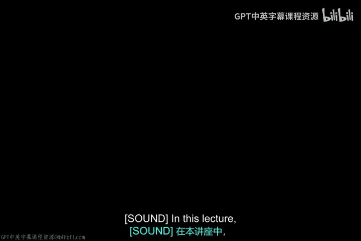
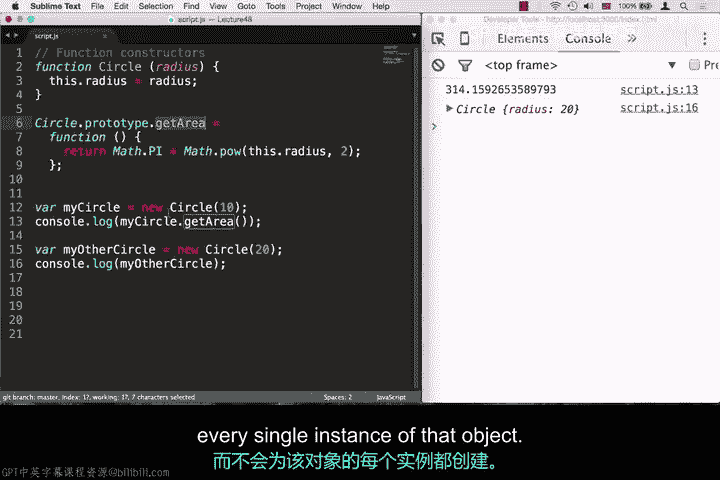

# 约翰霍普金斯大学《Web开发者的HTML, CSS, and Javascript》中英字幕 - P81：15_第48讲 函数构造器、原型与this关键字.zh_en - GPT中英字幕课程资源 - BV1WzY6z9EUd

Yeah。

In this lecture I'd like to show you one more way to create objects in ja。

 and it's a very common way， especially if you have functionality together with those objects very similar to like a Java class。

 for example， right now I am in script。gs and I am located in the lecture 48 folder let me go ahead and close the file Exper before we jump into yet another way how to create objects in Java。

 I'd like to explore one particular topic let's go ahead and write a function。😊。

And we'll call this function， let's say test and all we'll do this function is do console thatlog and we'll say hello Coursera。

Okay so if we save that now， well nothing is going to happen， we actually have to call that function。

 so let's go ahead and call the function test and now we see hello Coursera Now we discussed in one of the previous lectures as to what happens when you actually invo a function。

 We discussed the fact that a new execution context is created within which this line or whatever is inside the function is actually executed and we also discussed the fact that that execution context gets a special variable called this。

 Let's find out what this variable is pointing to as though console that log。😊。

True is we could just delete this and just put it right here and let's look what this is at this point。

 this special variable， let's go ahead and save that。

And this is pointing to the global window object， right。

 that's the object that has all of these parameters， all of these properties。 and in fact。

 if I actually set a property on this object， say this dot my name。😊。

Give it yaakov so if I save that and if I output this again and in fact I could do it right here。

 I could say this or window that my name and I could log that out， console that log。

And it will say yaov because what I did here is since this is pointing to the global object window that my name or my name property was created on the window object Okay so that's all nice and well but if we actually wanted to kind of encapsulate some data within a particular object and use a function for it。

 then we would need this to point to something else and this is where function constructors come in let's go ahead and erase that and create yet another function let's just say function constructors。

😊，Okay， so let's create another function and let's call this function。

 Let's call this function circle。 We're going to create circles。 And this time， we're going to say。😊。

Circle with capital C Now there is really nothing about capital C that does anything special other than it lets me know that it's a function constructor。

 So it's basically just a convention to let other developers know that this is a function constructor as opposed to a regular function and a circle should have a radius and what I'm going to do inside the body of the circle is actually nothing more than just say console that log and I'll go ahead and log this and here comes yet another way that we're about to learn as to how to create objects let's go ahead and create a variable called my circle and what I'm going to do is instead of just invoking the function circle I'm going to use the new keyword and then say circle and give it let's say10 as the radius When I invoke a function together with the new keyword。

 the jascript engine makes this point to the object itself that got created。

 which is the circle So if I go ahead and console that log the actual my circle and so now I'm going to。

😊，Consil log this and I'm also going to cancel that log my circle It really should be the same thing。

 Let's go ahead and do that and then both are empty objects that are of type circle or sort of of type circle。

 It's not a real type but it's an object with a name circle So this means that technically what I could do here is I could say this dot radius so I could create a sort of a member variable or a property of this circle object and I could say a radius。

😊，So now the radius that I am creating the circle with is going to be stored as part of my object。

 So if I go ahead and log circle now， you'll see that now I am a circle that has a radius property of 10 Now what's really going on behind the scenes here is that this line right here is really pretty much equivalent to saying new object as we've done before and then that object gets named after the function that created it so it's really a function constructor in that it creates a new object by executing this function in a special way using this special new keyword Now the function constructor itself or the function circle cannot return anything。

 So if the function returns， let's say an empty object an anti literal and I'll save that you'll see that we're not really getting the behavior we want my circle is now just an empty object so we can't return anything from the function constructor it has to remain without a return value and the new keyword will arrange for。

😊，That when it creates an empty object and then sets it to be a circle it will go ahead and return that object and store it in whatever variable that we're providing for it so let's save it again now we see how circle with the radius1 Now what would be an object without some methods and methods in ja adjust functions that are set on properties of objects so let's go ahead and create one let's go ahead and create a this dot get area and this dot get area is going to be nothing more than a function and let's go ahead and put this function on a separate line。

😊，And function is going to have no arguments because we're actually going to get at the radius using this key so we're going to go ahead and have curly braces well won't forget to say a semicolon here because this is just an expression that gets set to the get area variable and here we can use a JavaScript prettyfin object that actually has been pretty much created the same way that we're creating our circle so we'll say math that pi times and there's another math method that's called POW power of or this that radius。

😊，And we wanted to raise it to the power of two， and we'll go ahead and put a semicolon after that。

Okay so now we have a get area method or get area function that will calculate the area of the circle。

 So here we created a circle with a radius 10 and we're outputting the circle。

 let's go ahead and output my circle that get area and we need to put Parnin after it because this is a function and we're invoking it so now that we save it we could see that the area is been calculated so 10 to the second power so 100 times pi sounds about right let's go ahead and take a little bit of a closer look to this my circle object that gets created。

 let's go ahead and log it one more time。😊，And you see my circle object has a radius of 10 and if we open it up we'll see the radius of 10 and has another property called get area and the value of gi area is a function。

 The problem is as we keep creating this circle object over and over in our code。

 we're going keep creating this get area function over and over in our code because every time we say new this entire thing gets created while for radius it's perfectly normal because each circle should have its own radius we really don't need for our type circle to have its own get area on every object it create and really should be just created once and all the circles。

 all the instances of a circle should share it And the way we could do that is by using a special property called prototype So let's go ahead and cut this out of here。

😊，And we'll say， circle。That prototype， thatt get area。

And that is what is going to be equal to our function and the function is going to be anonymous since we already have the name get area right here。

 and again we don't need an argument because we're going to use this keyword and the body we're going to say math that pi times math power of this。

 that radius。To the second power， So that is actually what we need to return。Okay。

 so there's our get area。 So let's go ahead and before we even call get area ourselves。

 let's go ahead and take a look at my circle object one more time。

 let's go ahead and save this and I'll put in my circle object and we'll take a look and you could see that the radius is here。

 the radius equals 10 but get area doesn't exist here Well where is it Well it's actually sitting inside of the special variable underscore underscore Proto underscore underscore that's a special property if we open that up you'll see that get area now is right here and proto is something is going to be existent on every single instance of this object。

 So if we for example， create another one var my other circle。😊，And it will say new circle。

And we'll give it 20 as the radius。And we'll go ahead and console that log。My other circle。

You'll see that the radius here is 10 and there's no get area and the radius here is 20 and again both of them are pointing to the same prototype variable that have a get area and this get area is actually the same location and memory as this get area It's the same thing so it doesn't get recreated over and over Now a couple of words of caution。

 number one is circle that prototype that get area is not something you should cut and put inside this function。

 you could certainly do that but that would be a mistake and the reason that would be a mistake is because this function is going to get executed every single time you create a new circle while every single time you don't need to define a prototype In other words what you will be doing is youll be overriding the memory space of get area every single time you create a new circle so basically that's wasted processing。

 It's not really wasted memory space since it's going to put in the same memory space this function。

Over and over again， but it's wasted processing， so you really should not be putting that inside of a function constructor。

So definitely put this outside， let's go ahead in。Indent it this way。

 So that's cautiontient number one。 Qt number two is make sure you don't forget the new keyword because if you omit the new keyword。

 let's go ahead and comment this out。 let's go ahead and log this variable。

 you'll see it's undefined。 Well， the reason it's undefined is because this is nothing more than a function It's just a regular ja function。

 So a regular ja function that you're passing1 to and actually does not return anything。

 Well when it doesn't turn anything this my circle becomes undefined。

 And if you actually try to say that get area。😊，Right we're going to get an error because it says cannot read property get area of undefined because my circle at this point is undefined。

 so make sure remember to put the new key there。 one clue is to always make the function constructor names capitalized。

 That's why you will remember that this is not just a regular function It's actually a function constructor and you must use it with the keyword new okay so let's unment this back out and save it and now everything works as we expected。

 So these a function constructors， you could create an object using them using the keyword new and you could set a prototype property on that function such that whatever property you set on it will only be created once and will not be created for every single instance of that object。

