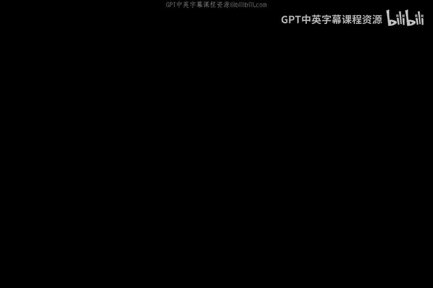
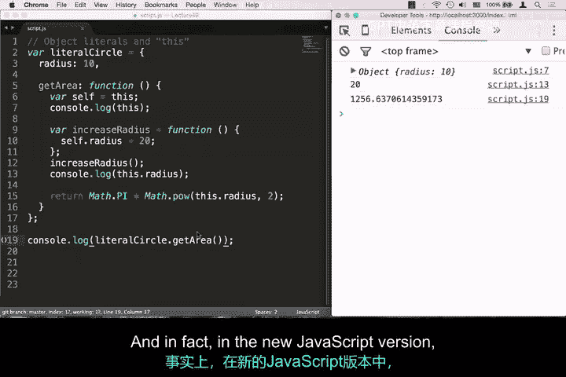

# 约翰霍普金斯大学《Web开发者的HTML, CSS, and Javascript》中英字幕 - P82：16_第49讲 对象字面量与this关键字.zh_en - GPT中英字幕课程资源 - BV1WzY6z9EUd

Yeah。

In the previous lecture we saw how this keyword behaves itself when it's part of a function constructor that is it's referring to the function itself or the object itself when that function is invoked together with the new keyword in this lecture would like to look at object literal and how the this keyword behaves itself inside of one so I'm looking at scriptgs and located in the lecture 49 folder so let me go ahead and close the browser and let's create an object literal what' called literal circle since we've done circles before and an object literal is just two curly braces and don't forget the semicolon at the end。

😊，And we'll give it a radius of 10。 Okay， so an object literal with the radius of 10 and we'll also we'll put a comma and we'll give it at get area and get area is going to be a function。

 its value of this property is going to be a function。😊。

We don't need the name already have get area and we're not going give it the argument either。

 What we're going to do is we're going to do console log and we'll console log this right inside the get area method。

 So let's go ahead and save that and once we created that object literal。

 let's go ahead and call the get area function and see what happens when we do console log this we obviously have not really yet at least calculated the area So let's go ahead and save that and we'll see that what's going on here is that this is no longer referring to the window object to the global object but it's actually referring to our circle class our literal circle which is an object with the radius of 10 if we open it up。

 we'll see that it has a get area property in a radius of 10。

 So when an object literal gets created this instead of pointing to the global object is actually pointing to the actual object that got created。

 therefore what we could do is we can do return math。😊，That pi times math dot power。

 and we could say this dot radius。To the second power。

 So this is referring to the literal circle object and it has a property called radius。

 which is right here。 So therefore， this is perfectly legal and it should work just fine？

 So let's go ahead and actually console that log the answer to our get area execution And when we execute that we do get 314 and so on？

 So this actually work just fine Now， why is that， Why is it that this is working。

 Why is this keyword referring to the object instead of referring to like any your other regular function to the global object like window。

 Well， believe it or not， you already know the reason to this And the reason you know this is because when we discussed object literals I told you that this statement right here when you open the curly braces is really tantamount to what。

😊，New object。So when that happens， this is actually what's executed in the background new object well you see that new keyword again。

 and when we see the new keyword this variable inside of that object is now referring to the actual object and not to the outside window or outside global object so this in fact works exactly like functional constructors in terms of the new keyword right even though the new keyword here is kind of implicit。

 well everythings here implicit since this is an object literal。😊。

Now there is a bug or at least what most people consider is a bug within the JavaScript implementation in every single browser it's really within the JavaScript specification and the bug comes out in this fashion。

 if inside Git area I will go ahead and create another function just like I can and I'll say var increase radius。

😊，And it's going to be a function and I don't need a name again。

 and I don't really need an argument here either and inside the body of the function。

 I am going to go ahead and increase the radius to 20， so I'll say this dot radius。Equals 20。

 So now when this method executes right here this line executes right here。

 this thatt radius should now be 20。 so it shouldn't be 314。

 It should be a much larger area of the circle。 So let's go ahead and actually invoke which is defined this function here。

 Don't forget the semicolons because that's an expression let's go ahead and invoke this function right here。

 So now after this in。 this thatt radius should be 20 and this whole line should execute with the value of this thatt radius equals 20。

 So let's go ahead and save that And what do you know it's still 314。 That's kind of strange。

 Well let's go ahead and console that log。What our radius is， this that radius。

 What exactly is our radius before we execute this。 But after we increased the radius。

 let's go ahead and save that， and it's still 10 Now where did this 20 go。 Well。

 the way this works is that when you have an inner function within another function this keyword starts pointing to the global object。

 And we can actually test this by saying window that radius and this should say 20 and so it does。

 So this 20 actually got set on the global object instead of on our literal circle object。

 So how do you get around this。 Well， there's a common pattern that people use to get around this。

 And the way you get around this is you just say var self equals this So now that you have self self is always going to be referring to this and this at this point。

 at least is referring to the literal circle object。 So instead。😊。

In the inner functions referring to this， you always refer to self so now radius is equal 20 and now this should update the radius inside the object literal inside our literal circle so when we execute this line right here this that radius should be equal to 20 not 10 let's go ahead and execute this and as you could see now our radius is indeed 20 and the area is much larger so this is the way you get around this kind of an annoying JavaScript bug and I guess there is a disagreement out there whether or not this is a bug or this is intended and this is how it's supposed to work either way it's not really very useful and in fact in the new JavaScript version which is ECcma 6 this supposedly has been fixed。

😊。

