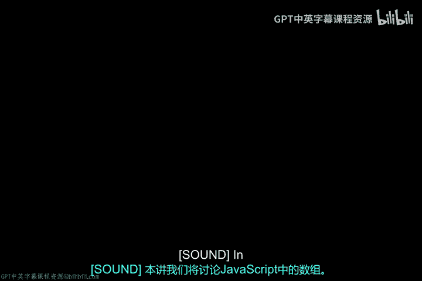
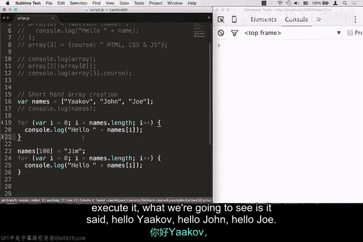

# 约翰霍普金斯大学《Web开发者的HTML, CSS, and Javascript》中英字幕 - P83：17_第50讲 第1部分 数组.zh_en - GPT中英字幕课程资源 - BV1WzY6z9EUd

Yeah。

In this lecture we're going to speak about arrays in ja I'm assuming you already know what arrays are。

 but if you don't arrays are just a collection of data in ja， however。

 since we have dynamic typing array take on a pretty interesting set of properties so right now I'm in sublime text and I'm looking at scriptjs and I'm located in the lecture 50 folder so let me close the browser and let's create an array so let's call it var array and we'll say new array once I created the array。

 I can now set items into that array and arrays are zero base so I could say zero and let's say in the first position which is position  zero I'll place a string and I'll use my name yaakov in the second position which is position1。

😊，I'll place a number， let's say two in a third position。Which is2。I'll place a function。

 and let's say it's going to be function that you could pass a name to and let's put a。

Semiccolon there and all of this function is going to do is just going to say hello and whatever the name is plus name。

 Okay， so in the third position， which is right here the fourth position。

 as should say I am going to place an object literal well put a semicolon over there and object lit will say course。

 that's the property name and the name of the course is HTML， CSS and JavaScriptvascript。 Okay。

 so here's my array And if I do console that log。On the array itself。

 you'll see that we have the array and as you can see inside the array。

 we have different types of objects stored there， some of just primitives and some are strings。

 some are functions， which are also objects and some are just objects。

So because of dynamic typing in JavaScript I'm able to store different types of objects in the same array。

 which is not true of most languages， most languages when you have an array。

 and you store data in an array， the data in one particular array has to be of the same type and if you want to have more than one type you have to separate it into separate arrays and just like I set the values using this brackets operator。

 I can also retrieve the values using the brackets operator so for example I could say console that log。

And I can output array sub1 or sub1 right here。 So array sub 1 meaning I want to go to the second item in the array。

 which is right here and I want to output it to the screen using console that log so if I save that and see it prints out2 Furthermoremore since at position 3 or really at index 2 here we have a function I can invoke this function very easily using their annotation so I'll say array and it's at position2 so I'll say position 2 and now since at position 2 is the value what's sitting in here in this position2 is the value of the function so that's the function value。

 not the return of the function but just the function value which means in order to invoke it all I have to do is put parentheses after it and once I do I can save it and undefined and the reason it says hello undefined is because I never pass name so let's go。

head and say yaakov and save that now says hello yaakov but I can even do something more more fun than that I can actually pass in the array because I already have yaakov stored here so I could say I'm passing in an array and it's in position zero so now what I'm doing is I'm retrieving position0 of this array which is yaakov string and I'm passing it to position2 value which is the value of the function。

 so the function is getting executed against the value yaakov so if I save that I'll get again same thing hello yaakov likewise I could certainly retrieve a property of a literal object that is stored inside the array so I could say here console log and I could say array sub3 or index3 and I could say dot course and that should print out HTML CSsS and JavaScriptscript let's go ahead and save that。

😊，And it says HTML， CSS， and JavaScript。Okay， I can also create arrays using a shorthand array notation。

 so let me go ahead and comment this out so it doesn't create our console so we'll save it and we'll clear the console let's go ahead and say shorthand array creation Okay。

 so what we're going to do is save var names。😊，And we're going to create an array simply by providing an empty brackets。

 so empty brackets now creates an array in the variable names and what I could do is I could start listing my names Yaakov John。

😊，Joe， let's see。Okay， so if I do console that log now on the names。

 I should say that see that array right there， yaakov John and Joe， So that works great。

 So now you see there's two ways to create an array one is kind of longhand nottation where you say new array and the other one simply by kind of like an array literal something like that。

 But you just use the brackets and you separate the array values by a comma and again。

 I could put whatever I want in here。 So if I wanted to。

 let's say I can actually use spacing here like this and if I wanted to。

 I could create an object here So let's say I could create an object and say name yaakov。😊，And comma。

 there's another object here。 If I wanted to have an object， will do。

Name John and I can actually leave it here because thes are not restricted to have the same type。

 So if I save that and I'll see object objectject Joe right so if I actually opened that up。

 I'll let me open this object you'll see array yaakov name yaakov and the same one is second one is name John Okay but let's un do that for now。

 Let's go back to the regular array we had before and let's go ahead and loop over this array printing out each name。

 let's say say hello to each name So for that we're gonna use a regular4 loop， we'll say v I equals0。

😊，And we need to keep looping until it's the end of the array while there's three items in the array and each array object has a special property called length and it's not a function。

 it's just a property that the ja engine sets for you so array names that length will give me the length of the array in this case it'll be three So what I'm saying is is that I want my loop variable to be0。

1 and2 and when it's three it's no longer going be less than the length of the array and it will quit okay so let's go ahead and print hello to the console so we'll say console that log and we'll say hello space。

😊，And then we'll say names。Bracket I So now every time through the loop。

 the eye is going to change and it's going to say hello to a different name。

 Let's go ahead and maybe comment that out so we don't see that on the console and we save it and we say hello yako hello John hello Joe Now what's interesting about a raise in ja is that they can even be sparse go ahead and make some room here and I could say something like names and I could say names 100 and I could set that value to be let's say Jim So now we have an array that has01 and two index and an 100 index and then between there's nothing there So if I actually go ahead and take that here and paste that loop right here and execute it what we're gonna see is it said hello yao hello John hello Joe and it starts that again hello yako hello Joe and then 97 times it just says hello undefined because what we're doing here is we're saying I want you to retrieve names with a index of four and5。

😊。

And6 and so on and those indices just don't exist in this particular array， but 100 does exist。

 so therefore you see when it gets to 100， it prints out hello Jim。

There is one more issue with the raise that you should be aware of and we'll discuss that issue in part two of this lecture。

