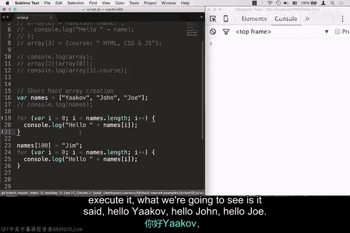

# JavaScript 入门：50.1：数组


在本节课中，我们将要学习 JavaScript 中的数组。数组是用于存储数据集合的核心数据结构。由于 JavaScript 的动态类型特性，数组展现出一些非常有趣和灵活的特性。

## 创建数组

上一节我们介绍了数组的基本概念，本节中我们来看看如何创建数组。在 JavaScript 中，主要有两种创建数组的方式。

第一种是使用 `new Array()` 构造函数：

```javascript
var array = new Array();
```

创建数组后，我们可以使用方括号 `[]` 和索引（从0开始）向其中添加元素。JavaScript 数组可以存储不同类型的数据。

```javascript
array[0] = “Yaakov”; // 字符串
array[1] = 2; // 数字
array[2] = function(name) { // 函数
    console.log(“Hello ” + name);
};
array[3] = { // 对象字面量
    course: “HTML, CSS & JS”
};
```

第二种，也是更常用的方式，是使用数组字面量表示法，它更简洁：

```javascript
var names = [“Yaakov”, “John”, “Joe”];
```

## 访问数组元素

创建数组后，我们可以使用相同的方括号语法来访问其中的元素。

以下是访问数组元素的几种方式：

*   `console.log(array[1]);` // 输出数字 2
*   `array[2](“Yaakov”);` // 调用存储在索引2处的函数
*   `console.log(array[3].course);` // 访问对象属性，输出 “HTML, CSS & JS”

## 遍历数组

为了处理数组中的所有元素，我们通常使用循环。`for` 循环是最常见的选择，它利用数组的 `.length` 属性来确定循环次数。

```javascript
for (var i = 0; i < names.length; i++) {
    console.log(“Hello ” + names[i]);
}
```

## 稀疏数组

JavaScript 数组可以是“稀疏的”，这意味着数组元素之间的索引可以不连续。你可以直接为某个较高的索引位置赋值。

```javascript
names[100] = “Jim”;
```



此时，数组 `names` 在索引 0, 1, 2 和 100 处有值，而索引 3 到 99 是“空”的。如果遍历这个数组，这些空位置会输出 `undefined`。


本节课中我们一起学习了 JavaScript 数组的创建、元素访问、遍历以及稀疏数组的特性。数组是组织和管理数据的强大工具。在下一部分，我们将探讨数组的另一个重要特性。