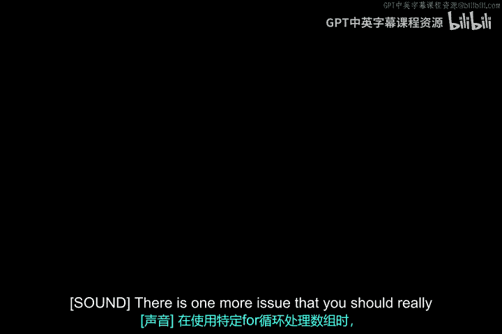
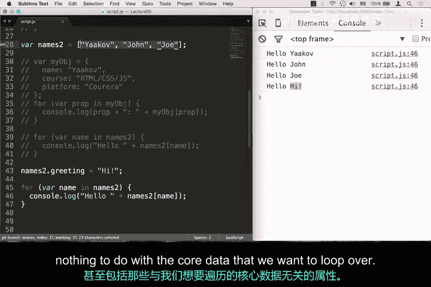

# 约翰霍普金斯大学《Web开发者的HTML, CSS, and Javascript》中英字幕 - P84：18_第50讲 第2部分 数组.zh_en - GPT中英字幕课程资源 - BV1WzY6z9EUd

Yeah。There is one more issue that you should really be aware of when it comes to using a certain for loop with a array。

Let's go ahead and comment all this out and I'll go ahead and copy my array one more time and I'll just call it something else。

 I'll call it names two maybe let's see names2。So I have it names two array and again it says yaov John and Joe Okay。

 so let's leave that aside for now and let's create an object literal we'll create object。

 Ill say my ob and we'll create it as an object literal we'll put the semicol in there and we'll say name。

😊，Yakov we'll say another property course。HtmL， CSS， JavaScript， comma， and we'll say platform。

 Coursera。Okay， so that's good enough。 So now there's something we actually haven't seen yet and I haven't shown you and there's a special for loop that you could use to traverse the properties of an object so this for loop looks like this it's a for and you declare it as aar prop in my object so basically it'll say I want to grab every property in my object this is what this prop is going to be so it's very convenient for objects because objects don't really have indices like an array does it has properties so let's go ahead and console that out。

😊，Counsl that log， propp。And we'll say semicolon here， well add that in and we'll add my object。

And we'll give it prop again since that notation and the brackets notation are equivalent。

 I'm allowed to do this， so this is lets us kind of a calculate in the calculated property Okay。

 so if I save that。😊，And I'll see that it's printing out name that's the name of the property and the value。

 name of the property and the value name property and the value。 Okay， that's all great。

 now we know that in JavaScript arrays are just objects and the indices are just property names so technically speaking I could use the same type of for loop on my names to array as well so let's go ahead and try that let's actually comment this out for a minute so we don't have it crowd our console let's make a little bit more room okay so now let's say four name in names。

😊，So sounds pretty good， so we'll say console。log and we'll say hi， hello。

 and we'll say names and we'll use a computed property notation name so every time through the loop。

This name will be equal a different property of the array。

 so in the first time it will be equal0 because that's a property name of the array。

 the second time will be equal1 and the third time it will be equal2 so this should work。

 let's go ahead and save that。And I messed up something here。 Nas is not defined。 Of course not。 Na2。

 Let's go ahead and say names2 here。 Let's save that again。 names2 is still not defined。

 and that's because I didn't put names to right here。 Okay， so now it will work。

 So now it says hello Yaov hello John and hello Joe。

 but the problem with this for loop is that array our objects after all。 So for example。

 there's nothing wrong with me saying names to that greeting。😊，Is equal to hi。

 let's say I want to save a specific greeting that I want to use。 So now if I use the same array。😊。

Go ahead and copy that and say afterwards， hi， and now if I use the same array and let's go ahead and comment that out for a minute and save it。

 what I'm going to get is hello yaak of hello John hellojo hello high。

 Now the reason that is is because the greeting became a property of their array。

 no different than a number0 or number two or number one and so on。

 greeting becomes a property of their array。 and this for loop loops over the property names of the object。

 And since again， arrays are just objects in jascript。 This four loop will loop over properties。

 even over properties that really have nothing to do with the core data that we want to loop over。😊。

