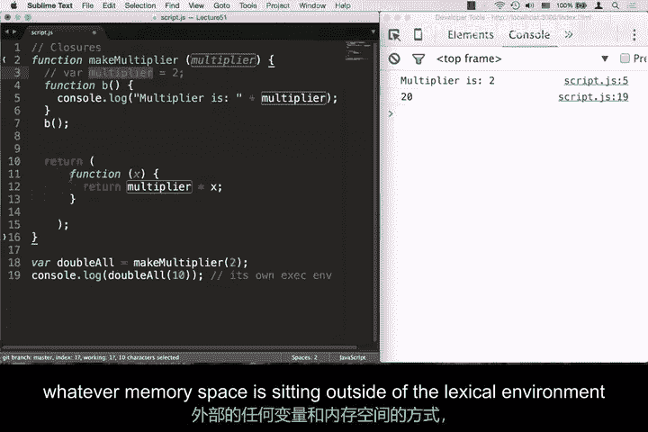
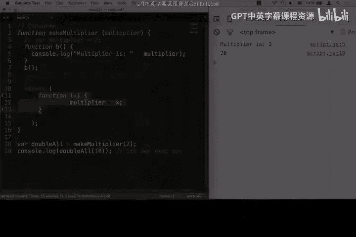

# 约翰霍普金斯大学《Web开发者的HTML, CSS, and Javascript》中英字幕 - P85：19_第51讲 闭包.zh_en - GPT中英字幕课程资源 - BV1WzY6z9EUd

Yeah。

In this lecture， we're going to talk about JavaScript closures。

NowCs is a pretty essential topic to understand， in fact， without this concept implementing the ja。

 something like Ajax wouldn't really even be possible and believe it or not。

 closures is something you've already seen。 So right now I'm looking at my sublime text at Sc dojs and I'm located in lecture 51 folder。

 let me close the file browser and let me give you an example that you've seen before。

 let me create a function。And the function we'll call make multiplier。

And we'll pass it an argument called multiplier and in this body of this function。

 we're going to return and what we're going to do is we're going to return a function。

 so we're going to say return， let's put parentheses around this so we could see it a little bit better with a semicolon at the end。

And what we're going to do is we're going to return a function。Function without a name。

 we don't need a name for it。Because it's just a value of the function and the function that we're returning should be able to take one argument。

 let's call it x， and what we're going to do is we're going to return multiplier times x。

So this function make multiplier is going to take a multiplier that is supplied to it some number and is going to return another function as part of its return value that is going to take an argument a number and is going to multiply it using the multiplier provided in the outer function。

 So let's go ahead and execute this function。 So let's say v double all。

We're going to double everything and double O is going to be equal to make multiplier。😊。

Two so double all is now a function that doubles everything， so let's go ahead and say console。logg。

Double all and let's say 10。 And when we save that。 And when I save that。

 it will go ahead and take 10， multiply it by 2， and we should see 20 over here。 So let's save it。

 and 20 is what we see。 Okay， great。 Now let's for second understand how did this work out。

 the very first time we called make multiplier， we pass it a value of two。

 So now when we get to this portion right here， it's really no different than saying var multiplier right there equals to 2。

 That is really what's going on。 So according to our rules。

 I should be able to use this multiplier inside of an inner function。

 So before even get to the return。 let's go ahead and create another function， let's call function。

 I don't know what's call it function B。 and we'll just say console do log multiplier is。😊。

And we'll output the multiplier。And let's invoke the function right there。Now。

 when we invoke a function， let's go ahead and do that。 save it。

 We invoke to function and says multiplier is 2。 Now。

 how does the inner function right here B know that the multiplier is2 Well we spoke about what happens when a function is executed。

 When a function is executed， it gets a few things。 number one， it gets its own execution context。

 So it's isolated from everything else。 number two， it gets a special this variable。

 we spoke about that before。 number3， it gets a reference to its outer lexical environment。

 So when a variable is referenced inside of a function。

 the first thing it does is check whether or not this variable has been defined inside of its local lexical environment。

 meaning has the multipier variable been defined inside the B function and the answer is it's not。

 it's not defined And if it's not defined it means the next thing that the jascript engine does it looks at the outside lexical environment of this function。

 Well the outside lex。😊，Environment dysfunction function meaning where it's defined the outside of that is the make multiplier function and the make multiplier function has that variable。

 so once it finds it it goes ahead and uses it in the function B that we're executing right here Now that's all great Now let's take a look at our return statement。

😊，The problem is that our return statement doesn't really create its own execution environment because this is not a function execution。

 This is just a function value。 This is an object， a function that gets returned back to the color of the make multiplier function。

 Okay so if this is not an execution of the function that means it doesn't get its own this variable。

 it means it does not get an auto of reference， it simply gets returned to the color。

 So now when it gets returned to the color in this line right here。

 So this variable is now equal to this function。 And in the next line when we actually execute double all and pass it at 10。

😊，This function is now finally being executed， which means it is now getting its own execution environment and it is now in this line right here。

It gets its own execution environment and it gets its own outer variable environment and so on。

 So how then can it possibly know what the multiplier variable is because at the time that this is executing The make multiplier function is no longer in the execution stack。

 It's done it return whatever it needed to return。 and it's no longer functioning， It's done。

 it's popped off the execution stack Well， the reason this is still works is because of jascript closures。

 Since a function like this is returned from inside of this function。

 jascript preserves its outer lexical environment memory space for this function So this function can go ahead and produce what it needs to produce。

 So the multiplier is something that's still sitting in memory in lexical outside scope of this function。

 So even when we call double all it will go ahead and execute this function。😊。

Create its own execution environment， it will go ahead and look for the multipier variable in its own execution environment。

 it will not find it and it will then try to look for this variable in its outer lexical environment and the outer lexical environment memory space will still remain even though the make multiplier function no longer exists that's how we basically are able to trap or to close in whatever variables and whatever memory space is sitting outside of the lexical environment of this return function and that's how closures work。

😊。

