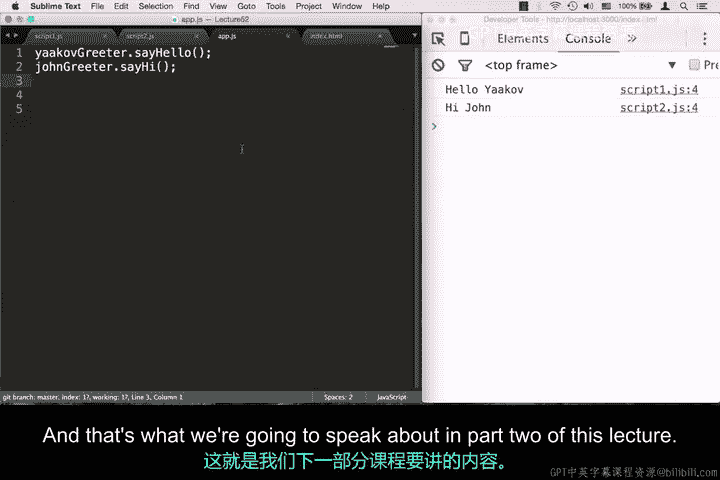

# 约翰霍普金斯大学《Web开发者的HTML, CSS, and Javascript》中英字幕 - P86：20_第52讲 第1部分 伪命名空间.zh_en - GPT中英字幕课程资源 - BV1WzY6z9EUd

Yeah。

In this lecture we're going to speak about a pretty common scenario and how to resolve it and we'll look at some best practices as well right now I'm in sublime text and I'm located in the lecture 52 folder let me go ahead and close the file browser here so you can see a little bit better and I'm looking at index that are HTML at a moment what I'm doing here is I'm actually loading three scripts one after the other Sc1gs script 2gs and Abgs So this happens a lot when you actually import a couple of libraries and so those libraries could be something you wrote yourself what it could be external libraries as well but in this case these are two libraries that I wrote myself and they are very very simple The first one is just declares a variable name it's my name yaakov and then the function say hello and the function say hello does nothing more than just says logs hello plus the name and it'll just say hello yaakov script number two which。

is what is declared afterwards， script number two is declaring a name John and then it declares a function called say hi and all it does again is just logs hi plus the name John。

Now Abd Js， this is the third one in the list here here， Abd Gs， it invokes， say hello。

 this is from the first one says hello， so it should say hello Yaakov， and then it invokes say hi。

 which is right here and it should say hi John， let's go ahead and save this and see what the console prints out。

We save it and says hello John， and then hello hi John。 Now that's kind of strange。 hello John。

 it really should have said hello yaakov not hello John。

 Now why is this happening Well it's actually pretty simple why this is happening。

 If you look at our index at HTML the first thing that the browser loads is script 1 do js and script do1 dojs declares a variable name and this name variable is sitting in the global scope and it's also declares a function called hello say hello again in the global scope。

 So when this executes， it will take whatever name variable is sitting in the global scope。

 Now right after script 1 we're loading script2 dojs which again declares name in the global scope。

 which basically means that at this point right here。

 my name equals yaov gets overridden with name equals John and then we declare another function。

 which is a little bit of a different name that says hi。😊。

Say hi and that is the one that prints out hi plus name。 So by the time we get to say hello。

 our name variable has actually changed from yaakov to J。

 And what's going on is that one script is stepping on the toes of the other basically So how do we solve this situation when one way of solving situation is introduced namespaces and namespace is basically just a container for some functionality and for some declarations。

 The only thing is is jascript doesn't really have namespaces that other languages have However。

 in ja we could fake namespaces very easily。 let's go to script script 1gs And instead of just saying yaakov here。

 let's declare a variable called var yaakov greeter。😊。

And we'll just make it equal to an empty object Now instead of just declaring name right here in the global scope。

 what I'll do is I'll declare name as a property of yaakov greeter。

 so yakov greeter that name is yaakov and function will be the same way I'll just cut it out of here and I'll say yaakov greeter dot say hello equals this function。

 so now I have yakov greeter and I can now refer to the name and I could refer to say hello as through yaakov greeder one more thing I need to change is this name right here really should be not just name but yakov greeter name。

😊，Okay， so we're good here。 if we go to now script2 dogs， we could do the same thing。 we'll say var。

John Ger and we'll make it equal to an empty object and now everything else that we have in this file we're going to start with。

 we don't need to declare a variable anymore because we already have one。

 we're going to start with this John Ger so here it's going to be John Ger do say hi。

And we're going to take out let's say hi out of here。And this again is going to be John Grer。 name。

Okay so now that we've converted this to a namespace and now everything that we are referring to inside this in terms of the variable names and the functions are going to have to go through these namespace object so inside our app do Gs in order to say hello that's no longer going to work so if I go ahead and save this and save that you could see here now it says that say hello is not defined well it's not defined because in the global scope there's no such function as say hello however there's an object that has this function attached to it So if I say yaakov greeter。

😊，That's say hello and this will be John。Greer that say hello that' say hi and I save that you could see how now it says hello Yaakov and Haija。

 so that worked perfectly， So this is something that you could do in order to separate kind of your namespace and separate your functionality into separate files and also into separate namespaces so you don't step one upon the other。

😊，But there's something you could do to go even further in order to separate different variables that are sort of like private variables between different scripts and different execution contexts。

 and that's what we're going to speak about in part two of this lecture。😊。

