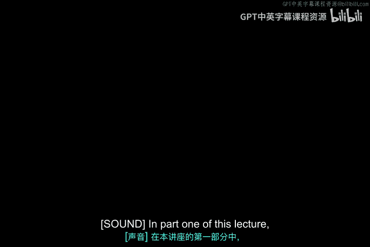
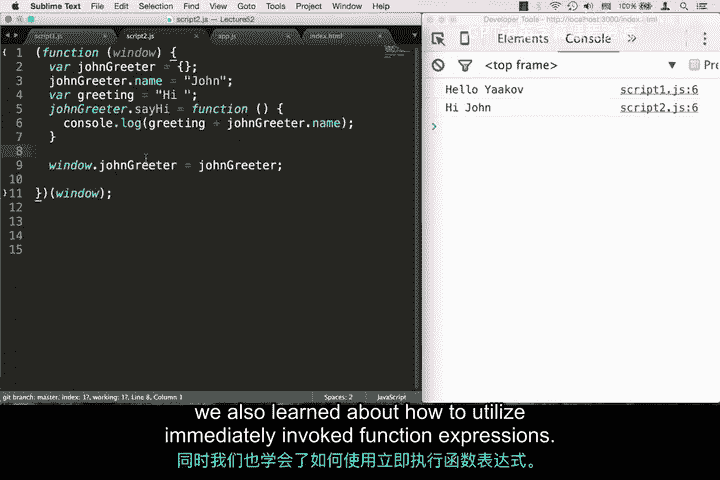

# 约翰霍普金斯大学《Web开发者的HTML, CSS, and Javascript》中英字幕 - P87：21_第52讲 第2部分 立即调用函数表达式(IIFE).zh_en - GPT中英字幕课程资源 - BV1WzY6z9EUd

Yeah。

In part one of this lecture， we spoke about faking namespaces using ja objects such that certain variables and functions can coexist in the global scope without stepping on each other's toes so to speak but there is something you could do to go even further a lot of the times when you have a bunch of functionality sitting in a script a lot of it it's not really something that you'd necessarily even want to put into some namespace Sometimes you just wanted to execute when the browser loads that jascript。

 you just wanted to execute and kind of go away so you don't necessarily need to put it in a namespace So for example。

 if I didn't want to hardcode the string， say hello if I wanted to， for example。

 let me cut it and say greeting。😊，In this greeting I just want to declare as a regular variable。

 so I just want that to be a string， so I just want to be able to use that string inside of my say hello function。

 Well I could do the same thing Vaar equal greeting in the script number two and say var greeting except this time I want to say hi and just substitute it with。

😊，Greeting。Well we kind of have exactly the same problem again。

 don't we greeting now is going to be part of the window object part of the global object in script2 and in script1 is going to be again part of the global object so once again I'm going now end up with Ha Yaakov Hajan instead of helllo Yaakov Hajaan。

😊，Well， one more thing we could do is introduce something's called immediately invoked function expression。

 Let's go to our app Gs and I'm actually going to comment this out for a minute and show you what immediately invoke function expression is I'm sure you've seen a function before that in this course that we've done where let's say we're just gonna go ahead and console that log say hello Cosera okay so in order to now for us to execute this function we need to say a and put our print behind it right and go ahead and save that and now you'll see hello Cosera and you also remember that I could save this function in a variable so I could say var a equals function hello Cosera and this is exactly the same thing if I save this you'll see it will refresh and'll say again hello Cosera Well the way we execute a function is by putting these print behind its name well remember function is just a value this whole thing is nothing more than an。

😊，It's a function object。 so technically speaking， I could just wrap it in parentheses right here as just an object right So if I save it again。

 nothing really changes。 Well， how do I execute a function again。

 I execute by putting parentheses right behind it。 Well then it follows that if I erase this variable right here。

 I can invoke this function right in line by just putting parentheses right after its declaration。

 So this function is going to produce this declaration right here is going to produce a function and the parentheses right behind it is going to invoke it immediately。

 So this is what's called immediately invoked。😊，Function， expression。Otherwise known as。Ify。

So immediately won't function expression， it's an expression because this line right here or this set of code is actually something that produces a value。

 thus it's an expression， something that produces a value， well what value does it produce。

 it produces a function object and then we're taking that function object and we're just putting parentheses right behind it and that invokes that function object and therefore when we save we' once again going to see hello Cosera。

😊，And I could certainly even pass parameters to it， for example。

 if this function wanted a name to be passed to it， and instead of just saying say hello。

 I'll just say hello plus name， so if I execute it right now， what do you think is going to say？

It's going to say hello undefined， Why is that well because it's asking for a name to be passed to it and we're passing nothing to it。

 so let's go ahead and pass Coursera。And when we save， it will say once again，Ho Coursera。

So in the same vein， let me go ahead and comment this out。

 so you have it for your record so to speak and I will uncomment the greeter。 if I do this again。

 it's still say hi and hi。 So how can we separate that。 Well if we go to script1。

 we could wrap this entire thing with parentheses function。😊，And wrap this whole thing。

Into a function。 So now this whole thing is sitting inside of a function， technically speaking。

 I could just。😊，Indent it a little bit like this。 So this whole entire thing and sitting inside of a function。

 And if I just leave it like this， this would be kind of bad because all I would be doing is declaring a function。

 Well， I't want to just declare。 I actually want this code to execute So in order to get this code to execute and execute just onload of script swaas All I need to do is put parentheses behind it and put a semicolon So now this is going to execute the second it loads。

 Now， if I save that， this is not really going to work。 Why is that， Well， because in Abda Js。

 yakov grider that's say hello is undefined is not defined So where is yakov greeter。

 Because this is at this point is looking in the Windows object to see where yakov grider is and yakov grider is not defined there because now we've put it in its own execution context So yakov grider is only living inside of this function So how can we expose this yakov greeter to the window object。

 Well， we could go ahead and。😊，The window object as part of the parameters to the function。

 and we'll say window here。And at this point， when we say yak of greeter。

 we can even do it right at the end， we could just say window， that's this window right here。

That yakov greeter equals to yakov greeter。 So now what we've done is we've exposed our yakov greeter object and we placed it into the window object。

 We can expose it to the outside。 So now when we're in Abda Gs。

 yakov greeter is indeed exposed to the outside。 So let's go ahead and save that。

 And now you could see hello yaakov hijan。 And the truth matter is even here。

 we still want to do the same thing。 And in fact， let's go do it this way。

 Usually the way we want to type it up is not try to wrap those curly braces all around。

 It's very confusing that way。 But instead do this。 you have parentheses。 You know。

 there's going to be a function inside of it。 And I know I'm going to want to invoke that function。

 So really， I'm going to put the parentheses right behind it and put a semicolon at the end。

 So now all I need to do is declare this function。😊。

And the function is going to have the parentheses right behind the word function and cur the braces。

 and now I could just open it up and take this entire thing。😊。

Cut it out of here and maybe even indent it， place it over here， let's indent it a little bit more。

And there it is， except again， the junk reader， we want to expose that junk reader to the window object to the outside。

 So we'll go ahead and pass the window object here and pass it in here and now right at the end。

 or we could do it right here， it doesn't really matter where， but we could do it right at the end。

 we could say that window。😊，That John greeter is equal to junk greeter。

 So the windowju greeter we're creating a new property on the window object and we're setting it to the ju greeter that is the object that we set inside of this execution context of this function so we save that and now we see hello yaov hija So notice we were able to use something that we want to expose outside in other words。

 whatever we wanted to expose outside， we simply placed it as a property on this John greeter object and whatever we wanted to use inside like a greeting So like almost like a private variable we could still use and we could still use it inside the function and we don't have to expose it to the outside and at the same time this greeting was not going to collide with this greeting inside the yakakov greeter or inside this function basically but not inside the yakov we just inside this function because each one of those variables is being defined in their own execution context meaning in this function。

😊，This greeting is being defined in this function， so what we've done is we've learned about namespaces or at least how to fake namespaces in JavaScript。

 which is totally legitimate and we' also learned about how to utilize immediately invoked function expressions。

😊。

