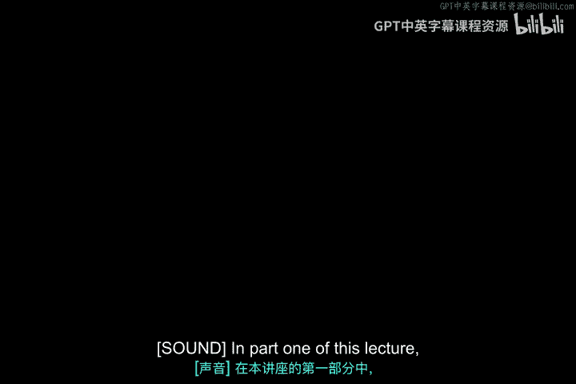
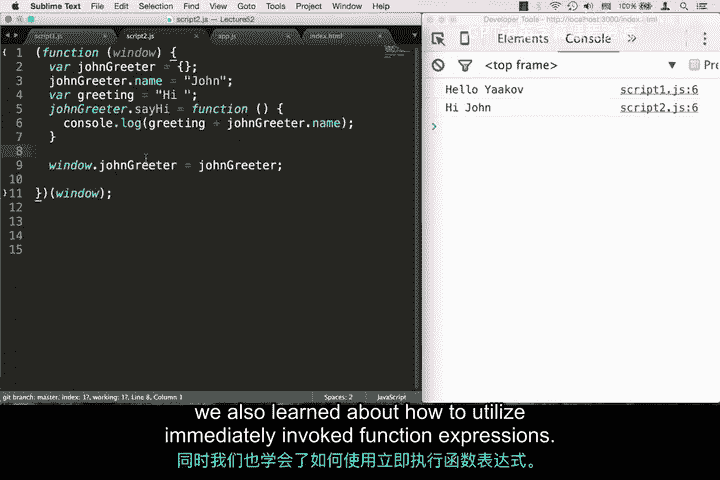

# JavaScript 核心概念：52.2：立即调用函数表达式(IIFE) 🚀



在本节课中，我们将学习如何通过立即调用函数表达式（IIFE）来进一步管理代码，避免全局作用域中的变量和函数冲突。这是一种创建私有作用域并选择性暴露功能的强大技术。

## 概述

上一节我们介绍了如何使用对象来模拟命名空间，以隔离全局作用域中的代码。本节中，我们来看看一种更彻底的方法：立即调用函数表达式（IIFE）。这种方法允许代码在加载时立即执行，并创建一个独立的作用域，从而避免污染全局命名空间。

## 从问题出发

假设我们有两个脚本文件，它们都定义了一个名为 `greeting` 的变量。当这两个脚本在同一个页面中加载时，后加载的脚本会覆盖先加载的脚本中的 `greeting` 变量，导致意外的行为。

例如，`script1.js` 可能包含：
```javascript
var greeting = "Hello";
function sayHello(name) {
    console.log(greeting + " " + name);
}
```
而 `script2.js` 可能包含：
```javascript
var greeting = "Hi";
// ... 其他使用 greeting 的代码
```
当两个脚本都加载后，`greeting` 的最终值将是 `"Hi"`，这可能会破坏 `script1.js` 中 `sayHello` 函数的预期功能。

## 引入立即调用函数表达式（IIFE）

为了解决这个问题，我们可以将代码包裹在一个函数中，并立即调用它。这就是立即调用函数表达式。

以下是一个IIFE的基本结构：
```javascript
(function() {
    // 你的代码在这里
})();
```
这段代码定义了一个匿名函数，并立即通过末尾的 `()` 执行它。函数内部的所有变量都存在于这个函数自己的执行上下文中，与全局作用域隔离。

## 如何创建和使用IIFE

让我们通过一个例子来分解IIFE的创建过程。

首先，我们从一个常规函数开始：
```javascript
function greet() {
    console.log("Hello Coursera");
}
greet(); // 调用函数
```
我们可以将这个函数转换为函数表达式，并立即调用它：
```javascript
(function greet() {
    console.log("Hello Coursera");
})();
```
甚至可以使用匿名函数：
```javascript
(function() {
    console.log("Hello Coursera");
})();
```
当这段代码被浏览器加载时，函数会立即执行，输出“Hello Coursera”，并且函数内部声明的任何变量都不会泄露到全局作用域。

## 向IIFE传递参数

IIFE也可以接收参数。这对于将全局对象（如 `window`）传递到函数作用域内非常有用，以便有选择地暴露某些功能。

例如，我们可以创建一个模块，只将需要公开的部分附加到 `window` 对象上：
```javascript
(function(global) {
    var privateGreeting = "Hello"; // 私有变量

    var myGreeter = {
        sayHello: function(name) {
            console.log(privateGreeting + " " + name);
        }
    };

    // 将有选择地暴露 myGreeter 到全局作用域
    global.myGreeter = myGreeter;

})(window); // 将 window 对象作为参数传入
```
现在，在全局作用域中，我们可以访问 `window.myGreeter.sayHello("Yaakov")`，但无法直接访问 `privateGreeting` 变量。这有效地创建了公共和私有成员的分离。

## 使用IIFE解决冲突

回到最初的两个脚本冲突问题，我们可以用IIFE将它们分别包裹起来：

`script1.js` 可以改写为：
```javascript
(function() {
    var greeting = "Hello";
    function sayHello(name) {
        console.log(greeting + " " + name);
    }
    // 根据需要暴露 sayHello 到全局
    window.sayHello1 = sayHello;
})();
```
`script2.js` 可以改写为：
```javascript
(function() {
    var greeting = "Hi";
    // ... 其他使用 greeting 的代码
    // 这个 greeting 与 script1 中的完全隔离
})();
```
这样，每个 `greeting` 变量都存在于各自独立的函数作用域中，互不干扰。

## IIFE的优势总结

以下是使用立即调用函数表达式的主要好处：

*   **避免全局污染**：减少全局作用域中的变量和函数数量，降低命名冲突的风险。
*   **创建私有作用域**：函数内的变量对外部是不可见的，实现了数据的封装和私有化。
*   **模块化代码**：有助于组织代码，形成独立的模块，每个模块拥有自己的作用域。
*   **立即执行**：代码在定义时即刻运行，适用于初始化任务。

## 总结




本节课中我们一起学习了立即调用函数表达式（IIFE）。我们了解了它如何通过创建一个独立且立即执行的函数作用域，来有效地隔离变量、避免全局命名冲突，并实现代码的模块化封装。通过将需要公开的部分有选择地附加到全局对象（如 `window`），我们可以在保持代码私密性的同时，提供必要的接口。IIFE是构建更清晰、更健壮JavaScript应用程序的基础工具之一。