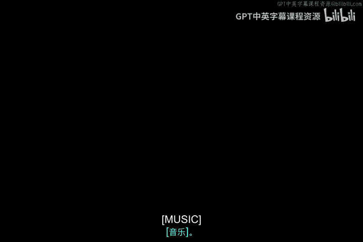

# Web开发者的HTML, CSS, and Javascript：4：模块四总结

## 概述
在本节课中，我们将对模块四的学习内容进行回顾与总结。模块四主要深入探讨了JavaScript的核心概念，为构建动态网页应用奠定了坚实基础。

## 课程内容回顾
上一节课程中，我们完成了模块四的学习。虽然这门课程时间有限，无法涵盖JavaScript的所有知识，但我们已经进行了相当深入的探讨。我们所学习的内容为你打下了非常坚实的基础。

实际上，我敢打赌，即使是一些经验丰富的开发者也不一定完全掌握本模块中的所有主题。

## 后续学习展望
在下一个模块中，我们将开始应用JavaScript来创建网页应用程序。请继续坚持学习，你只剩下一个模块，就能完成整个课程了。

## 总结
本节课中，我们一起回顾了模块四的核心内容，并展望了后续的学习方向。你已经掌握了JavaScript的关键知识，为进入实际的Web应用开发做好了准备。