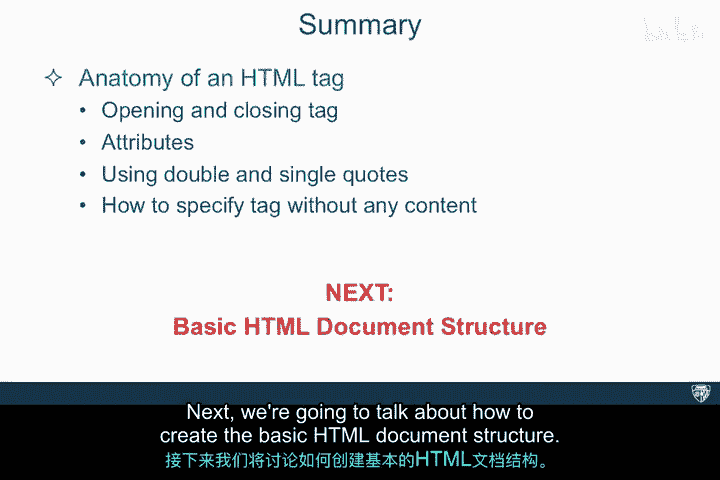

# 约翰霍普金斯大学《Web开发者的HTML, CSS, and Javascript》中英字幕 - P8：7_第3讲 HTML标签结构解析.zh_en - GPT中英字幕课程资源 - BV1WzY6z9EUd

。

At the core of HTML is the HTML tag， so it's pretty important to understand what HTML tag consists of and how to properly。

 syntactically， properly code up an HTML tag。Usually HTML tags have an opening and a closing tag and they surround some content in this case the tag P which stands for paragraph is communicating to us that the content in the gray area should be treated as a paragraph now technically speaking P by itself is called an element and together with the angle brackets。

 it's called a tag， but the truth is the term is used so interchangeably that whenever somebody refers to an element P or a tag P they really could mean one and the same thing。

Now most of its shel tags have a closing tag that matches its opening tag， but not all， for example。

 the BR and HR tag， BR standing stands for line break and HR stands for horizontal rule。

 only have an opening tag， they don't have a closing tag at all。

Now every HTML element can have predefined attributes。

 so we will learn some of the most common ones as we progress in a course。

 but here here's what you need to know about tag attributes in general attribute is a name value pair that is kind of a metadata about the element itself that it's being applied to so in this example we are assigning my ID as the value of the ID attribute Each attribute has its own rules for the meaning of its value so for example ID attribute being assigned in as example has to be unique within the scope of the entire HTML document in other words no other element of any kind in the web page is allowed to have its ID attribute equal to the string my ID if there's another element with the same value for ID that would mean that the web page contains invalid HTML which can potentially break some styling or even functionality of the page。

😊，Now let me go over some of the basic spacing rules。

 no space is allowed to exist between the opening bracket and the tag name and likewise space is not allowed between the opening bracket and the forward slash of the closing tag however you must have at least one space between the tag itself and any of its attributes and space is allowed everywhere else and is simply ignored。

 so if you have extra space after the P element in the opening tag or if you have extra space between the equal sign of the attribute name attribute value or you have other spaces even return characters。

 all that is completely ignored by the browser。😊，One more rule。

 attributes can only be specified on the opening tag。

 so you can't specify an attribute on the closing tag。

Now let's talk about the value of attributes for a minute in HTML5 enclosing the value of the attribute in quotes is technically actually not required in all circumstances。

 but nevertheless its best practice to always surround the value of the attribute in either single or double quotes it doesn't matter whether you single or double quotes they really are equivalent in HTML a more interesting case arises when the value of the attribute itself contains quotes so the actual value has quotes as part of its value in this type of situation the only thing you have to watch out for is making sure you close the quote in the opposite order of opening them so if the last quote was a single quote it must be closed first which quotes you start with doesn't make any difference you could start with double quotes as we have in the example here or you could start with single quotes you can also nest these as many times as you want as long as you close them obviously in the proper order but in practice is kind of very rare。

😊，You have to have more than two levels of quotes and any more than that and your code just becomes messy and hard to read。

Now if you have dealt with previous versions of H， especially X H。

 you might be familiar with the idea of a selfcloing tag。

 A self-closing tag is basically an Xm type of shorthand notation for a tag that happens to not to contain any content for example。

 if we wanted to have a placeholder in our HTML document for some other content that will will dynamically perhaps insert at some some later point thatll be one example when we would need to have an HTML tag that has no content to begin with however in HTML 5 the tags a little bit more semantic。

 so if an HTML 5 tag is capable meaning it can possibly ever have some content it is illegal for that tag to be self-closing even if there' is no content at the moment So instead you have to provide an opening and the closing tags without any space in between them to signify and to communicate the lack of content as surrounded by this tag So in summary went over the。

😊，And you have an HTML tag， the opening， the closing tags。

 the fact that it can have attributes describing what the tag itself is。

 remember they could use double and single quotes interchangeably just make sure if there is actual quotes in the value of an attribute。

 you have to interchange them in the same order that you open them。

 you have to all close them in the opposite order and also when over how to specify a tag without any content inside HTML5 which for which the rules are a little bit different than for the previous versions of HTML next we' can talk about how to create the basic HTML document structure。

