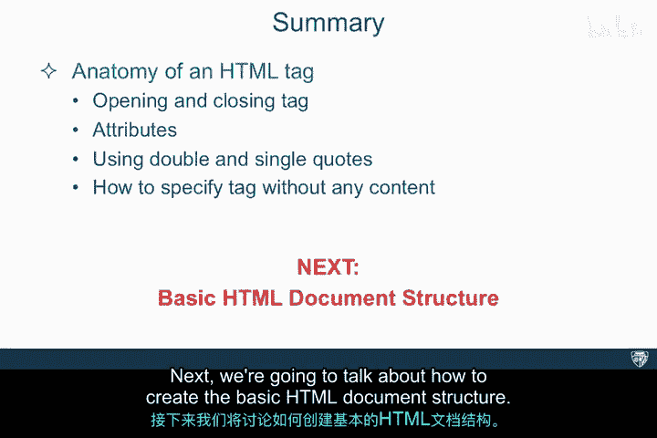

# HTML基础教程：第3讲：HTML标签结构解析


在本节课中，我们将要学习HTML的核心组成部分——HTML标签。我们将详细解析标签的语法结构、属性规则以及一些重要的书写规范，帮助你打下坚实的HTML基础。

## HTML标签的构成

HTML的核心是标签。理解HTML标签的构成以及如何正确编写其语法非常重要。

通常，HTML标签由一个开始标签和一个结束标签组成，它们将一些内容包裹起来。例如，标签`P`代表段落，它告诉浏览器灰色区域内的内容应被视为一个段落。从技术上讲，`P`本身被称为**元素**，而加上尖括号`<p>`和`</p>`后，整体被称为**标签**。但在实际使用中，这两个术语经常互换使用。

大多数HTML标签都有与其开始标签匹配的结束标签，但并非全部如此。例如，`<br>`（换行）和`<hr>`（水平线）标签只有开始标签，没有结束标签。

## HTML标签的属性

每个HTML元素都可以拥有预定义的属性。随着课程的深入，我们将学习一些最常见的属性。以下是关于标签属性你需要了解的一般知识：

属性是一个**名值对**，它是应用于元素本身的元数据。在下面的例子中，我们将值`myID`赋给了`id`属性。

```html
<p id="myID">这是一个段落。</p>
```

每个属性对其值的含义都有自己的规则。例如，被赋值为`myID`的`id`属性在整个HTML文档范围内必须是唯一的。换句话说，网页中任何其他元素都不允许将其`id`属性设置为字符串`myID`。如果存在另一个具有相同`id`值的元素，则意味着该网页包含无效的HTML，这可能会破坏页面的某些样式甚至功能。

## 基本间距规则

现在，让我们回顾一些基本的间距规则。

*   在开始标签的尖括号`<`和标签名之间不允许有空格。
*   同样，在结束标签的`</`和标签名之间也不允许有空格。
*   但是，在标签本身与其任何属性之间必须至少有一个空格。
*   其他地方的额外空格（包括回车符）都会被浏览器完全忽略。

例如，在开始标签的`p`元素后有额外空格，或者在属性名、等号、属性值之间有额外空格，这些都会被忽略。

还有一个规则：属性只能在开始标签上指定，不能在结束标签上指定。

## 属性值的引号规则

接下来，让我们谈谈属性值。在HTML5中，从技术上讲，并非在所有情况下都必须用引号将属性值括起来。然而，最佳实践是始终用单引号或双引号将属性值括起来。使用单引号还是双引号在HTML中没有区别。

一个更有趣的情况是当属性值本身包含引号时。在这种情况下，唯一需要注意的是确保以与打开引号相反的顺序关闭引号。

例如：
```html
<p title='约翰说："你好，世界！"'>一个包含引号的标题。</p>
```
或者：
```html
<p title="这是一个'嵌套'的例子">另一个例子。</p>
```

你从哪种引号开始并不重要，也可以根据需要嵌套任意多层引号，只要确保以正确的顺序关闭它们即可。但在实践中，很少需要超过两层引号，否则代码会变得混乱且难以阅读。

## HTML5中的空标签

如果你接触过早期版本的HTML，特别是XHTML，你可能熟悉**自闭合标签**的概念。自闭合标签是XHTML中一种简写表示法，用于表示不包含任何内容的标签。

然而，在HTML5中，标签的语义更强。如果一个HTML5标签**有能力**（即它可能在未来拥有内容），那么即使当前没有内容，将其设为自闭合也是不合法的。相反，你必须提供一个开始标签和一个结束标签，并且它们之间没有空格，以表示该标签没有包裹任何内容。

例如，在HTML5中，一个没有内容的段落应该这样写：
```html
<p></p>
```
而不是XHTML风格的：
```html
<p />
```

## 课程总结

本节课中，我们一起学习了HTML标签的核心结构。我们介绍了开始标签、结束标签，以及标签可以拥有描述其自身的属性。我们学习了可以使用双引号和单引号，但如果属性值本身包含引号，则需要以相反的顺序交替使用它们。我们还讲解了在HTML5中如何指定一个没有内容的标签，其规则与早期HTML版本有所不同。




下一节，我们将讨论如何创建基本的HTML文档结构。