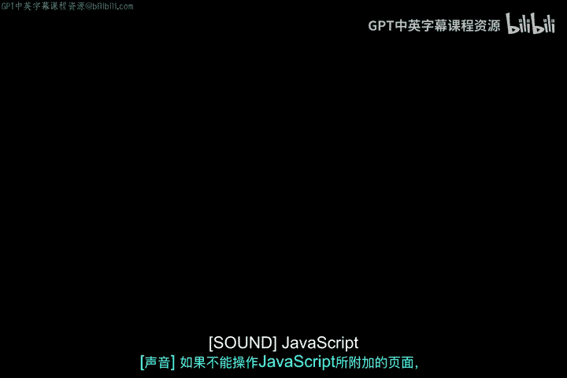
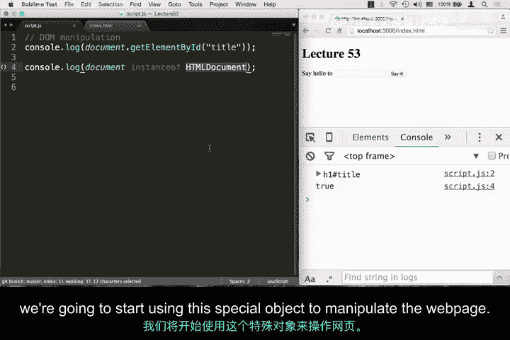

# 约翰霍普金斯大学《Web开发者的HTML, CSS, and Javascript》中英字幕 - P90：24_第53讲 第1部分 DOM操作.zh_en - GPT中英字幕课程资源 - BV1WzY6z9EUd

Yeah。

Javascript in the browser wouldn't really be any fun if you wouldn't be able to manipulate the page that that ja is attached to so in this lecture we're going to speak about da manipulation otherwise known as document object model manipulation So the first question that comes when we start talking about do manipulation is how to include the actual scriptjs how to include your javascript library inside your HTML page Currently I'm looking at scriptgs which is located in the lecture 53 folder and I'm going to go ahead and close the file browsers we have some more space here and before we even start going on about where to include the scriptgs let's go ahead and learn about the special object called document and the document object represents the entire HTML document the document object model so we know that there's an object called window otherwise known as this and it contains a whole bunch of things one of the things that contains is a document property so if we go ahead and say let's。

This。And say window document you'll see that what you get is a document object and if you open it up。

 you could see that the document object contains our entire HTML page。

 This document object is the stepping stone for us to be able to get at individual elements within our web page and there's a few ways to do that So let's go ahead and take a look at our index at HTML just to familiarize ourselves as to what's going on here So what we have here is a very simple page。

 it has an H1 title we just says lecture 53 we gave it an ID called title then we have a paragraph that says say hello2 and we have an input field again with an ID name it's a type text so it's going display a text box and we also included a button that just says say it and then at the very end here we have this div that is an empty div that just has the ID content and we'll see why we need that a little bit later So one of the central methods that the document object has is being able to。

😊，Get at the element by the ID。 So let's go to our console and let's try to get at this H1 element right here。

 So where we could do that is by the special method called let's go ahead and say document that get element by ID and in parentheses we're going to specify the actual I in quotation marks。

 but I is going to be without the pound sign it's just the actual I in this case it's just title So if we execute that statement you'll see what returns is the element H1 that has the title ID Now of course we could do console do log inside our script do js to accomplish exactly the same thing。

 So let's go ahead and try that first let's include scriptjs which is located in the Js folder inside our head section of the document so we'll say script。

😊，And we'll say source， source equals。So it's Js script do Js and we can emit the type attribute here because jascript is really the only type that's possible here。

 So go ahead and save that。 let's go to our script do js and execute exactly the same thing。

 Let's go say document dot now the reason we're able to use document here is because we're in a global scope。

 The global scope is window and window has an attribute has a property called document in it。

 So when we say document， this will obviously go ahead and look on the window object to see if document is one of its properties and in fact it is。

 So document that get element by ID。😊，And we're going to say title。

 and let's go ahead and console that log this。So let's see what happens when we do that。

 let's save that。And we get null well that's kind of strange Why would we get null why are we not getting this lecture 54 or lecture 53 title Well the reason we're not getting it is because of when this line is being executed Let's take a look at our index that HTML again。

😊，This line is executed just like any other jascript is exactly where it is mentioned。

 So it's as if we took this line right here and we copy and pasted it right in the middle of the script tag Well the problem is is that when you're calling and asking the document to retrieve for you something that has an ID title at this point of the rendering of the HTML page The H1 with an ID title doesn't exist yet。

 So therefore you get no So how do we solve that Well just a couple of ways of solving it。

 One is to have a special method that listens for an event in the lifecycle of the page loading and says when page is loaded go ahead and execute this line however there is even a simpler way to fix that especially the fact that what we're trying to do is insert some behavior into the page it's not how the page is going to look it's how the page is going to behave and whenever things like that ja code like that is executed。

😊，s always always best not to keep it in the head but actually place it at the very end of the document so which is what we're going to insert right here so this ja is going to execute after all of these things have been already processed loaded in the browser's memory and the document object model is now going to be alive and well so now if we save that you'll see that now we are getting at this point the H1 that has an ID equal to title so this code executes just fine only when this element has already been loaded and rendered。

😊，Now the reason we're able to use this function called element get element by ID is because document is a special object and the object name of the document is HTML document it's a special object that has a whole bunch of different methods that you could call on a document so in fact we can actually console that out Con that log document and find out is it an instance off it's an instance off operator we actually haven't seen before the tests whether or not or particular instance is actually an instance of a particular class in this case it is HTML document so if we print that out to our console let's save that you'll see that that's true so document is actually an instance of HTML document so if you go on the web and look up HTML document you will be able to see all the methods that HTML document defines for you to help you manipulate the webpage。

😊，So now that we know about the special object called document， others known as HTML document。

 in part two of this lecture， we're going to start using the special object to manipulate the web page。

