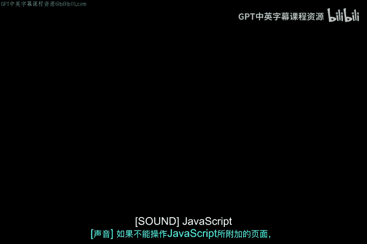
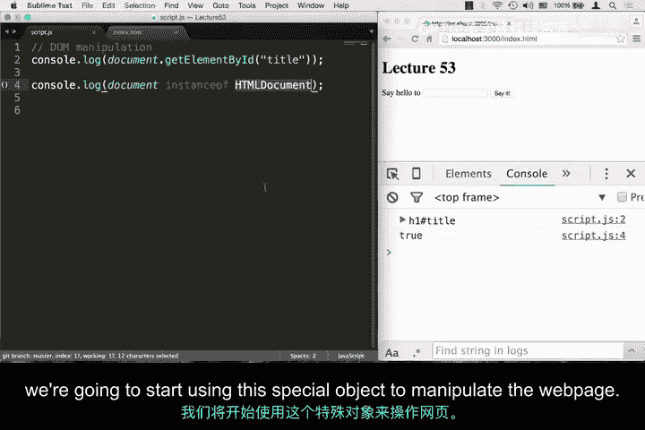

# Web开发者的HTML, CSS, and Javascript：P90：24_第53讲 第1部分 DOM操作

## 概述
在本节课中，我们将要学习如何在浏览器中使用Javascript来操作网页。这被称为DOM（文档对象模型）操作。我们将从了解如何将Javascript脚本引入HTML页面开始，并认识一个核心对象——`document`。

## 认识 `document` 对象
如果无法操作Javascript所依附的页面，那么浏览器中的Javascript将失去意义。因此，本节我们将讨论DOM操作。

开始讨论DOM操作时，第一个问题是如何将实际的脚本（`script.js`）或Javascript库包含到HTML页面中。在深入讨论脚本位置之前，我们先来了解一个特殊的对象：`document`。

`document` 对象代表了整个HTML文档，即文档对象模型。我们知道有一个名为 `window`（也称为 `this`）的对象，它包含许多属性，其中之一就是 `document` 属性。如果我们执行 `window.document`，你将看到一个 `document` 对象。展开它，你会发现这个对象包含了我们整个HTML页面的结构。

这个 `document` 对象是我们获取网页中各个元素的基石。有多种方法可以实现这一点。

## 分析示例页面
让我们先查看 `index.html` 文件，熟悉一下页面的结构。

我们有一个非常简单的页面：
*   它有一个H1标题，内容是“lecture 53”，我们给它分配了ID `title`。
*   接着是一个段落，内容是“say hello2”。
*   然后是一个输入字段，同样有ID `name`，类型是文本，所以它会显示一个文本框。
*   我们还包含了一个按钮，上面写着“say it”。
*   最后，这里有一个空的 `div`，其ID为 `content`。我们稍后会明白为什么需要它。

## 通过ID获取元素
`document` 对象的核心方法之一是能够通过ID获取元素。

让我们在控制台中尝试获取这个H1元素。我们可以使用一个特殊的方法：`document.getElementById()`。在括号内，我们用引号指定实际的ID（注意，这里不需要 `#` 符号，直接写ID名即可，本例中是 `title`）。

执行该语句，你会看到返回的是具有 `title` ID 的H1元素。

当然，我们也可以在 `script.js` 中使用 `console.log` 来实现完全相同的效果。让我们先尝试一下。

首先，我们在文档的 `head` 部分引入位于 `js` 文件夹中的 `script.js` 文件。我们使用 ``。这里可以省略 `type` 属性，因为Javascript是此处唯一可能的类型。

保存后，我们转到 `script.js` 并执行相同的操作。我们输入 `document.getElementById('title')`，并用 `console.log` 打印它。

我们之所以能在这里使用 `document`，是因为我们处于全局作用域中。全局作用域是 `window`，而 `window` 有一个名为 `document` 的属性。因此，当我们说 `document` 时，它显然会在 `window` 对象上查找 `document` 属性，而事实上它确实存在。

保存后，我们得到了 `null`。这有点奇怪。为什么是 `null`？为什么我们没有得到“lecture 53”这个标题？

我们没有得到它的原因在于这行代码执行的时间点。让我们再次查看 `index.html`。这行代码的执行位置与任何其他Javascript代码一样，就在它被提及的地方。这就好比我们把这一行代码复制并粘贴到了 `<script>` 标签的中间。

问题在于，当你在HTML页面渲染的这个时间点，调用并请求文档检索具有 `title` ID 的元素时，那个具有 `title` ID 的H1元素还不存在。因此，你得到的是 `null`。

## 解决脚本执行时机问题
我们如何解决这个问题呢？有几种方法。

一种方法是使用一个特殊的方法来监听页面加载生命周期中的事件，并声明“当页面加载完成后，再执行这行代码”。然而，有一个更简单的解决方法，特别是考虑到我们试图做的是向页面注入一些行为（而不是页面如何显示）。像这样的Javascript代码，最好永远不要放在 `<head>` 中，而是应该放在文档的最末尾。

我们将在这里插入它。这样，这段Javascript代码将在所有这些元素都已被浏览器处理、加载到内存中，并且文档对象模型已经准备就绪之后才执行。

现在保存，你会看到此时我们成功获取到了ID为 `title` 的H1元素。这段代码只有在元素已经加载和渲染完成后才能正常执行。

## `document` 对象的本质
我们之所以能够使用 `getElementById` 这个函数，是因为 `document` 是一个特殊的对象。`document` 的对象名是 `HTMLDocument`。它是一个特殊的对象，拥有大量你可以调用的方法。

事实上，我们可以用 `console.log(document)` 输出它，并使用我们之前未见过的 `instanceof` 操作符来测试某个特定实例是否属于某个特定类。在本例中，它是 `HTMLDocument`。如果我们将其打印到控制台并保存，你会看到结果为 `true`。所以，`document` 实际上是 `HTMLDocument` 的一个实例。如果你在网上搜索 `HTMLDocument`，你将能看到 `HTMLDocument` 定义的所有用于帮助你操作网页的方法。

## 总结
本节课中，我们一起学习了DOM操作的基础。我们认识了核心的 `document` 对象（即 `HTMLDocument` 的实例），了解了如何通过 `document.getElementById()` 方法根据ID获取页面元素，并解决了脚本执行时机的问题，明白了将行为脚本放在页面底部的重要性。在下一部分，我们将开始使用这个特殊对象来实际操纵网页。