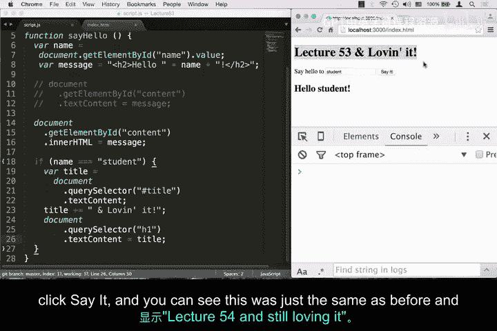

# 约翰霍普金斯大学《Web开发者的HTML, CSS, and Javascript》中英字幕 - P91：25_第53讲 第2部分 DOM操作.zh_en - GPT中英字幕课程资源 - BV1WzY6z9EUd

Yeah。

In part one of this lecture we' learned about a special JavaScript object called HTML document that allows us to manipulate the web page in this lecture we're going to use that object to actually do just that Let's go ahead and comment that out for now。

😊，And let's turn our attention to index at HTML We have this paragraph here that says say hello too and it has an input element and a button Now the button is not really going to do anything as you could see right here as much as I click it it won't really do anything because no behavior has been really assigned to it Now we're gonna have a whole lecture on event handling but for now let's assign it some simple behavior and the way one of the ways at least you do it is you could say oncl which is an attribute that exists on basically every single element in the HTML document you can assign it some functionality in it so in mean in other words you could call a JavaScript function in here so we'll say say hello we'll call a function say hello oncl of this button let's in fact actually put it right here so we could see it a little bit better。

😊，So uncled this button we're going to call a function。

 say hello let's go ahead and define the say hello function。

 let's save that and if we actually go ahead and click this now we'll get an error because say hello is not defined yet let's go ahead and define that say hello function。

 so let's say function。😊，And the function name is going to be say hello and we don't need any arguments for now and for now in the body of this function。

 all I want to do is be able to retrieve the value that the user typed in into this text box so how do I do that Well I can once again use my document let's do console that log and once again can use my document let's。

😊，Give some spacing over here， document that get element by ID。And I could say what ID do I want。

 well let's go take a look at our HTML and the ID of the input element is name so I could go ahead and copy that and I won't get a by ID name。

 but if I just do that and leave it alone right this way and save that。Now when I click save， say it。

 what I'm going to get is I'm going to get the actual element well I don't really want the element。

 I want the value inside the element that the user type 10。

 so the way I do that is by accessing the value property that value when I do this and save it so now if I say say it nothing is really going to show up because I didn't really type anything but I'd say it say yaakov and say say it now yaakov value is going to show up。

Now my ultimate goal here is that the web page in this space right here should greet me say hello yaakov so one of the ways I could do that is first of all save the value that I retrieved from the input element that the user typed in。

 save it in a variable so let's go ahead and do that let's say var message or let's say name actually。

😊，And let's go ahead and erase this， let's see if this will fit。Now it doesn't。

 so let's go ahead and just put it in a second line and we'll just say var name equals and we'll retrieve the name that the user typed in。

 Okay， so far so good， let's go and define a message and the message will be hello space。

Plus name that we retrieved。 plus， and let's give it an exclamation point。 Okay。

 so now that we have the message， it's time to actually insert this message somewhere here。

 How do we do that， Well's take a look at our HTML document。

 There's this div that we defined and left completely empty and it has an I called content。 Okay。

 so that means we could retrieve it as well。 Okay， so let's go ahead and do that and we know how to do that at this point。

 We could say document that get element by I D。And the idea was content。

So how do we now insert things it wouldn't be that value because that's only for input elements and a div is not an input element。

 but there is a property to be able to insert text inside of an element so let's go ahead and actually put this on a separate line so I could see it a little bit better and the value is text content so if I say text content and say the text content is equal to message and put a semico on after that and save that so now when I say yaov。

😊，And say， say it。This message shows up， and in fact， if we actually inspect the element。

 let's go ahead and do that and you could see， let's lower this a little bit somehow。

You could see that we have div ID equals content and inside of it。

 you see hello yaakov Now that's all great except now what I really want is I want this yaakov to be an H2。

 This is lecture 53 that's an H1 I want the yaakov to be an H2 Well let's try to see if we could do that let's go back to the console and let's just augment this with a H2 and we'll close H2 right here to make it into a string okay so now if we save that let's say again。

 yaakov and we'll click say it not quite what we want right H2 think or at least the browser thinks that this H2 is just text。

 not really something that the browser should render Well we can actually fix that because there's another property that tells the browser that what I'm inserting is actually HTML for the browser to render So let's go ahead and copy this and comment it out and we'll have another line that looks almost just like that except the text content is going be。

😊，replace with another property called inner HTML So when we say inner HTML。

 the thing that it gets assigned to it is going to be interpreted as HTML and therefore rendered so now if we save that。

😊，And type in yakov right here。And now we see that this is now， in fact， an H2。

 so if we inspect the element。We could see here now that the div with ID content has an H2 inside of it that is actually being definitely rendered as an H2。

 Now believe it or not， armed just with this knowledge alone you could already do quite a bit inside the HTML page let's go ahead and put some behavior into this that has a little bit more smarts into it I want this thing to say hello whatever the name is that the user provides unless of course they say hello student student in which case I don't want to just to say hello student I want that value to trigger a side effect to the page and change our title a little bit So how can we accomplish that Well we could definitely test inside the say hello method or say hello function we could test if name that's actually let's move that all the way here if name is equal triple equals because we want it to be a string equal to student。

😊，Then I want to do a couple of things。 Number one is I want to retrieve what this title is because I want to add a little bit of a string right here。

 I want to add something else to it， I want to say lecture 53 and something else。

 So the way I do that is I could say var title。😊，Equals and at this point。

 let's go ahead actually and put it on the second line and say document do and we can if we wanted to say get element by ID right here and basically specify title because if we look at our index HTML page。

 our title our H1 has a title as an ID however， there's another method it's very worthwhile for you to learn and it's much more generic that get element by ID because get on by ID really just restricts you to be able to select things within your page by ID but you might want to be able to select it by other things so like for example。

 the way you select things using CSS So the method we could use and instead of get element by ID is called query selector。

😊，And in this case， query selector takes not the ID name but actually a selector。

 so if we wanted to select it by ID， in this case title。

 you would do the same thing you would do in CSS by selecting this element。

 well the way you would do that is you would actually specify pound sign title right because that's a CSS selector。

 not just title itself。So this should go ahead and grab the H1 element out of our HTML page。

 except we don't just want the H1 element， what we want is the the text content of the H1 element so let's go ahead and say that text content。

😊，And that will be then the value of our title。 So now all we want to do is now we want to augment the title a little bit。

 So let's go ahead and say title plus equals you've seen this before just means title equals title plus plus something。

But the easier way just to say plus equals。And we're going to add something， let's say and loving in。

 loving in it。So it's lecture 53 and loving it So the student is really loving it at this point am I correct。

 am I correct anyway， so let's go on so now let's go ahead and save this and we'll go ahead and put name here well if I put yaov right it will just say hello Yaco but if I put student。

😊，Gotta spell it correctly and say say hello hello student， but nothing really changed here。

 Why is that Well， that's actually simple right？ remember pass by reference。

 pass by value or copy by reference copy by value。 Well this is a primitive and we're copying a primitive out of text content into this title So therefore when we change the title。

 the text content property is not changed at all。 what we actually have to do is turn around and explicitly set it So let's go ahead and grab this whole documenting right here and we'll put it over here and we'll say text content equal to title that's the new title that we've updated right here。

😊，So now when we save that and go ahead and try it with。

 let's say Yaakov and if we say click say it we'll see hello Yaakov。

 but if we actually put student in here，And click say it。Now we've not only said hello student。

 but we also updated our H1 title and now it says lecture 53 and loving it Now the last thing I want to point out to you is that this is a selector by ID but we don't have to select it by D because this is nothing more then using CSS selectors to select element within our page Well if we take a look here。

 we could use something else we can use the fact that there's only one H1 element in the entire page so if I wanted to I could simplify this by saying H1 so I erase this and just say H1 so H1 is the only element that this is gonna select and in fact if there would be more than one H1 element in my HTML page what this will return is the first matching element if you wanted a list of elements that matches a particular query selection you would use a different method I think I believe it's called query all Selector so anyway so at this point we just want one so if we say H1。

😊，This will accomplish exactly the same thing as calling it by title。

 so if we save that and test it out by saying student。And click say it。

 and you can see this works just the same as before and it's lecture 54 and still loving it。😊。

