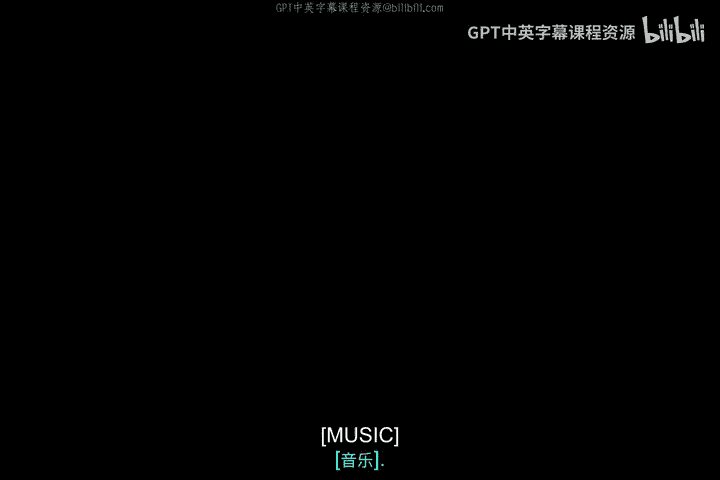
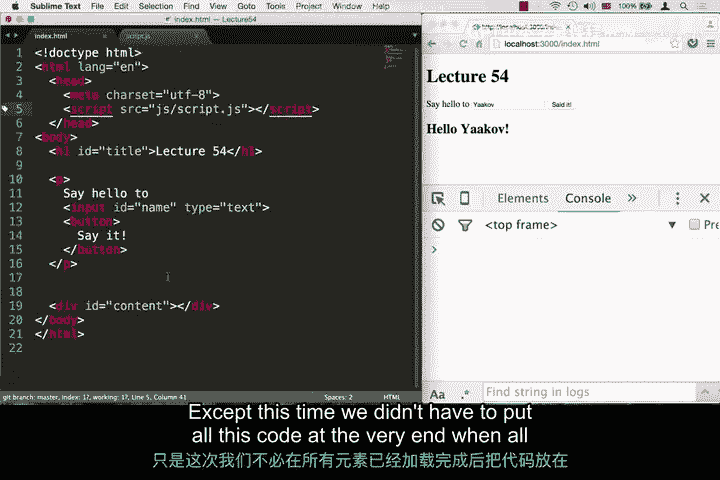

# 约翰霍普金斯大学《Web开发者的HTML, CSS, and Javascript》中英字幕 - P92：26_第54讲 事件处理.zh_en - GPT中英字幕课程资源 - BV1WzY6z9EUd

Yeah。

We've already seen a simple example as to how to bind an event handler to a particular element。

 I'm located right now in the index HTML in the lecture 54 folder。

 let me go ahead and close the file browser so we could see a little bit better。

 So you remember this HTML document we had a button in the middle of here that says unclick equals equals say hello and you can remember when we entered some name over here and click say say it it will say hello yaakov using this say hello function。

 I'd like to explore now a couple of different ways that you can actually assign event handlers to elements。

 Now first of all， what are event handlers。 Well， event handlers are basically functions that you bind using specific methods to certain events that happen in the browser Now those events might be triggered by just the lifecycle。

 meaning something like the page loaded That's an event or it could be triggered by user interaction like a user type。

😊，A character or user clicked something So one of the most simplest ways to assign an event handler to a particular element is to just use the on something attribute on that element So here we could see that we're using oncl and we say say hello executing that ja function say hello but the truth is if you take a look there's a whole bunch of these and they really have to do with keyboard and mouse events as well as focus events so for example on blur means when this particular element loses focus so I can actually go to my input field here and say on blur and we'll say say hello。

😊，Well the same function will execute when I type something in here。

 let's go ahead and refresh the browser and' say I'll say yaakov and the second I get lose the focus from here like that。

 so let's go ahead and save our index that HTML and this will get reloaded So if I go and type in yaov and the second this field loses focus you'll see that hello say hello we'll get executed and hello yaakov will appear So let's actually erase that for a minute so were don't crowd our space here So placing an unclick on on blur or on some event straight on the HTML is one option Now this option comes with some side effects one side effect is is that you kind of have to dirty up your HTML with these unclick on blur on key down and so on on these events and typically and as we've been speaking about it before HTML is really just for content it's not really there for behavior so that's one difference second difference let's go ahead and save that。

😊，Second difference is this if we go to the say hello function。

 which is what we are executing when somebody clicks the say it button and we go ahead and console。😊。

That log this。 What is this pointing to。 Let's go ahead and save that。

 and we don't have to even enter anything here。 We'll just click say it。

 and it's apparently pointing to the window object。 So why is that Well。

 since this say hello function is being defined in the global context。

 it makes perfect sense that when we say this this will be pointing again to the global context。

 which is the window object。 And since in here， we're not doing anything at all by assigning this to this unclick attribute。

 we're not doing anything at all to change that context for this hello function we actually are executing it right here。

 So that remains the same。 However， there's a different way of doing the same thing that is binding this function to the click event。

 Let's go ahead and take a look at another way of doing this。

 in this way it's called unobbstrusive event binding。

 And the reason that's called that way is because the HTML doesn't really need to know anything about your jascript。

 So let's go ahead and go to the HTML and let's go ahead and。😊，rasse this out of here。

 So now the Shima doesn't know anything about the click handler。 Let's save that。 go to the script。

 and here's what we're doing here。 We're saying document query selector button。

 So we selected that element and we're calling this function called ended event listener and we're saying that I want you to listen for the click event and when that happens。

 I want you to use this function expression or this function value which is say hello。

 which is pointing to our say hello function。 Now when we do this。

 let's take a look as to what this now is going to point to。😊。

Let's go ahead and go to let's save this script and let's go ahead and click say。

And obviously we didn't provide anything， but as you could see this now is pointing to the actual button and that makes perfect sense since we're passing the value of this function into this particular element so this element button gets a call calleded event listener and inside of that call we somehow assigned this say hello to its event so therefore this variable is now pointing at the containing object。

 which at this point is the button element Now there's a similar way to assign that click handler except using the unclick property let's go ahead and comment this out and uncom this line right here。

 I can see there's a typo here it really should be unclick So point is whatever the unclick onber on something that you have available on the element itself you could use that as a property of the object that you selected So in this case we're selecting again the element object。

😊，And we're setting it on click property to be the value of the function。 say hello again。

 it's just a value。 we're not providing parentheses here after the function。 we're not executing it。

 we're just setting its value to it So what do you think the say hello function is going to say when we say console log this Well since this is pointing or is being executed inside of an object that is the button object when we go ahead and click say it's going to be once again a button object。

 And you know while this way might seem a little bit more complicated to assign event handlers then simply just saying on click over here。

 it does provide us a little bit more flexibility let me show you what I mean So let me go ahead and comment this out and leave just the add event listener way of editing the click event So what I'm going to do now is I would like to do is as I'm typing this when I say yaov and I click say it I want the。

😊，Name of the button or the label of the button to change Well。

 that's very easy to do if the this variable inside of the event handler already points directly to the target element that you're working on。

 So let's go ahead and go here and say that when this happens。

 I'm going to go ahead and say this dot text content equals to set it。😊。

So we're going to say that the button set it already。

 so when I save this and I say Yaakov and when I click say it， it will change to set it。

And that's a much more convenient way of doing things instead of having to once again select using the query API。

 select this button and change its label and that's because in this jascript。

 I don't really have to know what triggered the click event if I had to do it the other way I would have to know that the button is the one that triggered the click event in this case I don't need to know that I just need to know that something that has text content triggered that particular event let's discuss one more event that is a lifecycle event of the page that will let us actually assign the events to the elements of the page once they load but before anything else loads before any images load before any CSS loads and so forth and since we're going to be listening for that event we no longer need to provide this script at the bottom of the page we can actually cut the script out here and place it very easily in the head and let's save that and now what we need to do is we need to actually listen for a particular。

Event on the browser lifecycl and that event is called， let's say， document do Ed event listener。

 and the event is called dumb content。Load it。And what we want to do is we want to assign a function。

 Let's go ahead and put our。Seendmiccollon and what we' want to do is we want to assign a function。😊。

And when I need a name and every event handler function gets this event object。

 So and inside this function， we can now start assigning different events。

 So what we can't do now is we can create this function hello。😊，And grab this whole text right here。

Cut it out。And place it right here。And maybe move it over a little bit。Okay。

 so now we have the entire function sitting inside of Ed event listener and it will get executed。

 this function will get executed when this event fire is called Dom content loaded and that will happen before any images or any CSS or any other script is loaded so。

😊，If we save it？And say Yaakov。Click say it， as you could see。

 we still have our functionality working just as before。

 except this time we didn't have to put all this code at the very end when all the elements have loaded already。

 instead we're listening for the event when all those elements have loaded and in that case we're able to execute these functions and get element by ID and be sure that these elements already exist in the document object model。

😊。

