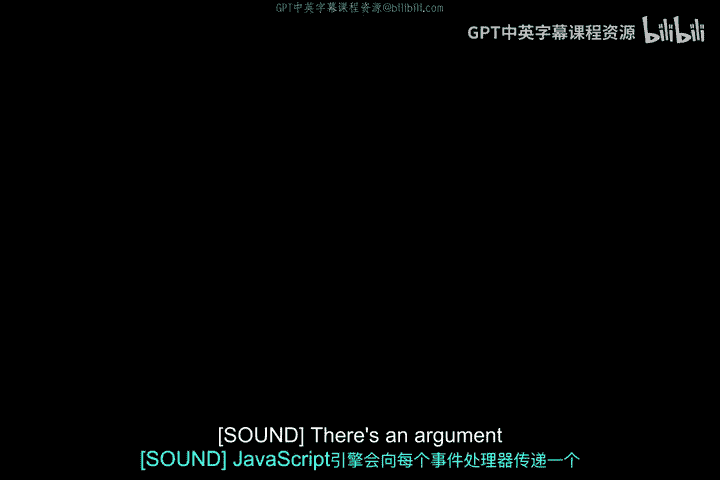
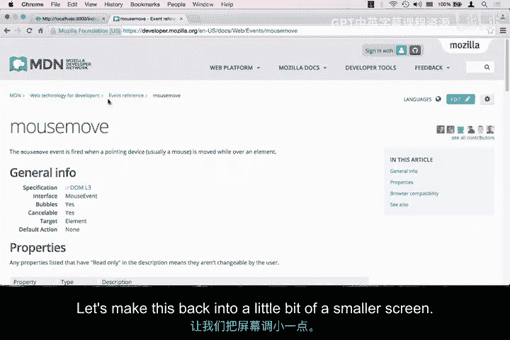
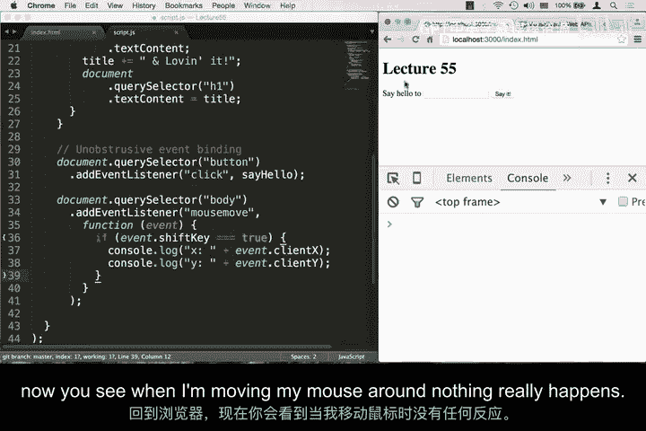

# 约翰霍普金斯大学《Web开发者的HTML, CSS, and Javascript》中英字幕 - P93：27_第55讲 事件参数.zh_en - GPT中英字幕课程资源 - BV1WzY6z9EUd

Yeah。

There's an argument that's passed by the JavaScript engine into every single event handler。

 and this is something I kind of glanced over in the previous lecture， so let's talk about it now。

 I am located in the script。gs file， which is located in the lecture 55 folder let me go ahead and close the file browser of sublime and lets the first thing we'll do is let's go ahead and log the event。

 let's go ahead and say console。 log。And let's go ahead and log the event we print it out and let's say say it and we see that the object that event is is a mouse event if we open it up actually。

 we'll see there's a whole bunch of properties that this mouse events has it's a clientax client Y where this was where the X and Y coordinate was on the page there is the movement page X。

 there's the path there's the screen X screen Y which is the location of the X coordinate Vi V。

 the entire screen， there's the shift key which tells us whether or not the shift key was being pressed down at the time that the click happened。

 So even though we haven't really used the event object this is something that passed in into every event handler let's take a look at the API documentation for event and we'll see what it actually gives us let's go to the event so and this is the event page of thez Mozilla developer network and it talks about all kinds of events that could happen and'll be。

😊，Depending on the type of event that happens either a key press or some kind of interaction with a keyboard or a mouse press or mouse move。

 which is interaction with the mouse you're gonna to have different types of events it' going to be different types of objects that contain different type of properties that are related to that type of event so you can see here for example。

 we have a keyboard event object that's probably related to keyboard events and there's also a mouse event object and again that's related to the mouse events so I clicked on it and it gives you a whole bunch of different properties of the mouse event that is passed into you and explains to every single one of them is what they do so there's the client X and client Y and it tells you the client X the x coordinate of the mouse pointer in the local Dom content coordinates if we scroll down theres also should be a shift key the shift key property and it returns true if the shift key was down when the mouse event fired Now there are different types of mouse。

Events theres mouse out mouse over mouse move。 we click on mouse move。

 Basically what tells you is that mouse moveve event is fired when a pointing device。

 usually mouse is moved while over an element。 let's go ahead and try to implement different type of behavior。

 Let's go ahead and implement a console log we're gonna log to the console client text and client Y position of the mouse pointer。

 but only when I press the shift key and move the mouse over any part of the body element。

 let's make this back into a little bit of a smaller screen。

 let's go back to our page and we're go ahead and clear that So we're going do is we're going to create yet another event listener So here we have an event listener called say hello and and we're actually assigning it right here。

 and we're gonna create another one。 So and we're gonna create another one exactly the same way。

 we'll say document。😊。

That。Quus selector， and this time we'll say on the entire body。

And I want to add event listener and event listen I want to add is mouse move。 So it's mouse move。

 and notice since I'm using the add event listener that's not on mouse moveve is just mouse move and then let's go ahead and put a semi on the answer but don't forget。

😊，And then we're going to do is we're going to create a function。😊。

And the function is going to get an event， obviously。By the JavaScript engine。And in this function。

 what we want to do is we want to do console thatlo。The event that client X。And again。

 cancel that log。Then that client Y。 So if we save that now， and as I start moving the mouse over。

 you will see。You will see that we're logging where my mouse is moving。

 we wereloging the X and Y coordinates now we didn't really specify what they are so it's a little hard to tell。

 it's probably a better idea to do something like this X is this。And why is that。

That's probably a little bit better。 So now when we mouse over， at least we see x and y okay。

 but we what we wanted to do is we wanted to only log this when I pressed the shift key down。

 So in our function in our event handler， what we're going to do is we're going to put an if statement we're going to say if。

Event that shift。 and I can't remember what the name is。 So we'll go ahead and look this up。

 go back and look up the。Property name called Shikey， just like that。So we'll say event shift key。

Equals true。If that's the case， that's when we're going to log this。

 otherwise we're just going to ignore this mouse move event completely。Okay， so we'll do this。

 we'll position it like that， and now let's go ahead and save that。

Let's go back to our browser and now if you see when I'm moving my mouse around。

 nothing really happens， but if I press the shift key。

 which obviously you can't see and start moving the mouse around。

 oh sudden the mouse move is printing out the client X and client Y coordinates so if I let go the shift key。

😊。

See， the mouse moveve event handler is no longer printing out the X and Y coordinates because the if statement is basically saying skipip it because the shift key property is not equal to true。

